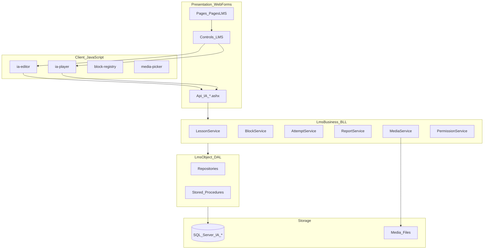
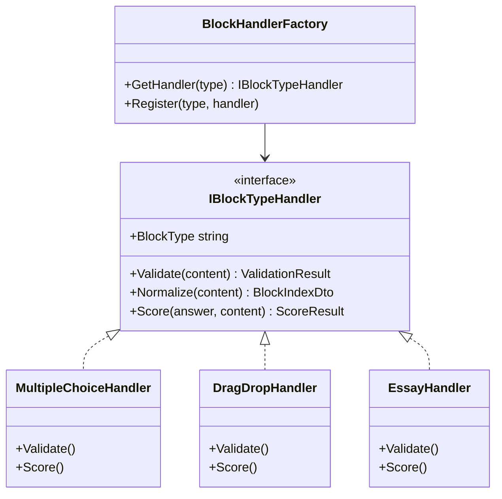
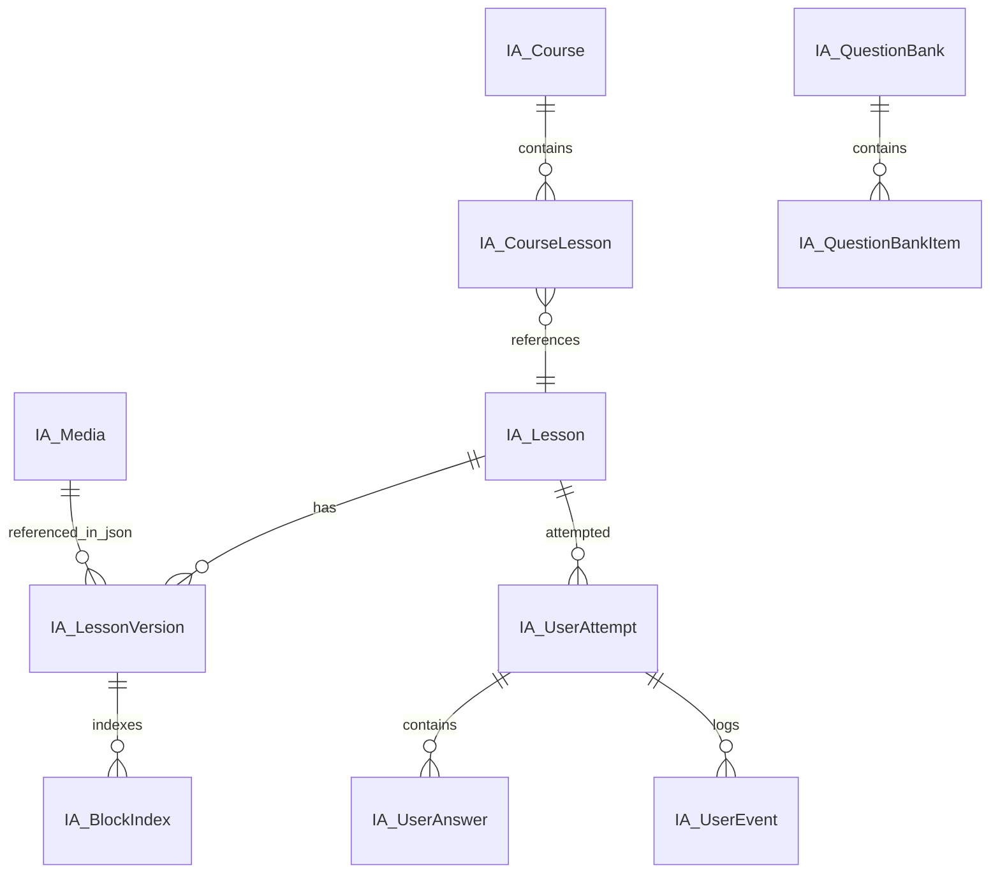
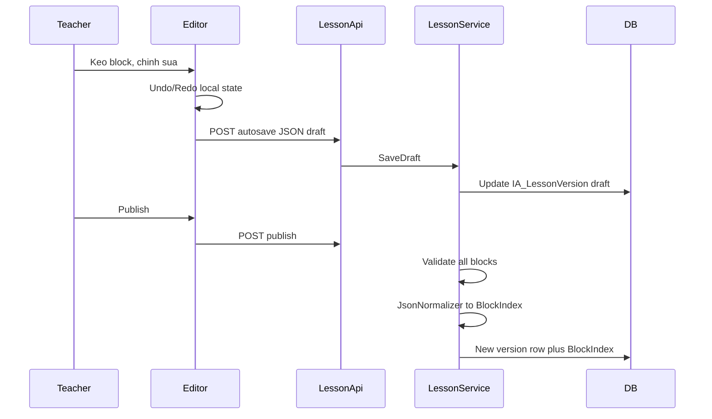
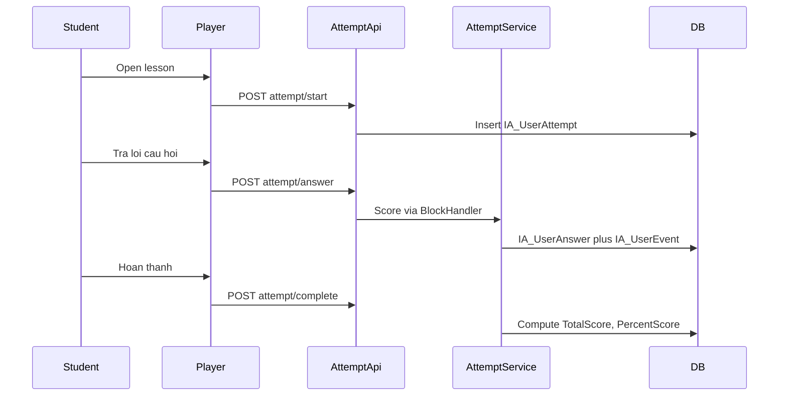
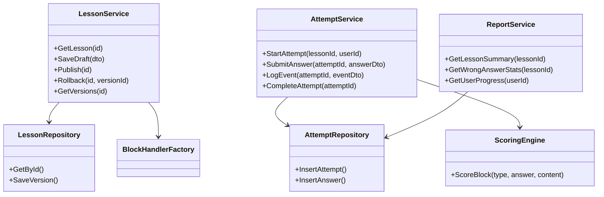

# Kế hoạch thiết kế Authoring Tool (H5P-like, độc lập)

## 1. Đánh giá hiện trạng và mức độ dự án

### Hiện trạng CMS-Video

| Thành phần | Trạng thái |
|---|---|
| [hos/Controls/LMS](hos/Controls/LMS) | **Trống** — placeholder |
| [hos/Pages/PagesLMS](hos/Pages/PagesLMS) | **Trống** — placeholder |
| DAL hiện tại | `InformationWebObject.dll` — CMS tin tức, không có LMS |
| Frontend | jQuery 3.7, Bootstrap (app.min.css), pattern Page + UserControl + [BDS.Master](hos/BDS.Master) |
| API mẫu | [ChatApi.ashx.cs](hos/Controls/InformationSection/Information/ChatApi.ashx.cs) — JSON qua `JavaScriptSerializer` |

### Tham chiếu V2-HeSinhThai (không tái sử dụng trực tiếp)

- Mô hình `LIB_BookCategory` + HTML/CKEditor — **cây thư mục**, không phải JSON block.
- H5P chỉ có bundle thử nghiệm, **chưa tích hợp** vào lesson flow.
- **Kết luận:** Cần thiết kế mới; chỉ học pattern UI (UserControl composition, permission, ASHX JSON).

### Đánh giá mức độ (Effort / Complexity)

| Phạm vi | Mức độ | Thời gian ước lượng (1 team 2-3 dev) | Ghi chú |
|---|---|---|---|
| **Phase 0 — Foundation** (DB, JSON engine, API shell, 2 block) | Trung bình | 3-4 tuần | Rủi ro thấp, nền tảng bắt buộc |
| **Phase 1 — MVP Authoring** (Editor DnD, 6 block, Player, autosave, version cơ bản) | Cao | 6-8 tuần | ~40% giá trị sản phẩm |
| **Phase 2 — Result Engine + Reporting cơ bản** | Cao | 4-6 tuần | Tracking, chấm điểm, dashboard đơn giản |
| **Phase 3 — Interactive Video + Question Bank + Course** | Rất cao | 8-10 tuần | Block phức tạp nhất |
| **Phase 4 — Toàn bộ 20+ loại nội dung + Branching + Survey** | Rất cao | 12-16 tuần | Mỗi block = mini-product |
| **Full platform** (Permission đầy đủ, REST API, analytics nâng cao) | **Enterprise / Rất cao** | **12-18 tháng** | Tương đương 30-50% scope H5P |

**Tổng đánh giá:** Dự án **Enterprise-grade**, phức tạp tương đương xây mini-H5P. Khả thi trên WebForms 4.0 nếu tách rõ **SPA nhẹ phía client** (Editor/Player JS) + **ASHX API** phía server; tránh PostBack cho authoring.

**Khuyến nghị chiến lược:** Schema mới prefix `IA_*` (Interactive Authoring), project BLL/DAL riêng trong solution — **không** mở rộng `LIB_*` vì mô hình dữ liệu không tương thích JSON block.

---

## 2. Kiến trúc tổng thể



### Nguyên tắc thiết kế

1. **Editor chỉ sinh JSON** — không render logic chấm điểm trong Editor.
2. **Player đọc JSON + Block Registry** — thêm block mới = đăng ký plugin, không sửa core Player.
3. **Dual storage:** JSON snapshot (authoring) + bảng chuẩn hóa (reporting/query) — tránh hardcode theo loại câu hỏi.
4. **Version immutable** — mỗi publish tạo `IA_LessonVersion`; attempt gắn versionId.
5. **Event-sourced tracking** — mọi hành vi học viên ghi `IA_UserEvent` + `IA_UserAnswer`.

---

## 3. Cấu trúc solution đề xuất

```
CMS-Video/
├── hos/                                    # WebForms (Presentation)
│   ├── Controls/LMS/
│   │   ├── Editor/                         # AuthoringEditor.ascx
│   │   ├── Player/                         # LessonPlayer.ascx
│   │   ├── Media/                          # MediaManager.ascx
│   │   ├── Report/                         # ReportDashboard.ascx
│   │   └── Shared/                         # BlockPalette, PreviewModal
│   ├── Pages/PagesLMS/
│   │   ├── LessonList.aspx
│   │   ├── LessonEdit.aspx
│   │   ├── LessonPlay.aspx
│   │   ├── CourseList.aspx
│   │   └── Report.aspx
│   ├── Api/LMS/                            # ASHX REST handlers
│   │   ├── LessonApi.ashx
│   │   ├── BlockApi.ashx
│   │   ├── MediaApi.ashx
│   │   ├── AttemptApi.ashx
│   │   └── ReportApi.ashx
│   └── assets/lms/
│       ├── js/core/                        # registry, json-engine, api-client
│       ├── js/blocks/                      # 1 folder per block type
│       ├── js/editor/
│       ├── js/player/
│       └── css/lms-authoring.css
├── LmsBusiness/                            # BLL (.NET 4.0 Class Library)
│   ├── Services/
│   ├── DTO/
│   ├── Validation/
│   ├── Scoring/                            # Strategy pattern
│   └── BlockHandlers/                      # Server-side block validation
└── LmsObject/                              # DAL (.NET 4.0 Class Library)
    ├── Entities/
    ├── Repositories/
    └── Helpers/
```

**Namespace:** `InformationWeb.Lms.*` (Web), `LmsBusiness.*`, `LmsObject.*`

**Tích hợp hiện có:**
- Connection string: dùng `SystemConfig.ConnectionString` từ `DCore.dll` (pattern [SectionAbout.ascx.cs](hos/Controls/InfoSection/SectionAbout.ascx.cs)).
- Error log: `SystemError(SystemConfig.ConnectionString, ...)`.
- Master page: `BDS.Master` cho trang public; có thể thêm `LMS.Master` cho admin/teacher (full-width, không banner).

---

## 4. JSON Engine — Schema chuẩn

### 4.1 Document schema (Lesson)

```json
{
  "schemaVersion": "1.0",
  "lessonId": 1001,
  "versionId": 3,
  "title": "Bai hoc 1",
  "language": "vi",
  "settings": {
    "passScore": 70,
    "maxAttempts": 0,
    "showFeedback": true,
    "randomizeBlocks": false
  },
  "blocks": []
}
```

### 4.2 Block schema (mọi loại dùng chung)

```json
{
  "id": "blk_8f3a2c1d",
  "type": "multiplechoice",
  "typeVersion": "1.0",
  "title": "Cau hoi 1",
  "order": 1,
  "parentId": null,
  "scoring": {
    "enabled": true,
    "maxScore": 1,
    "weight": 1
  },
  "settings": {},
  "content": {},
  "children": []
}
```

**Lý do:** `type` + `typeVersion` cho phép evolve schema từng block; `settings` vs `content` tách cấu hình hiển thị vs dữ liệu; `children` hỗ trợ composite (Course, Presentation, Interactive Video markers).

### 4.3 Ví dụ block Multiple Choice

```json
{
  "id": "blk_mc01",
  "type": "multiplechoice",
  "typeVersion": "1.0",
  "scoring": { "enabled": true, "maxScore": 1 },
  "content": {
    "question": "Thủ đô Việt Nam?",
    "options": [
      { "id": "opt_a", "text": "Hà Nội", "correct": true },
      { "id": "opt_b", "text": "TP.HCM", "correct": false }
    ],
    "allowMultiple": false,
    "shuffleOptions": true,
    "feedbackCorrect": "Chính xác",
    "feedbackWrong": "Sai rồi"
  }
}
```

### 4.4 Ví dụ Interactive Video

```json
{
  "id": "blk_iv01",
  "type": "interactivevideo",
  "typeVersion": "1.0",
  "content": {
    "mediaId": 501,
    "sourceUrl": "/Media/LMS/video/lesson1.mp4",
    "posterUrl": "/Media/LMS/video/lesson1.jpg",
    "interactions": [
      {
        "id": "int_01",
        "timeFrom": 30.5,
        "timeTo": 30.5,
        "pauseVideo": true,
        "blockRef": "blk_mc01"
      }
    ]
  }
}
```

### 4.5 JSON Engine components

| Component | Vai trò |
|---|---|
| `JsonSchemaValidator` | Validate theo registry server-side |
| `JsonNormalizer` | Flatten blocks → rows cho DB indexing |
| `JsonMigrator` | Upgrade `typeVersion` cũ → mới |
| `JsonDiffEngine` | So sánh version (rollback UI) |

**Lưu trữ:** `IA_LessonVersion.ContentJson` (NVARCHAR(MAX)); parse khi load Player; normalize vào `IA_BlockIndex` khi publish.

---

## 5. Block Plugin Architecture



**Client-side mirror:**

```javascript
// assets/lms/js/core/block-registry.js
BlockRegistry.register('multiplechoice', {
  editor: MultipleChoiceEditor,
  player: MultipleChoicePlayer,
  icon: 'fa-list',
  category: 'question',
  schemaVersion: '1.0'
});
```

**Thêm block mới (ví dụ Memory Game):**
1. Tạo `blocks/memorygame/editor.js` + `player.js`
2. Đăng ký trong `block-registry.js`
3. Thêm `MemoryGameHandler.cs` implement `IBlockTypeHandler`
4. Insert `IA_BlockDefinition` (metadata palette)
5. **Không sửa** Editor shell / Player shell / DB core

---

## 6. Database Design (SQL Server)

Prefix **`IA_`** — Interactive Authoring. Thiết kế **generic**, không bảng riêng cho MCQ/DragDrop.

### 6.1 Core tables

**IA_Lesson**
- LessonId (PK), Title, Slug, Description, Status (Draft/Published/Archived)
- CurrentVersionId, CreatedBy, CreatedDate, ModifiedDate, IsDeleted

**IA_LessonVersion**
- VersionId (PK), LessonId (FK), VersionNo, ContentJson (NVARCHAR(MAX))
- ChangeNote, CreatedBy, CreatedDate, IsPublished

**IA_BlockIndex** (denormalized cho search/report)
- BlockIndexId, VersionId, BlockId (string), BlockType, ParentBlockId
- OrderIndex, Title, MaxScore, HasScoring, MetaJson (NVARCHAR(MAX))

**IA_BlockDefinition** (registry)
- BlockType, DisplayName, Category, Icon, EditorPath, IsScorable, IsComposite, IsActive

**IA_Media**
- MediaId, FileName, OriginalName, MediaType, MimeType, FileSize
- StoragePath, ThumbnailPath, UploadedBy, UploadedDate, IsDeleted

**IA_Course / IA_CourseLesson**
- Course metadata + mapping CourseId → LessonId + OrderIndex

**IA_QuestionBank / IA_QuestionBankItem**
- BankId, ItemBlockJson (block template), Tags, Difficulty

### 6.2 Tracking tables

**IA_UserAttempt**
- AttemptId, LessonId, VersionId, UserId, AttemptNo
- Status (Started/InProgress/Completed/Abandoned)
- StartedAt, CompletedAt, DurationSeconds
- TotalScore, MaxScore, PercentScore, IsPassed

**IA_UserAnswer**
- AnswerId, AttemptId, BlockId, BlockType
- AnswerJson (NVARCHAR(MAX)) — generic payload
- IsCorrect (nullable), Score, TimeSpentSeconds, AnsweredAt, AttemptCount

**IA_UserEvent** (xAPI-inspired, generic)
- EventId, AttemptId, BlockId (nullable), EventType
- EventDataJson, EventTime, SessionId

EventType ví dụ: `lesson.started`, `lesson.completed`, `block.viewed`, `block.answered`, `video.play`, `video.pause`, `video.seek`, `video.completed`

### 6.3 Permission tables

**IA_Role** — Admin, Teacher, Student, Reviewer, Guest

**IA_LessonPermission** — LessonId, UserId/RoleId, PermissionFlags (View/Edit/Publish/Report)

Tích hợp user: map sang bảng user hiện có của hệ thống (`SystemManagementObject`) qua UserId.

### 6.4 ERD tóm tắt



**Lý do không hardcode Question/Option tables:** MCQ options nằm trong JSON; `IA_BlockIndex` + `IA_UserAnswer` đủ cho reporting tổng hợp. Nếu cần analytics sâu (option A chọn nhiều nhất), thêm SP parse `AnswerJson` hoặc materialized view theo block type.

---

## 7. Luồng nghiệp vụ chính

### 7.1 Authoring flow



### 7.2 Learning flow



---

## 8. UI/UX — Editor & Player

### 8.1 Editor layout (3 cột — giống Notion/H5P)

```
┌──────────────┬─────────────────────────────┬──────────────┐
│ Block Palette│     Canvas (SortableJS)     │ Properties   │
│ - Text       │  [Block 1: Multiple Choice] │ Form dong    │
│ - MCQ        │  [Block 2: Image]           │ theo type    │
│ - Video      │  [Block 3: Drag Drop]       │              │
│ - ...        │  (+ Add block)              │ Score/Feedback│
└──────────────┴─────────────────────────────┴──────────────┘
 Toolbar: Undo | Redo | Preview | Save | Publish | Version
```

**Controls WebForms:**
- [LessonEdit.aspx](hos/Pages/PagesLMS/LessonEdit.aspx) — shell page
- [AuthoringEditor.ascx](hos/Controls/LMS/Editor/AuthoringEditor.ascx) — host `#ia-editor-root`

**Thư viện JS:**
- **SortableJS** — reorder blocks
- **Interact.js** — drag-drop zones (DragDrop, Hotspot)
- **Quill** — rich text block
- **Video.js** — interactive video player
- Command pattern — undo/redo stack

### 8.2 Player layout

- Full-width, mobile-first (Bootstrap 5 grid)
- Progress bar + block navigation
- Modal overlay cho câu hỏi trong Interactive Video
- Không load Editor code — bundle riêng `ia-player.min.js`

### 8.3 Media Manager

- Upload qua [MediaApi.ashx](hos/Api/LMS/MediaApi.ashx) (chunk upload optional phase 2)
- Lưu file: `/Media/LMS/{yyyy}/{mm}/{guid}.{ext}`
- Thumbnail auto cho image/video poster
- Grid picker modal dùng chung Editor + Properties panel

---

## 9. REST API (ASHX)

Pattern theo [ChatApi.ashx.cs](hos/Controls/InformationSection/Information/ChatApi.ashx.cs): `IHttpHandler`, JSON request/response, `Newtonsoft.Json` (nên thêm reference — mạnh hơn `JavaScriptSerializer`).

| Endpoint | Method | Mô tả |
|---|---|---|
| `/Api/LMS/LessonApi.ashx?action=list` | GET | Danh sách bài |
| `...?action=get&id=` | GET | Lấy lesson + JSON |
| `...?action=saveDraft` | POST | Lưu nháp |
| `...?action=publish` | POST | Publish version |
| `...?action=versions&id=` | GET | Lịch sử version |
| `...?action=rollback` | POST | Rollback |
| `/Api/LMS/AttemptApi.ashx?action=start` | POST | Bắt đầu attempt |
| `...?action=answer` | POST | Ghi câu trả lời |
| `...?action=event` | POST | Ghi event |
| `...?action=complete` | POST | Hoàn thành |
| `/Api/LMS/MediaApi.ashx?action=upload` | POST | Upload media |
| `/Api/LMS/ReportApi.ashx?action=summary` | GET | Dashboard data |

**Response envelope chuẩn:**
```json
{ "success": true, "data": {}, "error": null, "errorCode": null }
```

**Auth:** Kiểm tra session user hiện có; API token (phase 4) nếu cần mobile app.

---

## 10. BLL/DAL — Class structure



**SOLID mapping:**
- **S:** Mỗi Service một domain (Lesson, Attempt, Media, Report)
- **O:** `IBlockTypeHandler` mở rộng block mới
- **L:** DTO không phụ thuộc Entity
- **I:** `ILessonRepository`, `IAttemptRepository` (interface trong LmsBusiness, implement LmsObject)
- **D:** Service nhận interface qua constructor (simple manual DI trong ASHX handler factory)

**Stored Procedures naming:** `IA_Lesson_Get`, `IA_LessonVersion_Save`, `IA_Attempt_Start`, `IA_Answer_Insert`, `IA_Report_LessonSummary`

---

## 11. Lộ trình triển khai theo phase

### Phase 0 — Foundation (3-4 tuần)
- Tạo projects `LmsObject`, `LmsBusiness`
- Script DB core tables (`IA_Lesson`, `IA_LessonVersion`, `IA_BlockIndex`, `IA_Media`, `IA_UserAttempt`, `IA_UserAnswer`, `IA_UserEvent`)
- JSON schema v1 + `BlockHandlerFactory` shell
- ASHX: `LessonApi`, `AttemptApi` (skeleton)
- JS core: `block-registry`, `api-client`, `json-engine`
- Pages shell: LessonList, LessonEdit, LessonPlay

### Phase 1 — MVP Authoring (6-8 tuần)
**Block types (6):** Text, Image, HTML, MultipleChoice, TrueFalse, FillBlank

- Editor DnD (SortableJS), Properties panel, Undo/Redo
- Player render 6 block + scoring cơ bản
- Autosave draft, Publish, Version list
- Media Manager (image upload)
- Permission cơ bản: Teacher edit, Student play

### Phase 2 — Result Engine + Reporting (4-6 tuần)
- Full attempt lifecycle + event tracking
- Scoring engine + pass/fail
- Report dashboard: điểm TB, tỷ lệ đúng, câu sai nhiều, tiến độ
- Export CSV

### Phase 3 — Advanced blocks (8-10 tuần)
**Block types (+8):** InteractiveVideo, DragDrop, Matching, Essay, Audio, PDF, Slide/Presentation, QuestionBank

- Video.js + timeline editor
- Manual grading workflow (Essay)
- Question Bank + Random Question block
- Course container block

### Phase 4 — Extended content (12-16 tuần)
**Block types còn lại:** DragText, FlashCard, Accordion, Hotspot, Timeline, MemoryGame, Survey, Poll, BranchingScenario, Iframe, Embed

- Branching logic engine
- Reviewer workflow
- API token auth
- Performance: JSON cache, CDN media

---

## 12. Rủi ro và giảm thiểu

| Rủi ro | Giảm thiểu |
|---|---|
| Scope 20+ block types — quá lớn | Plugin registry + phase rollout; MVP 6 block trước |
| WebForms PostBack conflict với SPA Editor | Editor/Player 100% client-side; server chỉ ASHX API |
| JSON schema breaking changes | `schemaVersion` + `typeVersion` + Migrator |
| Reporting chậm trên JSON lớn | `IA_BlockIndex` normalize khi publish |
| .NET 4.0 giới hạn | Không dùng async/await; Newtonsoft.Json; Dapper optional |
| Duplicate với LIB_* | Schema `IA_*` riêng; adapter sync optional sau |

---

## 13. Quyết định kiến trúc quan trọng (tóm tắt)

| Quyết định | Lý do |
|---|---|
| JSON document + BlockIndex normalized | Cân bằng flexibility authoring vs query performance |
| Plugin block (client + server handler) | Thêm loại nội dung mới không sửa core |
| ASHX thay vì Web API | Phù hợp WebForms 4.0, pattern đã có (ChatApi) |
| Version immutable | Audit trail, rollback, attempt gắn đúng nội dung |
| Event table generic | Interactive Video, time tracking, analytics mở rộng |
| Projects LmsObject/LmsBusiness riêng | SOLID, testable, không trộn vào InformationWebObject CMS |

---

## 14. Deliverables Phase 0 (bước triển khai đầu tiên)

1. SQL script tạo bảng `IA_*` core
2. Projects `LmsObject` + `LmsBusiness` referenced từ [InformationWeb.csproj](hos/InformationWeb.csproj)
3. `LessonApi.ashx` + `LessonService` CRUD draft
4. `assets/lms/js/core/*` + block Text + MultipleChoice (editor + player)
5. [LessonEdit.aspx](hos/Pages/PagesLMS/LessonEdit.aspx) + [AuthoringEditor.ascx](hos/Controls/LMS/Editor/AuthoringEditor.ascx) hiển thị editor MVP
6. URL rewrite entries trong [urlrewrite.config](hos/urlrewrite.config): `/lms/edit`, `/lms/play/{slug}`
