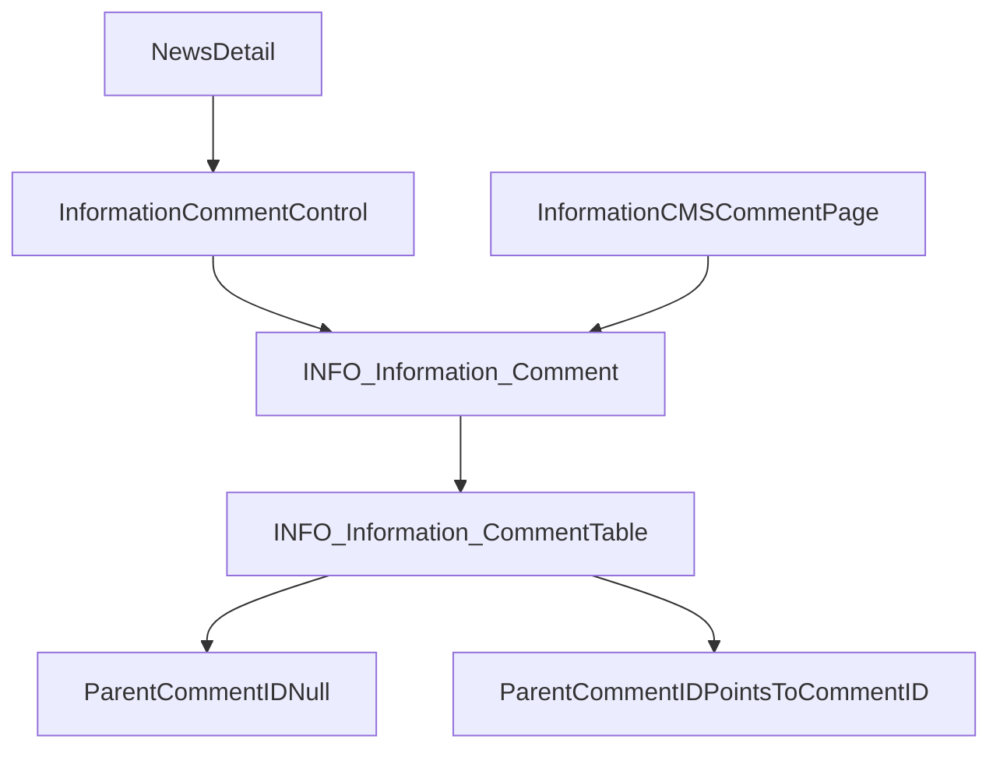

# Information Comments Implementation Plan

## Kết Quả Kiểm Tra Hiện Tại
- `1.HOS/InformationWeb/Controls/InfoSection/News/NewsDetail.ascx` hiện **không có khu vực comment** và `NewsDetail.ascx.cs` chỉ bind chi tiết, sidebar, related, tag. Chưa có load/save comment.
- `1.HOS/InformationCMS` hiện **không có control/page quản lý comment** trong `Controls/Information` hoặc `Pages/Information`.
- `1.HOS/InformationWebObject/Base/INFO_Information_CommentBase.cs` đã tồn tại model cơ bản theo `InformationID`, có `Add/Update/Delete/Get/GetAll/Search`, nhưng chưa có `ParentCommentID` để trả lời dạng cây và base hiện chưa khớp đầy đủ với SQL `Fullname`.
- SQL sync hiện có store cơ bản `INFO_Information_Comment_ADD/EDIT/DELETE/GET/GETALL`, bảng `INFO_Information_Comment`, cột `Fullname` trong patch sync, nhưng chưa thấy store public list theo bài viết, chưa có `ParentCommentID`, chưa có CMS search/list quản lý chuẩn.

## Thiết Kế Đề Xuất
Giữ nhỏ gọn theo kiến trúc hiện có:
- Web tạo control riêng `InformationComment.ascx` để dùng lại, không sửa layout detail ngoài việc gắn control dưới nội dung bài.
- Comment lưu vào `INFO_Information_Comment` theo `InformationID`; reply lưu cùng bảng bằng `ParentCommentID` nullable.
- Người dùng ngoài Web gửi comment mặc định `IsActived = 0`, CMS duyệt mới hiển thị.
- CMS thêm page/menu quản lý comment, có lọc theo bài/comment chưa duyệt, duyệt/xóa/trả lời. Reply CMS lưu là comment con `ParentCommentID = CommentID` và `IsActived = 1`.
- Cập nhật `InformationWebObject.Base` cho `ParentCommentID` và `Fullname` để Object layer đúng contract DB.

## Files Sẽ Tạo/Sửa
- SQL patch mới: `sql/patches/20261011_INFO_Information_Comment_threaded_comments.sql`
  - Add `ParentCommentID bigint null` nếu chưa có.
  - Add/ensure `Fullname nvarchar(50)` nếu chưa có.
  - Add FK self-reference optional hoặc giữ index-only nếu DB legacy khó áp constraint.
  - Create/alter stores: `INFO_Information_Comment_ADD`, `EDIT`, `GET`, `GETALL`, `SEARCH`, `PUBLIC_LIST_BY_INFORMATION`, `CMS_SEARCH`, `CMS_REPLY`, `CMS_ACTIVATE`.
- Object layer:
  - Modify `1.HOS/InformationWebObject/Base/INFO_Information_CommentBase.cs` thêm fields/properties/constants/parameters parse method và Add/Edit params.
  - Modify `1.HOS/InformationWebObject/INFO_Information_Comment.cs` thêm helper nhỏ nếu cần, ví dụ `GetPublicByInformation`, `SearchCMS`, `Reply`, `Activate` để tránh gọi raw SQL ở Web/CMS.
  - Modify `1.HOS/InformationWebObject/InformationWebObject.csproj` nếu cần include file mới, ưu tiên không tạo file mới nếu partial hiện có đủ.
- Web detail:
  - Create `1.HOS/InformationWeb/Controls/InfoSection/News/InformationComment.ascx` + `.cs` + `.designer.cs`.
  - Modify `1.HOS/InformationWeb/Controls/InfoSection/News/NewsDetail.ascx` chỉ gắn control ở dưới nội dung bài, không đổi giao diện hiện có.
  - Modify `NewsDetail.ascx.cs` lưu `InformationID` sau khi bind detail và truyền sang comment control; kiểm tra `IsCommentAllow` nếu store detail đã trả về.
  - Modify `1.HOS/InformationWeb/InformationWeb.csproj` include control mới.
- CMS:
  - Create `1.HOS/InformationCMS/Controls/Information/InformationCommentList.ascx` + `.cs` + `.designer.cs`.
  - Create `1.HOS/InformationCMS/Pages/Information/InformationComment.aspx` + `.cs` + `.designer.cs`.
  - Modify `1.HOS/InformationCMS/InformationCMS.csproj` include page/control mới.
  - SQL patch thêm menu/quyền quản lý comment theo pattern `SYS_Permission`, `SYS_Menu` hiện có.

## Validation Và Bảo Mật
- Web submit validate: `InformationID > 0`, `Fullname` bắt buộc, `Content` bắt buộc, `Email` đúng định dạng nếu nhập, giới hạn length theo DB.
- Không hiển thị raw exception ra UI; log qua pattern hiện có.
- Encode toàn bộ `Fullname`, `Title`, `Content`, `Email` khi render comment.
- Chỉ hiển thị comment `IsActived = 1` và `IsDeleted = 0` ở Web.
- CMS thao tác activate/delete/reply cần kiểm tra permission riêng, ví dụ `INFO_Information_Comment_View/Edit/Delete/Reply`.

## Kiểm Thử
- Build `InformationWebObject`, `InformationWeb`, `InformationCMS` bằng MSBuild .NET Framework.
- SQL smoke test bằng ADO.NET hoặc script:
  - Insert comment root `InformationID = existing id`, `ParentCommentID = null`, `IsActived = 0`.
  - Activate comment, public list thấy comment.
  - Reply CMS tạo child với `ParentCommentID = root id`, public list trả theo đúng bài.
- Browser/manual test sau khi implement:
  - Mở detail bài có `IsCommentAllow = 1`, gửi comment, thấy thông báo chờ duyệt.
  - CMS duyệt comment, quay lại detail thấy comment.
  - CMS reply, detail thấy reply dưới comment cha.
  - Bài `IsCommentAllow = 0` không cho gửi comment.

## Những Gì Không Làm Trong Vòng Này
- Không redesign giao diện comment.
- Không thêm captcha nếu project chưa có sẵn ở detail comment; nếu spam là yêu cầu tiếp theo thì dùng `CaptChaImage` hiện có.
- Không làm nested reply vô hạn phức tạp ở UI; lưu DB dạng cây nhưng render 1-2 cấp theo nhu cầu quản trị để giữ đơn giản.