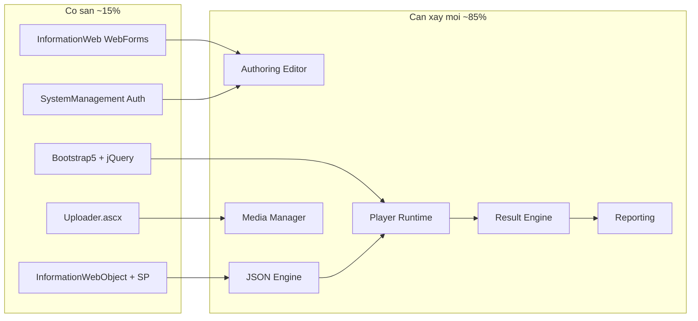
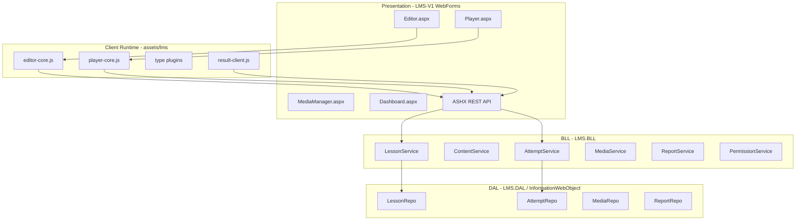
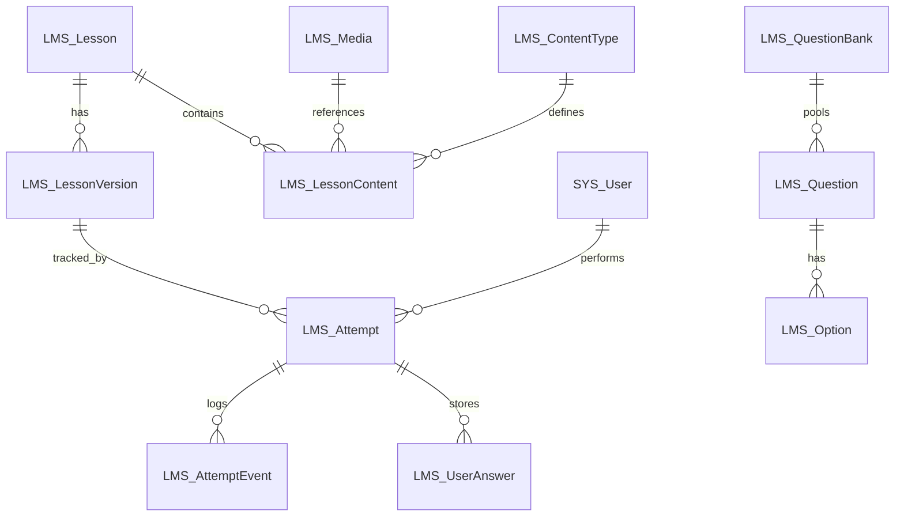
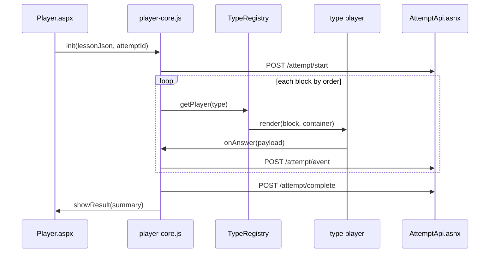
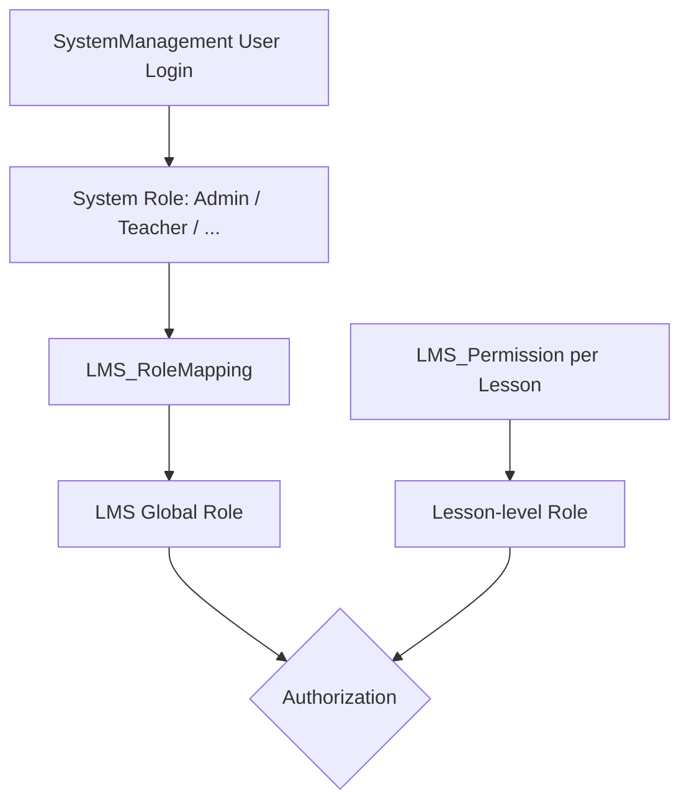
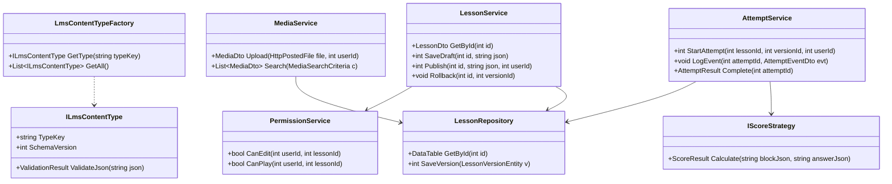

# Kế hoạch thiết kế LMS Authoring Tool (H5P-like, độc lập)

## 1. Đánh giá mức độ sẵn sàng — `@hos/LMS-V1`

| Hạng mục | Hiện trạng | Mức độ | Ghi chú |
|---|---|---|---|
| Scaffold module | [`hos/LMS-V1/Pages`](g:\0.LMS\CMS-Video\hos\LMS-V1\Pages), [`hos/LMS-V1/Controls`](g:\0.LMS\CMS-Video\hos\LMS-V1\Controls) | 5% | Chỉ có thư mục trống, chưa có `.csproj` entry |
| Kiến trúc 3 lớp | [`InformationWebObject`](g:\0.LMS\CMS-Video\hos\InformationWeb.csproj) (external) | 40% | Pattern `GetDataTable(SP, params)` đã ổn định, cần mở rộng entity LMS |
| Frontend shell | [`BDS.Master`](g:\0.LMS\CMS-Video\hos\BDS.Master), Bootstrap 5, jQuery 3.7 | 35% | Có layout + theme; chưa có SPA/editor libs |
| JSON API pattern | [`ChatApi.ashx.cs`](g:\0.LMS\CMS-Video\hos\Controls\InformationSection\Information\ChatApi.ashx.cs) | 25% | ASHX + `JavaScriptSerializer`; cần chuẩn hóa REST + Newtonsoft.Json |
| Upload media | [`Uploader.ascx.cs`](g:\0.LMS\CMS-Video\hos\Controls\Uploader.ascx.cs) | 20% | Upload file cơ bản qua `DCore.ConfigManager`; chưa có media library |
| Auth / RBAC | `SystemManagement.dll` | 30% | Admin CMS có sẵn; public site chưa login — LMS sẽ dùng admin auth |
| LMS core (Editor/Player/Result) | Không có | 0% | Greenfield hoàn toàn |
| Reporting / Analytics | Không có | 0% | Greenfield |

**Tổng mức sẵn sàng: ~15%** — Nền tảng WebForms + DAL + UI theme có thể tái sử dụng; toàn bộ lõi Authoring/Player/Tracking phải xây mới.



---

## 2. Nguyên tắc kiến trúc cốt lõi

### 2.1. Content-Type Plugin Architecture (Strategy + Factory)

**Quyết định:** Mỗi loại nội dung là một plugin độc lập, đăng ký qua registry — không `switch/case` cứng trong Player/Editor core.

**Lý do:** Thêm `dragdrop`, `flashcard`, `branching` sau này chỉ cần thêm 3 file (Editor JS + Player JS + Schema validator) + 1 dòng registry, không sửa engine.

```
ILmsContentType (interface)
├── TypeKey: string          // "multiplechoice", "video", ...
├── SchemaVersion: int
├── ValidateJson(json)
├── ToNormalizedDb(dto)      // optional denormalize for reporting
├── GetEditorModule()        // JS module path
└── GetPlayerModule()        // JS module path
```

**Backend:** `LmsContentTypeFactory` đọc registry t� static config hoặc DB table `LMS_ContentType`.

**Frontend:** `window.LMS.registerType(typeKey, { editor, player, schema })`.

### 2.2. JSON-first, DB-normalized-for-reporting

**Quyết định:** Nguồn sự thật (source of truth) của nội dung là **JSON document** lưu trong `LMS_LessonVersion.ContentJson`. DB normalized (`LMS_Question`, `LMS_Option`) chỉ mirror cho reporting/search — sync khi publish.

**Lý do:** Editor/Player độc lập DB schema; thêm field mới trong JSON không cần migration DB ngay; reporting vẫn query nhanh qua bảng chuẩn hóa.

### 2.3. Version immutability

**Quyết định:** Mỗi lần Publish tạo bản `LMS_LessonVersion` mới (immutable). Attempt luôn gắn `VersionId`.

**Lý do:** Rollback an toàn; học viên đang làm bài không bị thay đổi nội dung giữa chừng; audit trail rõ ràng.

### 2.4. Event-sourced Result Engine

**Quyết định:** Ghi mọi hành vi học viên dưới dạng **event** (`started`, `block_viewed`, `answer_submitted`, `video_paused`, `completed`...) rồi aggregate thành điểm.

**Lý do:** Interactive Video cần timeline events; branching cần path tracking; reporting linh hoạt; replay/debug dễ.

---

## 3. Kiến trúc module tổng thể



### Cấu trúc thư mục đề xuất

```
hos/
├── LMS-V1/
│   ├── Pages/
│   │   ├── Editor.aspx          # Authoring shell
│   │   ├── Player.aspx          # Runtime shell
│   │   ├── MediaManager.aspx
│   │   └── Dashboard.aspx
│   ├── Controls/
│   │   ├── Editor/              # ASCX hosts cho editor blocks
│   │   ├── Player/
│   │   └── Report/
│   └── Api/
│       ├── LessonApi.ashx
│       ├── AttemptApi.ashx
│       ├── MediaApi.ashx
│       └── ReportApi.ashx
├── assets/lms/
│   ├── editor/                  # Editor core + block editors
│   ├── player/                  # Player core + block players
│   ├── shared/                  # schema, utils, api-client
│   └── vendor/                  # SortableJS, Video.js, Quill
InformationWebObject/             # Mở rộng project hiện có
├── LMS/
│   ├── Entity/                  # LMS_Lesson, LMS_Attempt, ...
│   ├── BLL/                     # Service classes
│   └── DAL/                     # Repository + SP calls
Database/
└── Scripts/
    ├── LMS_Schema.sql
    └── LMS_StoredProcedures.sql
```

**Lý do tách `assets/lms`:** Player có thể embed qua iframe/script trên site khác; Editor tải nặng, cache CDN-friendly; tách khỏi theme CMS.

---

## 4. JSON Schema chuẩn

### 4.1. Lesson document (root)

```json
{
  "schemaVersion": 1,
  "lessonId": 1001,
  "versionId": 5,
  "title": "Bai hoc 1",
  "description": "",
  "settings": {
    "passScore": 70,
    "maxAttempts": 0,
    "showFeedback": true,
    "timeLimitSeconds": 0
  },
  "contents": [
    {
      "id": "blk_a1b2c3",
      "type": "text",
      "order": 1,
      "title": "Gioi thieu",
      "data": { },
      "behaviour": { "required": false, "weight": 0 },
      "metadata": { "createdAt": "2026-08-02T05:00:00Z" }
    }
  ]
}
```

### 4.2. Block envelope (mọi loại content)

| Field | Mục đích |
|---|---|
| `id` | UUID client-side, ổn định qua undo/copy |
| `type` | Registry key (`video`, `multiplechoice`, ...) |
| `order` | Thứ tự render |
| `data` | Payload riêng theo type |
| `behaviour` | Scoring, required, retry policy |
| `metadata` | Editor-only hoặc audit |

### 4.3. Ví dụ `data` theo type (Phase 1)

**text**
```json
{ "html": "<p>Noi dung</p>", "format": "html" }
```

**image**
```json
{ "mediaId": 501, "url": "/Media/LMS/501/photo.jpg", "alt": "", "caption": "" }
```

**video / interactiveVideo**
```json
{
  "mediaId": 601,
  "url": "/Media/LMS/601/clip.mp4",
  "poster": "",
  "interactions": [
    {
      "id": "int_01",
      "timeFrom": 30.5,
      "timeTo": 30.5,
      "pauseVideo": true,
      "type": "multiplechoice",
      "data": { "question": "...", "options": [], "correctIds": [] }
    }
  ]
}
```

**multiplechoice** (Phase 2 nhưng schema định nghĩa sẵn)
```json
{
  "question": "Cau hoi?",
  "options": [
    { "id": "opt1", "text": "A", "correct": true }
  ],
  "singleAnswer": true,
  "explanation": ""
}
```

### 4.4. Schema versioning strategy

- `schemaVersion` ở root document
- Mỗi type có `typeSchemaVersion` trong `data` nếu cần
- `LmsSchemaMigrator` upgrade JSON cũ khi load Editor (forward-only)

---

## 5. Database design (SQL Server)

### 5.1. ERD tổng quan



### 5.2. Bảng cốt lõi

**LMS_ContentType** — registry loại nội dung
- `ContentTypeId`, `TypeKey`, `DisplayName`, `Category`, `IsScorable`, `IsActive`, `EditorModule`, `PlayerModule`, `SchemaVersion`

**LMS_Lesson**
- `LessonId`, `Title`, `Description`, `OwnerUserId`, `Status` (Draft/Published/Archived)
- `CurrentVersionId`, `CreatedAt`, `UpdatedAt`

**LMS_LessonVersion** — immutable snapshot
- `VersionId`, `LessonId`, `VersionNo`, `ContentJson` (NVARCHAR(MAX)), `ChangeNote`
- `PublishedBy`, `PublishedAt`, `IsPublished`

**LMS_LessonContent** — denormalized index cho search/report
- `ContentId`, `LessonId`, `VersionId`, `BlockId` (UUID), `ContentTypeId`, `SortOrder`
- `Title`, `IsScorable`, `MaxScore`, `ContentJson` (block-only snapshot)

**LMS_Media**
- `MediaId`, `FileName`, `OriginalName`, `MimeType`, `FileSize`, `StoragePath`, `LogicalUrl`
- `MediaType` (Image/Video/Audio/PDF/Doc), `UploadedBy`, `CreatedAt`, `IsDeleted`

**LMS_Attempt**
- `AttemptId`, `LessonId`, `VersionId`, `UserId`, `Status` (InProgress/Completed/Abandoned)
- `StartedAt`, `CompletedAt`, `DurationSeconds`, `Score`, `MaxScore`, `PercentCorrect`, `AttemptNo`

**LMS_AttemptEvent** — event log
- `EventId`, `AttemptId`, `BlockId`, `EventType`, `EventDataJson`, `EventAt`, `DurationMs`

**LMS_UserAnswer** — aggregated answer
- `AnswerId`, `AttemptId`, `BlockId`, `ContentTypeId`, `AnswerJson`, `IsCorrect`, `Score`, `MaxScore`
- `TimeSpentMs`, `AttemptCount`, `AnsweredAt`

**LMS_Question / LMS_Option** — mirror cho Question Bank + reporting
- Sync từ JSON khi Publish; không phụ thuộc Player runtime

**LMS_Permission** — mapping role LMS
- `UserId`, `LessonId`, `Role` (Owner/Editor/Viewer), tích hợp `SystemManagement` role

**LMS_LessonHistory** — audit Editor actions
- `HistoryId`, `LessonId`, `UserId`, `Action`, `SnapshotJson`, `CreatedAt`

### 5.3. Thiết kế không hardcode theo loại câu hỏi

- Cột `AnswerJson`, `EventDataJson`, `ContentJson` dùng JSON linh hoạt
- `ContentTypeId` + `TypeKey` thay vì bảng riêng `LMS_MultipleChoice`, `LMS_DragDrop`
- Scoring logic nằm ở **Player plugin** + **Result Engine strategy** (`IScoreStrategy`), không ở DB

---

## 6. Authoring Editor — UI/UX

### 6.1. Layout (3 panel)

```
┌──────────────┬─────────────────────────┬──────────────┐
│ Block Palette│   Canvas (SortableJS)   │ Properties   │
│ - Text       │   [Block 1: Video    ]  │ Form động    │
│ - Image      │   [Block 2: Text     ]  │ theo type    │
│ - Video      │   [Block 3: MC       ]  │              │
│ - Audio      │                         │ Score/Req    │
│ - PDF        │   [+ Drop zone]         │              │
│ - IV Video   │                         │              │
└──────────────┴─────────────────────────┴──────────────┘
 Toolbar: Undo | Redo | Preview | Save Draft | Publish
```

### 6.2. Editor core features

| Feature | Công nghệ | Ghi chú |
|---|---|---|
| Drag & drop palette → canvas | SortableJS | Reorder + clone from palette |
| Undo/Redo | Command pattern stack | Max 50 steps, serialize JSON diff |
| Copy/Duplicate/Delete | UUID regenerate | Deep clone `data` |
| Properties panel | Dynamic form loader | Mỗi type export `renderProperties(block)` |
| Rich text | Quill | Block `text`, `html` |
| Interactive Video editor | Video.js + timeline rail | Marker drag, pause-at-time |
| Autosave | Debounce 3s → API | Draft version, không publish |

### 6.3. WebForms integration

- [`Editor.aspx`](g:\0.LMS\CMS-Video\hos\LMS-V1\Pages) chỉ render shell + inject `lessonId`, `apiToken`, `userRole`
- Toàn bộ logic editor chạy client-side ES6 modules (transpile nếu cần IE — hoặc target modern browsers only)
- Master page riêng `LMS.Master` (không dùng public `BDS.Master` cho admin editor)

---

## 7. Player runtime

### 7.1. Render pipeline



### 7.2. Player principles

- **Stateless UI, stateful Attempt:** Player không lưu local; mọi state qua `AttemptId`
- **Lazy load plugins:** Chỉ tải JS module của types có trong lesson
- **Resume support:** Load events từ API → restore block progress
- **Interactive Video Phase 1:** pause → overlay question (reuse MC player inline) → resume

### 7.3. Scoring

`IScoreStrategy` per type:
- `CalculateScore(blockData, answerJson) → ScoreResult`
- Non-scorable blocks (text, image): weight = 0
- Essay: `IsCorrect = null`, chờ manual grading (Phase 3)

---

## 8. Result Engine

### 8.1. Event types (chuẩn hóa)

| EventType | Payload |
|---|---|
| `lesson_started` | `{ lessonId, versionId }` |
| `block_viewed` | `{ blockId, timeSpentMs }` |
| `answer_submitted` | `{ blockId, answerJson, isCorrect, score }` |
| `video_play` | `{ blockId, position }` |
| `video_pause` | `{ blockId, position, watchedSeconds }` |
| `interaction_triggered` | `{ blockId, interactionId, videoPosition }` |
| `lesson_completed` | `{ totalScore, maxScore, durationMs }` |
| `lesson_abandoned` | `{ lastBlockId }` |

### 8.2. Aggregation flow

1. Event insert → `LMS_AttemptEvent`
2. Trigger/async job cập nhật `LMS_UserAnswer` + `LMS_Attempt.Score`
3. Reporting đọc từ aggregated tables, không parse JSON hàng loạt

**Lý do event-first:** Interactive Video cần biết "xem bao nhiêu % video"; branching cần path; audit đầy đủ.

---

## 9. REST API design (ASHX Phase 1 → Web API Phase 2)

Base: `/LMS-V1/Api/`

| Method | Endpoint | Mô tả |
|---|---|---|
| GET | `/lesson/{id}` | Lấy lesson + current draft/published JSON |
| POST | `/lesson` | Tạo lesson mới |
| PUT | `/lesson/{id}/draft` | Lưu draft JSON |
| POST | `/lesson/{id}/publish` | Publish → new version |
| GET | `/lesson/{id}/versions` | Danh sách version |
| POST | `/lesson/{id}/rollback/{versionId}` | Rollback |
| GET | `/lesson/{id}/player?version=` | JSON cho Player |
| POST | `/attempt/start` | `{ lessonId, versionId, userId }` |
| POST | `/attempt/event` | Ghi event |
| POST | `/attempt/complete` | Hoàn thành + tính điểm |
| GET | `/attempt/{id}` | Resume state |
| POST | `/media/upload` | Upload file |
| GET | `/media` | Media library list |
| DELETE | `/media/{id}` | Soft delete |
| GET | `/report/lesson/{id}` | Dashboard data |
| GET | `/report/attempts` | Filter attempts |

**Auth:** Kiểm tra session `SystemManagement` + `LMS_Permission`. API token cho embed Player (Phase 2).

**Serialization:** Newtonsoft.Json (thay `JavaScriptSerializer` — giới hạn MAX JSON length .NET 4).

---

## 10. Permission model (SystemManagement)



| LMS Role | Quyền |
|---|---|
| Admin | Full system, all lessons |
| Teacher | Create/edit/publish own lessons, view reports |
| Reviewer | Preview + comment, no publish |
| Student | Play lessons, own attempts |
| Guest | Public lessons only |

**Mapping:** Bảng `LMS_RoleMapping(SystemRoleId → LmsRole)`. Lesson-level override qua `LMS_Permission`.

---

## 11. Media Manager

Tái sử dụng pattern [`Uploader.ascx.cs`](g:\0.LMS\CMS-Video\hos\Controls\Uploader.ascx.cs) + mở rộng:

- Storage path: `/Media/LMS/{MediaId}/{filename}` (tương tự `Information{ID}` pattern hiện có)
- Upload qua `MediaApi.ashx` (multipart)
- Metadata trong `LMS_Media`
- Video Phase 1: local MP4; Phase 2: optional YouTube/external URL
- PDF: embed qua iframe viewer
- Thumbnail auto-gen cho image (Phase 2)

---

## 12. Reporting Dashboard

**Phase 1 metrics:**
- Tổng lượt attempt / hoàn thành
- Thời gian trung bình
- Video watch rate (%)
- Block nào xem nhiều / bỏ nhiều

**Phase 2+ (khi có quiz):**
- Tỷ lệ đúng theo câu
- Câu sai nhiều nhất
- Score distribution chart

**Tech:** Server trả JSON → Chart.js render client; export Excel qua EPPlus/Aspose (nếu có license).

---

## 13. Class diagram (Backend C#)



**SOLID mapping:**
- **S:** Mỗi Service một domain
- **O:** `ILmsContentType`, `IScoreStrategy` mở rộng không sửa core
- **L:** Strategy implementations thay thế được
- **I:** Interface nhỏ per concern
- **D:** Service nhận Repository qua constructor (manual DI factory .NET 4)

---

## 14. Lộ trình triển khai

### Phase 0 — Foundation (3-4 tuần)
- Tạo DB schema + stored procedures (`LMS_*`)
- Mở rộng `InformationWebObject` với LMS entities/repos
- Setup `LMS-V1` pages trong `InformationWeb.csproj`
- API skeleton + auth tích hợp SystemManagement
- JSON schema v1 + ContentType registry (text, image, audio, video, pdf, html)

### Phase 1 — Core + Media + Interactive Video (8-10 tuần) — theo lựa chọn của bạn
- **Editor:** palette, canvas, properties, undo/redo, autosave
- **Block editors:** Text (Quill), Image, Audio, Video, PDF, HTML
- **Interactive Video:** timeline markers, pause, inline question overlay (MC đơn giản inline)
- **Player:** render all Phase 1 types, event tracking
- **Result Engine:** start/complete, block_viewed, video events
- **Media Manager:** upload + library UI
- **Version:** draft/publish v1

### Phase 2 — Assessment blocks (6-8 tuần)
- MC, True/False, Fill Blank, Essay
- Scoring strategies + feedback UI
- Question Bank + Random Question
- Reporting: score, correct rate, wrong questions

### Phase 3 — Interactive advanced (8-10 tuần)
- Drag Drop, Drag Text, Matching, Flash Card
- Image Hotspot, Memory Game, Timeline, Accordion
- Manual essay grading UI

### Phase 4 — Course & Scenario (6-8 tuần)
- Presentation/Slide, Course container, Branching Scenario
- Survey, Poll
- Embed/iframe, LTI-ready Player URL

### Phase 5 — Polish (ongoing)
- Full reporting dashboard + charts
- Performance: JSON compression, CDN, lazy load
- API token embed, xAPI export (optional)

---

## 15. Rủi ro và giảm thiểu

| Rủi ro | Giảm thiểu |
|---|---|
| `JavaScriptSerializer` limit | Dùng Newtonsoft.Json cho lesson JSON |
| .NET 4.0 không có async | Batch event writes; short transactions |
| ES6 vs legacy browser | Target Chrome/Edge modern; Editor admin-only |
| JSON blob lớn | Block-level storage option; compress published version |
| SystemManagement API không rõ | Wrapper `PermissionService` abstract; mock nếu cần |
| Scope creep 20+ content types | Plugin registry + phased rollout |

---

## 16. Quyết định thiết kế then chốt (tóm tắt)

1. **Plugin registry** thay vì monolithic switch — extensibility tối đa
2. **JSON source of truth + DB mirror** — tách Editor/Player khỏi schema DB
3. **Immutable version** — rollback an toàn, attempt nhất quán
4. **Event-sourced tracking** — đáp ứng video timeline + branching sau này
5. **ASHX REST trước, Web API sau** — phù hợp .NET 4 WebForms hiện tại
6. **Tái sử dụng SystemManagement auth** — không xây lại user management
7. **LMS-V1 module trong InformationWeb** — tận dụng DAL pattern + deployment hiện có
