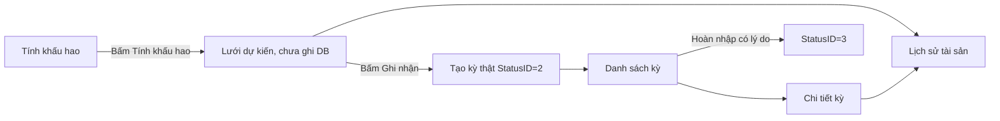

# Tách luồng khấu hao tài sản

## Luồng chốt

- Không còn `StatusID = 1` cho `FAM_DeviceDepPeriod`; `StatusID = 1` của `FAM_DeviceDepPolicy` vẫn giữ vì nghĩa là chính sách đang áp dụng.
- Tháng chưa có kỳ: lưới trống; bấm **Tính khấu hao** mới gọi Preview và vẫn không tạo DB; **Ghi nhận** mới Post toàn bộ tài sản đủ điều kiện theo tháng + chi nhánh.
- DB hiện được xác nhận không có kỳ Nháp, nhưng patch vẫn preflight; nếu bất ngờ tồn tại dữ liệu `StatusID = 1` thì dừng với thông báo, không tự biến đổi số liệu kế toán.

## 1. Thu gọn form tính khấu hao
- Giữ class/menu cũ [`1.WIN-FORM/FamManager/Device/frmDeviceDep.cs`](1.WIN-FORM/FamManager/Device/frmDeviceDep.cs) để không phá đăng ký form bằng reflection; đổi caption thành “Tính và ghi nhận khấu hao”.
- Sửa [`1.WIN-FORM/FamManager/Device/frmDeviceDep.designer.cs`](1.WIN-FORM/FamManager/Device/frmDeviceDep.designer.cs) và `.resx` để chỉ còn: chi nhánh, năm, tháng, nút Tính khấu hao, Ghi nhận, Danh sách kỳ, Lịch sử tài sản, Đóng và lưới `FAM_DeviceDepPeriod_Preview`.
- Bỏ `Chế độ xem`, lọc trạng thái kỳ, từ khóa/chủng loại/trạng thái/công trình khỏi form này để Preview và Post luôn cùng phạm vi tháng + chi nhánh.
- Bỏ toàn bộ mã thừa copy từ kiểm kê: sửa `RemainPrice` trên lưới, print/export biên bản kiểm kê, repository “Loại phiếu chi”, date controls ẩn, dialog grid tạm và logic Reverse/Search kỳ.
- Quyền: `FAM_DeviceDep_View` được Preview/xem lịch sử; `FAM_DeviceDep_Edit` mới được Ghi nhận. Handler kiểm tra lại quyền, không chỉ disable nút.

## 2. Tạo form danh sách kỳ riêng
- Thêm [`1.WIN-FORM/FamManager/Device/frmDeviceDepPeriodList.cs`](1.WIN-FORM/FamManager/Device/frmDeviceDepPeriodList.cs), designer và resx theo pattern `frmDeviceCheckingList`.
- Lưới master dùng `FAM_DeviceDepPeriod_Search`; lưới detail cố định dùng `FAM_DeviceDepPeriodDetail_Search`, thay cho dialog DevExpress tạo động nên cấu hình `SYS_GridColumn` được áp dụng đúng.
- Bộ lọc chỉ gồm năm, tháng, chi nhánh, trạng thái: Tất cả / Đã ghi nhận `2` / Đã hoàn nhập `3` với ánh xạ ID tường minh, không lấy `SelectedIndex` làm StatusID.
- Double-click/chọn kỳ load chi tiết; nút Hoàn nhập chỉ bật với kỳ `2`, bắt buộc lý do và quyền `FAM_DeviceDep_Reverse`; có nút mở lịch sử tài sản từ dòng detail.

## 3. Tạo form lịch sử tài sản riêng
- Thêm [`1.WIN-FORM/FamManager/Device/frmDeviceDepHistory.cs`](1.WIN-FORM/FamManager/Device/frmDeviceDepHistory.cs), designer và resx.
- Cho phép chọn tài sản hoặc nhận `DeviceID` từ hai form trên; dùng store/query `FAM_DeviceDepPeriodDetail_History`; lưới chỉ đọc, lọc và export dữ liệu.
- Form chỉ yêu cầu `FAM_DeviceDep_View`; không chứa Post/Reverse/chỉnh chính sách.
- Đăng ký sáu source/resource mới trong [`1.WIN-FORM/FamManager/FamManager.csproj`](1.WIN-FORM/FamManager/FamManager.csproj). Không bắt buộc thêm menu DB vì form chính mở được hai form phụ.

## 4. Bỏ Draft ở SQL và khóa dữ liệu thật
- Sửa schema [`01_20261019_FAM_DeviceDep_schema.sql`](2.SQL/patches/2026-10-19/FAM-DeviceDep/01_20261019_FAM_DeviceDep_schema.sql): constraint kỳ chỉ nhận `(2,3)`, default `2`, unique index kỳ hiệu lực chỉ lọc `StatusID = 2`.
- Tạo patch migration `27_20261019_FAM_DeviceDepPeriod_remove_draft.sql`: preflight xác nhận không có kỳ `1`, sau đó thay constraint/index; nếu có dữ liệu Draft thì `Raiserror` và rollback để tránh tự sửa sổ thật.
- Sửa riêng từng store có backup definition trong `backup/`: Post chỉ kiểm tra kỳ `2`; Search và History chỉ hiển thị `2/3`; Reverse giữ điều kiện `2 -> 3`. Đồng bộ cả bản store hiệu lực sau cùng, không tạo thêm bảng `Backup_*` trong DB.
- Cập nhật comment model tại [`1.WIN-FORM/FamObject/Base/FAM_DeviceDepPeriodBase.cs`](1.WIN-FORM/FamObject/Base/FAM_DeviceDepPeriodBase.cs), mô tả cột và verification SQL để không còn chữ “Nháp”.

## 5. Chuẩn hóa khấu hao đường thẳng
- Cập nhật [`02_20261019_FAM_DeviceDepPolicy_migrate.sql`](2.SQL/patches/2026-10-19/FAM-DeviceDep/02_20261019_FAM_DeviceDepPolicy_migrate.sql) và thêm patch kế tiếp để mọi tài sản đủ điều kiện `TSHH/TSVH`, tài sản cha, chưa thanh lý, không `QSDD/KHAC`, có nguyên giá đều có policy `MethodID = 1`, `IsLineDep = 1`; thiếu ngày bắt đầu thì lấy ngày đầu tháng hiện tại.
- Không viết lại snapshot của kỳ đã ghi nhận/hoàn nhập. Policy đã có lịch sử được giữ nguyên; verification báo rõ mọi ngoại lệ thay vì âm thầm sửa lịch sử kế toán.
- Khóa đường tạo/sửa policy tương lai trong store `FAM_DeviceDepPolicy_ADD`, `EDIT`, `SaveForDevice`: chỉ chấp nhận/ghi `MethodID = 1` cho luồng đang triển khai, tránh migration xong lại phát sinh phương pháp khác.

## 6. Chuẩn hóa lưới và gói triển khai
- Chỉnh [`13_20261019_SYS_GridColumn_FAM_DeviceDepPeriod.sql`](2.SQL/patches/2026-10-19/FAM-DeviceDep/13_20261019_SYS_GridColumn_FAM_DeviceDepPeriod.sql) theo từng màn hình: thứ tự/caption/tổng tiền cho Preview, Period Search, Period Detail và Asset History; mọi cột ID ẩn, cột tài chính read-only và format thống nhất.
- Cập nhật permission patch nhưng giữ nguyên tuyệt đối bốn PermissionID hiện có; không tạo/gán role.
- Regenerate [`FINAL_20261019_FAM_DeviceDep_install_all.sql`](2.SQL/patches/2026-10-19/FAM-DeviceDep/FINAL_20261019_FAM_DeviceDep_install_all.sql) theo đúng thứ tự patch độc lập; FINAL dùng cho chạy một lần, còn từng store vẫn có patch riêng.

## 7. Kiểm chứng
- Build `FamObject.csproj` và `FamManager.csproj` bằng toolchain legacy khả dụng; kiểm tra linter các file C# vừa sửa.
- Kiểm tra SQL tĩnh và query verification: không kỳ ngoài `2/3`, không kỳ Posted rỗng, không trùng tháng/chi nhánh, không tài sản đủ điều kiện thiếu policy thẳng, không policy mới `MethodID <> 1`, master `RemainPrice` khớp kỳ Posted cuối.
- Test thủ công: mở tháng chưa có thấy lưới trống; Tính chỉ load preview; Ghi nhận tạo đúng một kỳ `2`; danh sách kỳ/detail dùng đúng grid config; lịch sử mở đúng tài sản; Reverse yêu cầu lý do và chuyển sang `3`; không còn bất kỳ lựa chọn/chữ “Nháp” trên UI hoặc SQL mô tả.