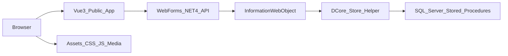

# Kế Hoạch Chuyển Public Site Sang Vue 3

## Mục Tiêu
- Dùng project hiện tại để luyện nắm luồng frontend -> API -> BLL/DAL -> stored procedure -> SQL Server.
- Vue 3 thay toàn bộ giao diện public: trang chủ, danh sách tin, chi tiết tin, danh mục nghề, liên hệ/đăng ký tư vấn.
- Backend API vẫn nằm trong `1.SOUECE/InformationWeb` để tương thích .NET Framework 4 và dùng lại `1.SOUECE/InformationWebObject`.
- Không chuyển CMS/admin trong giai đoạn này.

## Kiến Trúc Đề Xuất

## Phạm Vi Source Cần Đụng
- Public route hiện tại: `g:/0.DỰ ÁN/Z.WEB_SITE/WEB-Tuyen-Sinh-QN-2/1.SOUECE/InformationWeb/urlrewrite.config`
- Shell WebForms hiện tại: `g:/0.DỰ ÁN/Z.WEB_SITE/WEB-Tuyen-Sinh-QN-2/1.SOUECE/InformationWeb/Default.aspx`
- Public controls tham chiếu để map UI/data: `g:/0.DỰ ÁN/Z.WEB_SITE/WEB-Tuyen-Sinh-QN-2/1.SOUECE/InformationWeb/Controls/Home.ascx`
- Data access dùng lại: `g:/0.DỰ ÁN/Z.WEB_SITE/WEB-Tuyen-Sinh-QN-2/1.SOUECE/InformationWebObject/Base/INFO_InformationBase.cs`
- Form đăng ký hiện tại: `g:/0.DỰ ÁN/Z.WEB_SITE/WEB-Tuyen-Sinh-QN-2/1.SOUECE/InformationWeb/Controls/InfoSection/DangKyTuyensinh.ascx.cs`

## Lộ Trình Thực Hiện
1. Khảo sát và lập bản đồ dữ liệu public
- Liệt kê các section trong `Controls/Home.ascx` và store đang dùng.
- Gom các store public cần API hóa: tin trang chủ, tuyển sinh, danh sách tin, chi tiết tin, ngành nghề, category, tag/sidebar.
- Chốt JSON response đơn giản theo đúng dữ liệu Vue cần, không tạo abstraction lớn.

2. Tạo API .NET 4 tối thiểu
- Thêm nhóm endpoint trong project `InformationWeb`, ưu tiên `.ashx` hoặc WebForms handler đơn giản để tương thích VS2010.
- API gọi `InformationWebObject.INFO_Information.GetDataTable(...)` rồi convert `DataTable` sang JSON.
- Các endpoint đề xuất:
  - `/api/home.ashx` trả dữ liệu các section trang chủ.
  - `/api/news-list.ashx?category=tin-tuc&top=50`
  - `/api/news-detail.ashx?slug=...`
  - `/api/careers.ashx`
  - `/api/sidebar.ashx`
  - `/api/admission-register.ashx` cho form đăng ký tư vấn.
- Validate input ở API, không expose exception raw ra response.

3. Tạo Vue 3 public app
- Đặt frontend trong thư mục riêng, ví dụ `1.SOUECE/FrontendVue` hoặc `2.FRONTEND-VUE` nếu muốn tách rõ.
- Dùng Vue 3 + Vite, route public tương ứng URL hiện tại:
  - `/`
  - `/tin-tuc`
  - `/danh-muc-nghe`
  - `/nghe/:slug`
  - `/:slug`
  - `/:slug.html` nếu cần giữ link cũ.
  - `/lien-he`
- Tái sử dụng CSS/ảnh hiện có từ `InformationWeb/assets` trước, chưa viết lại design system.

4. Chuyển giao diện theo từng màn hình
- Trang chủ trước vì gom nhiều section và giúp hiểu data flow.
- Danh sách tin/ngành nghề tiếp theo vì dùng chung layout list/sidebar.
- Chi tiết tin/ngành nghề sau vì liên quan SEO/meta và route slug.
- Form đăng ký cuối cùng vì cần quyết định lưu DB/store hay chỉ gửi thông tin.

5. Tích hợp deploy song song
- Giai đoạn dev: Vue chạy riêng, gọi API từ WebForms, dùng CORS hiện có trong `Web.config`.
- Giai đoạn tích hợp: build Vue ra static files và cấu hình IIS/WebForms phục vụ `index.html` cho public routes.
- Giữ WebForms cũ tạm thời làm fallback để so sánh dữ liệu và giao diện.

6. SEO và route
- Ngắn hạn: Vue cập nhật `document.title`, meta description sau khi load detail.
- Nếu SEO quan trọng: thêm prerender sau, hoặc giữ một số URL detail quan trọng render từ WebForms trong thời gian chuyển tiếp.
- Không làm SSR ngay để tránh tăng độ phức tạp khi mục tiêu chính là luyện luồng và nâng cấp dần.

## Kiểm Tra
- So sánh từng API với màn hình WebForms cũ: số bản ghi, title, slug, thumbnail, date.
- Test route public: `/`, `/tin-tuc`, `/danh-muc-nghe`, `/nghe/{slug}`, `/{slug}`, `/{slug}.html`, `/lien-he`.
- Test lỗi API: slug không tồn tại, category rỗng, store lỗi, thiếu tham số.
- Test build Vue và chạy static trên IIS hoặc local preview.

## Không Làm Ở Giai Đoạn Đầu
- Không chuyển CMS/admin sang Vue.
- Không viết lại stored procedure nếu dữ liệu hiện đủ dùng.
- Không đổi database schema nếu chưa cần lưu form đăng ký.
- Không thêm SSR/Nuxt ngay, chỉ xem là bước nâng cấp sau khi public site chạy ổn.