Tài liệu hướng dẫn sử dụng Design System bao gồm màu sắc, typography, icon, spacing và components chuẩn cho toàn bộ hệ thống.

## Màu sắc (Color Palette)

### Color Palette Overview

```mermaid

graph TD
    A[Brand Colors] --> B[Primary]
    A --> C[Secondary]
    A --> D[Functional]

    B --> B1[Green #d3224d]
    B --> B2[Blue #005099]
    B --> B3[Primary Light #fce8ed]
    B --> B4[Primary Dark #a91b3d]
    B --> B5[Primary Hover #b91f43]

    C --> C1[Secondary #ff5543]
    C --> C2[Yellow #ffc224]
    C --> C3[Secondary Light #fff0ed]
    C --> C4[Yellow Light #fff8de]

    D --> D1[Red #c62828]
    D --> D2[Success #07875a]
    D --> D3[Warning #e69500]
    D --> D4[Info #1976d2]
    D --> D5[Red Light #fdecec]
    D --> D6[Success Light #e5f5ee]
    D --> D7[Warning Light #fff4d6]
    D --> D8[Info Light #e8f2fc]

    E[Theme Colors] --> E1[Navy #102f4d]
    E --> E2[Sidebar #183b59]
    E --> E3[Sidebar Hover #244d6c]
    E --> E4[Sidebar Active #d3224d]
    E --> E5[Header #ffffff]
    E --> E6[Overlay #102f4d80]

    F[Text Colors] --> F1[Primary #172636]
    F --> F2[Secondary #4d5e6d]
    F --> F3[Muted #6d7c87]
    F --> F4[Disabled #9aa5ad]
    F --> F5[Inverse #ffffff]
    F --> F6[Link #005099]
    F --> F7[Link Hover #003a70]

    G[Surface Colors] --> G1[Surface #ffffff]
    G --> G2[Page #f3f5f7]
    G --> G3[Soft #f8f4f2]
    G --> G4[Hover #f0f4f8]
    G --> G5[Selected #fce8ed]
    G --> G6[Border #dce3e9]
    G --> G7[Divider #e8edf1]
    G --> G8[Input Background #ffffff]
    G --> G9[Disabled Background #edf0f2]
    G --> G10[Card Background #ffffff]
    G --> G11[Modal Background #ffffff]

    H[Button Colors] --> H1[Primary Button #d3224d]
    H --> H2[Primary Button Hover #b91f43]
    H --> H3[Secondary Button #005099]
    H --> H4[Secondary Button Hover #003a70]
    H --> H5[Outline Button #dce3e9]
    H --> H6[Disabled Button #edf0f2]

    I[Table Colors] --> I1[Table Header #eaf0f5]
    I --> I2[Table Row #ffffff]
    I --> I3[Table Row Alternate #f8fafc]
    I --> I4[Table Row Hover #f0f4f8]
    I --> I5[Table Row Selected #fce8ed]
    I --> I6[Table Border #dce3e9]

    J[Status Colors] --> J1[Active #07875a]
    J --> J2[Inactive #9aa5ad]
    J --> J3[Pending #e69500]
    J --> J4[Rejected #c62828]
    J --> J5[Processing #1976d2]
    J --> J6[Active Background #e5f5ee]
    J --> J7[Pending Background #fff4d6]
    J --> J8[Rejected Background #fdecec]
    J --> J9[Processing Background #e8f2fc]

    K[Data Visualization] --> K1[Chart Blue #2878b5]
    K --> K2[Chart Green #22a06b]
    K --> K3[Chart Orange #f2994a]
    K --> K4[Chart Purple #8064a2]
    K --> K5[Chart Teal #159a9c]
    K --> K6[Chart Pink #d3224d]

    L[Focus Colors] --> L1[Focus Border #1976d2]
    L --> L2[Focus Ring #bfdbfe]
    L --> L3[Input Error Border #c62828]
    L --> L4[Input Success Border #07875a]

```

### Màu thương hiệu (Brand Colors)

| Tên | Variable | Hex | RGB | Sử dụng | Ví dụ |
|-----|----------|-----|-----|---------|-------|
| Brand Green | `--brand-green` | #d3224d | 211, 34, 77 | Primary actions, links, brand identity | Button chính, Logo, Active states |
| Brand Green Dark | `--brand-green-dark` | #aa1b3e | 170, 27, 62 | Hover states, dark mode variant | Hover button, Active menu |
| Brand Blue | `--brand-blue` | #005099 | 0, 80, 153 | Secondary actions, links | Button phụ, Links, Info |
| Brand Blue Dark | `--brand-blue-dark` | #003d75 | 0, 61, 117 | Hover states | Hover button phụ |
| Brand Secondary | `--brand-secondary` | #ff5543 | 255, 85, 67 | Accent, highlights | Edit button, Tags |
| Brand Secondary Dark | `--brand-secondary-dark` | #df3c2c | 223, 60, 44 | Hover states | Hover edit button |
| Brand Red | `--brand-red` | #c62828 | 198, 40, 40 | Error, danger, delete | Delete button, Error messages |
| Brand Red Dark | `--brand-red-dark` | #a71d1d | 167, 29, 29 | Hover states | Hover delete button |
| Brand Yellow | `--brand-yellow` | #ffc224 | 255, 194, 36 | Warning, highlights | Warning badges, Stars |
| Brand Success | `--brand-success` | #07875a | 7, 135, 90 | Success states | Success messages, Save button |
| Brand Success Dark | `--brand-success-dark` | #056b48 | 5, 107, 72 | Hover states | Hover save button |

### Màu chủ đề (Theme Colors)

| Tên | Variable | Hex | Sử dụng | Ví dụ |
|-----|----------|-----|---------|-------|
| Theme Navy | `--theme-navy` | #102f4d | Dark backgrounds, headers | Footer, Dark sections |
| Theme Sidebar | `--theme-sidebar` | #183b59 | Sidebar background | CMS sidebar |

### Màu văn bản (Text Colors)

| Tên | Variable | Hex | Contrast Ratio | Sử dụng | Ví dụ |
|-----|----------|-----|----------------|---------|-------|
| Text Primary | `--text-primary` | #172636 | 12.6:1 (white) | Headings, body text, primary content | H1-H6, Paragraphs |
| Text Secondary | `--text-secondary` | #4d5e6d | 7.2:1 (white) | Subtitles, descriptions, secondary text | Subtitles, Helper text |
| Text Muted | `--text-muted` | #6d7c87 | 5.1:1 (white) | Helper text, metadata, timestamps | Dates, Metadata |
| Text Disabled | `--text-disabled` | #9aa5ad | 3.5:1 (white) | Disabled states, placeholders | Disabled inputs, Placeholders |
| Text On Primary | `--text-on-primary` | #ffffff | N/A | Text on brand color backgrounds | Button text, Badge text |

### Màu bề mặt (Surface Colors)

| Tên | Variable | Hex | Sử dụng | Ví dụ |
|-----|----------|-----|---------|-------|
| Surface | `--surface` | #ffffff | Card backgrounds, modal bodies | App cards, Modals |
| Page | `--page` | #f3f5f7 | Page background | Main content area |
| Soft Surface | `--soft-surface` | #f8f4f2 | Subtle background areas | Alternative sections |
| Surface Hover | `--color-surface-hover` | #f7f8f9 | Hover states on surfaces | Card hover, Row hover |

### Màu nền mềm (Soft Backgrounds)

| Tên | Variable | RGBA | Sử dụng | Ví dụ |
|-----|----------|------|---------|-------|
| Soft Green | `--soft-green` | rgba(0, 80, 153, 0.08) | Brand green backgrounds | Green badges, Active indicators |
| Soft Blue | `--soft-blue` | rgba(0, 80, 153, 0.1) | Brand blue backgrounds | Blue badges, Info indicators |
| Soft Yellow | `--soft-yellow` | rgba(255, 194, 36, 0.16) | Warning/highlight backgrounds | Warning badges, Stars |

### Màu sắc khác (Misc Colors)

| Tên | Variable | Hex | Sử dụng | Ví dụ |
|-----|----------|-----|---------|-------|
| Ink | `--ink` | #172636 | Strong text, borders | Strong headings, Borders |
| Ink Soft | `--ink-soft` | #243d55 | Softer text, borders | Secondary borders |
| Muted | `--muted` | #4d5756 | Neutral content | Neutral text |
| Neutral Line | `--neutral-line` | #ede8e6 | Dividers, borders | Card borders, Table borders |
| Neutral Line Strong | `--neutral-line-strong` | #ede8e6 | Stronger dividers | Section dividers |

### Color Usage Guidelines

#### Do's
```css
/* ✓ Sử dụng màu brand cho primary actions */
.btn-primary {
  background-color: var(--brand-green);
  color: var(--text-on-primary);
}

/* ✓ Sử dụng màu text primary cho nội dung chính */
h1, h2, h3, p {
  color: var(--text-primary);
}

/* ✓ Sử dụng màu soft background cho badges */
.badge-success {
  background-color: var(--soft-green);
  color: var(--brand-success);
}
```

#### Don'ts
```css
/* ✗ Không dùng màu trực tiếp, dùng CSS variables */
.btn-primary {
  background-color: #d3224d; /* ✗ Sai */
}

/* ✗ Không dùng màu text primary cho disabled states */
button:disabled {
  color: var(--text-primary); /* ✗ Sai */
}

/* ✗ Không hardcode contrast ratios */
.some-text {
  color: #4d5e6d; /* ✗ Sai */
}
```

### Color Accessibility

| Background | Text Color | Contrast Ratio | WCAG Level |
|------------|------------|----------------|------------|
| #ffffff | #172636 | 12.6:1 | AAA |
| #ffffff | #4d5e6d | 7.2:1 | AA |
| #ffffff | #6d7c87 | 5.1:1 | AA |
| #d3224d | #ffffff | 4.8:1 | AA |
| #005099 | #ffffff | 7.5:1 | AA |
| #c62828 | #ffffff | 5.2:1 | AA |
| #07875a | #ffffff | 4.6:1 | AA |

### Màu sử dụng trong CSS

```css
/* Primary action */
.btn-primary {
  background-color: var(--brand-green);
  color: var(--text-on-primary);
  border-color: var(--brand-green);
}

.btn-primary:hover {
  background-color: var(--brand-green-dark);
  border-color: var(--brand-green-dark);
}

/* Secondary action */
.btn-secondary {
  background-color: var(--brand-blue);
  color: var(--text-on-primary);
  border-color: var(--brand-blue);
}

.btn-secondary:hover {
  background-color: var(--brand-blue-dark);
  border-color: var(--brand-blue-dark);
}

/* Danger action */
.btn-danger {
  background-color: var(--brand-red);
  color: var(--text-on-primary);
  border-color: var(--brand-red);
}

.btn-danger:hover {
  background-color: var(--brand-red-dark);
  border-color: var(--brand-red-dark);
}

/* Success state */
.text-success {
  color: var(--brand-success);
}

/* Warning state */
.text-warning {
  color: var(--brand-yellow);
}

/* Soft backgrounds */
.badge-soft-success {
  background-color: var(--soft-green);
  color: var(--brand-success);
}

.badge-soft-primary {
  background-color: var(--soft-blue);
  color: var(--brand-blue);
}
```

## Typography

### Font Family

**Primary Font**: Be Vietnam Pro (Google Fonts)

**Fallback Chain**:
```css
--font-family-base: 'Be Vietnam Pro', 'Segoe UI', Arial, sans-serif;
--font-body: var(--font-family-base);
--font-heading: var(--font-family-base);
```

**Google Fonts Import** (trong `index.html`):
```html
<link rel="preconnect" href="https://fonts.googleapis.com">
<link rel="preconnect" href="https://fonts.gstatic.com" crossorigin>
<link href="https://fonts.googleapis.com/css2?family=Be+Vietnam+Pro:wght@400;500;600;700&display=swap" rel="stylesheet">
```

### Font Size Scale

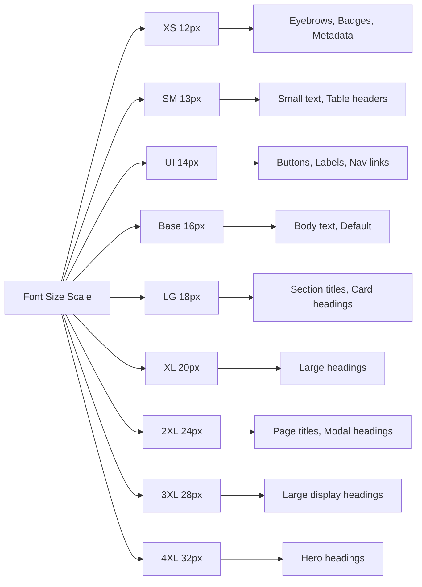

| Tên | Variable | Rem | Pixels | Line Height | Sử dụng | Ví dụ |
|-----|----------|-----|--------|-------------|---------|-------|
| XS | `--font-size-xs` | 0.75rem | 12px | 1.4 | Eyebrows, badges, metadata | Badges, Labels nhỏ |
| SM | `--font-size-sm` | 0.8125rem | 13px | 1.4 | Small text, table headers | Table headers, Helper text |
| UI | `--font-size-ui` | 0.875rem | 14px | 1.5 | Buttons, labels, nav links | Buttons, Form labels |
| Base | `--font-size-base` | 1rem | 16px | 1.6 | Body text, default | Paragraphs, Body content |
| LG | `--font-size-lg` | 1.125rem | 18px | 1.4 | Section titles, card headings | Card titles, Section headers |
| XL | `--font-size-xl` | 1.25rem | 20px | 1.4 | Large headings | Modal headings |
| 2XL | `--font-size-2xl` | 1.5rem | 24px | 1.35 | Page titles, modal headings | Page titles |
| 3XL | `--font-size-3xl` | 1.75rem | 28px | 1.3 | Large display headings | Hero text |
| 4XL | `--font-size-4xl` | 2rem | 32px | 1.3 | Hero headings | Landing page hero |

### Font Weight

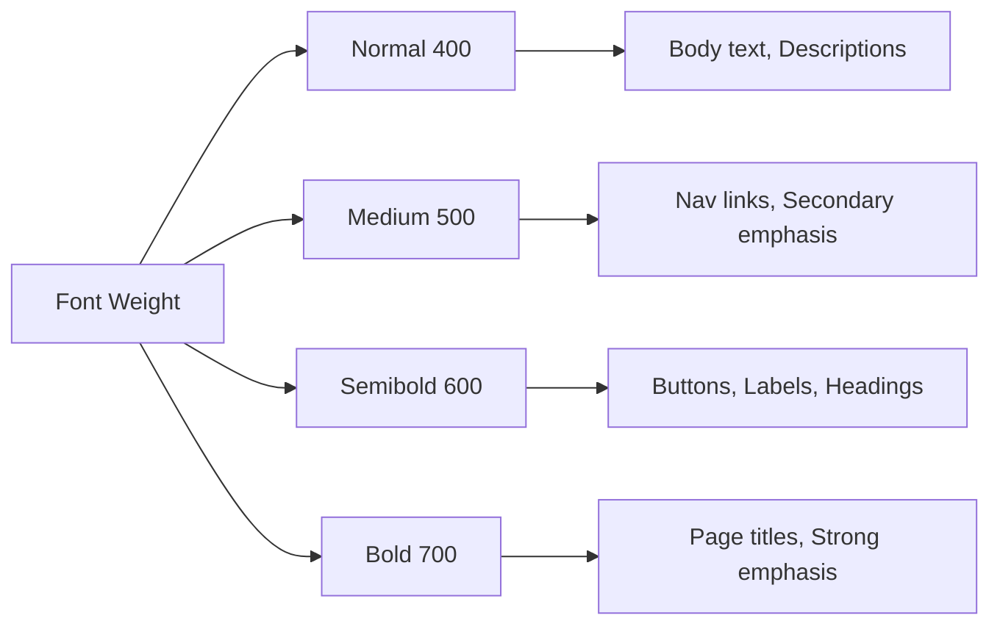

| Tên | Variable | Value | Sử dụng | Ví dụ |
|-----|----------|-------|---------|-------|
| Normal | `--font-weight-normal` | 400 | Body text, descriptions | Paragraphs, Descriptions |
| Medium | `--font-weight-medium` | 500 | Nav links, secondary emphasis | Sidebar links, Nav links |
| Semibold | `--font-weight-semibold` | 600 | Buttons, labels, headings | Buttons, Form labels, Section titles |
| Bold | `--font-weight-bold` | 700 | Page titles, strong emphasis | Page titles, Important headings |

### Line Height

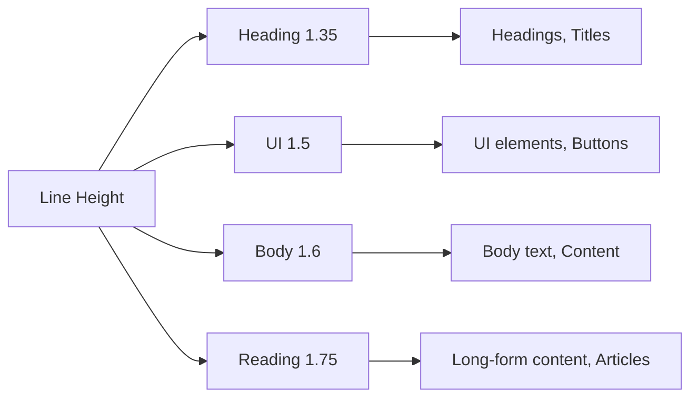

| Tên | Variable | Value | Sử dụng | Ví dụ |
|-----|----------|-------|---------|-------|
| Heading | `--line-height-heading` | 1.35 | Headings, titles | H1-H6, Page titles |
| UI | `--line-height-ui` | 1.5 | UI elements, buttons | Buttons, Form controls |
| Body | `--line-height-body` | 1.6 | Body text, content | Paragraphs, Lists |
| Reading | `--line-height-reading` | 1.75 | Long-form content, articles | Articles, Documentation |

### Typography Hierarchy

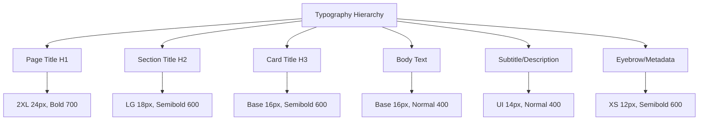

#### Page Title (H1)
```css
.page-title {
  font-size: var(--font-size-2xl);      /* 24px */
  font-weight: var(--font-weight-bold); /* 700 */
  line-height: var(--line-height-heading); /* 1.35 */
  color: var(--text-primary);
  letter-spacing: 0;
}
```

**Sử dụng**: Tiêu đề trang chính, modal headings

**Ví dụ HTML**:
```html
<h1 class="page-title">Quản lý môn học</h1>
```

#### Page Subtitle
```css
.page-subtitle {
  font-size: var(--font-size-ui);       /* 14px */
  font-weight: var(--font-weight-normal); /* 400 */
  line-height: var(--line-height-ui);   /* 1.5 */
  color: var(--text-secondary);
}
```

**Sử dụng**: Mô tả phụ, breadcrumb text

**Ví dụ HTML**:
```html
<p class="page-subtitle">Quản lý và soạn nội dung môn học lớp</p>
```

#### Section Title (H2)
```css
.section-title {
  font-size: var(--font-size-lg);       /* 18px */
  font-weight: var(--font-weight-semibold); /* 600 */
  line-height: 1.4;
  color: var(--text-primary);
  letter-spacing: 0;
}
```

**Sử dụng**: Tiêu đề section, card headers, modal content headings

**Ví dụ HTML**:
```html
<h2 class="section-title">Danh sách môn học</h2>
```

#### Card Title (H3)
```css
.card-title {
  font-size: var(--font-size-base);     /* 16px */
  font-weight: var(--font-weight-semibold); /* 600 */
  line-height: 1.4;
  color: var(--text-primary);
  margin: 0;
}
```

**Sử dụng**: Tiêu đề card, panel headers

**Ví dụ HTML**:
```html
<div class="app-card">
  <div class="card-header">
    <h3 class="card-title">Thống kê</h3>
  </div>
</div>
```

#### Eyebrow
```css
.eyebrow {
  font-size: var(--font-size-xs);       /* 12px */
  font-weight: var(--font-weight-semibold); /* 600 */
  line-height: var(--line-height-ui);   /* 1.5 */
  letter-spacing: 0;
  color: var(--text-secondary);
  text-transform: none;
}
```

**Sử dụng**: Category labels, metadata tags, small headers

**Ví dụ HTML**:
```html
<span class="eyebrow">TỔNG QUAN</span>
```

#### Form Label
```css
.form-label {
  font-size: var(--font-size-ui);       /* 14px */
  font-weight: var(--font-weight-semibold); /* 600 */
  line-height: 1.4;
  color: var(--text-primary);
  margin-bottom: 0.4rem;
}
```

**Sử dụng**: Form field labels, filter labels

**Ví dụ HTML**:
```html
<label class="form-label">Tên môn học</label>
```

#### Body Text
```css
body {
  font-size: var(--font-size-base);     /* 16px */
  font-weight: var(--font-weight-normal); /* 400 */
  line-height: var(--line-height-body); /* 1.6 */
  color: var(--text-primary);
}
```

**Sử dụng**: Mặc định cho toàn bộ nội dung

**Ví dụ HTML**:
```html
<p>Nội dung bài học sẽ hiển thị ở đây với font size base.</p>
```

#### Reading Content (Long-form)
```css
.lesson-html {
  font-size: 1.03125rem;                /* ~16.5px */
  font-weight: var(--font-weight-normal); /* 400 */
  line-height: var(--line-height-reading); /* 1.75 */
  max-width: 900px;
}

.lesson-html h1 {
  font-size: var(--font-size-3xl);      /* 28px */
  font-weight: var(--font-weight-bold); /* 700 */
  line-height: 1.3;
}

.lesson-html h2 {
  font-size: var(--font-size-2xl);      /* 24px */
  font-weight: var(--font-weight-bold); /* 700 */
  line-height: var(--line-height-heading); /* 1.35 */
}

.lesson-html h3 {
  font-size: var(--font-size-xl);       /* 20px */
  font-weight: var(--font-weight-semibold); /* 600 */
  line-height: 1.4;
}
```

**Sử dụng**: Nội dung bài học, tài liệu, articles

**Ví dụ HTML**:
```html
<div class="lesson-html">
  <h1>Giới thiệu về lập trình</h1>
  <p>Nội dung bài học với line-height rộng để dễ đọc...</p>
</div>
```

#### Tiny Text
```css
.tiny {
  font-size: var(--font-size-xs);       /* 12px */
  font-weight: var(--font-weight-normal); /* 400 */
  line-height: 1.4;
  color: var(--text-muted);
}
```

**Sử dụng**: Metadata, timestamps, helper text

**Ví dụ HTML**:
```html
<small class="tiny">Cập nhật: 15/01/2026</small>
```

### Typography trong Tables

#### Table Header
```css
.table thead th {
  font-size: var(--font-size-sm);       /* 13px */
  font-weight: var(--font-weight-semibold); /* 600 */
  line-height: 1.4;
  letter-spacing: 0;
  color: #fff;
  background: var(--eduvers-base);
  text-transform: uppercase;
}
```

**Ví dụ HTML**:
```html
<table class="table">
  <thead>
    <tr>
      <th>Tên</th>
      <th>Mã</th>
    </tr>
  </thead>
</table>
```

#### Table Cell
```css
.table tbody td {
  font-size: var(--font-size-ui);       /* 14px */
  font-weight: var(--font-weight-normal); /* 400 */
  line-height: 1.45;
  color: var(--ink-soft);
}
```

### Typography trong Buttons

#### Button Base
```css
.btn {
  font-size: var(--font-size-ui);       /* 14px */
  font-weight: var(--font-weight-semibold); /* 600 */
  line-height: 1.2;
  letter-spacing: 0;
}
```

#### Button Small
```css
.btn-sm {
  font-size: var(--font-size-sm);       /* 13px */
  font-weight: var(--font-weight-semibold); /* 600 */
}
```

**Ví dụ HTML**:
```html
<button class="btn btn-primary">Lưu</button>
<button class="btn btn-primary btn-sm">Lưu</button>
```

### Typography trong Badges

```css
.badge {
  font-size: var(--font-size-xs);       /* 12px */
  font-weight: var(--font-weight-semibold); /* 600 */
  line-height: 1.3;
  letter-spacing: 0.015em;
  border-radius: 4px;
  padding: 0.38rem 0.5rem;
}
```

**Ví dụ HTML**:
```html
<span class="badge badge-success">Đang hoạt động</span>
<span class="badge badge-soft-success">Hoàn thành</span>
```

### Typography trong Navigation

#### Sidebar Link
```css
.sidebar .side-link {
  font-size: var(--font-size-ui);       /* 14px */
  font-weight: var(--font-weight-medium); /* 500 */
  line-height: 1.4;
}
```

#### Navbar Link
```css
.lms-nav .nav-link {
  font-size: var(--font-size-ui);       /* 14px */
  font-weight: var(--font-weight-medium); /* 500 */
  line-height: 1.4;
}
```

### Typography trong Curriculum (Sidebar môn học)

#### Chapter Heading
```css
.curriculum-heading strong {
  font-size: var(--font-size-base);     /* 16px */
  font-weight: var(--font-weight-bold); /* 700 */
  line-height: 1.4;
}
```

#### Chapter Toggle
```css
.chapter-toggle strong {
  font-size: var(--font-size-ui);       /* 14px */
  font-weight: var(--font-weight-semibold); /* 600 */
  line-height: 1.4;
}
```

#### Lesson Link
```css
.chapter a strong {
  font-size: var(--font-size-sm);       /* 13px */
  font-weight: var(--font-weight-semibold); /* 600 */
  line-height: 1.45;
}
```

### Typography trong Quiz & Bài tập

#### Question Heading
```css
.quiz-question h3 {
  font-size: var(--font-size-base);     /* 16px */
  font-weight: var(--font-weight-semibold); /* 600 */
  line-height: 1.55;
}
```

#### Answer Option
```css
.quiz-option {
  font-size: var(--font-size-ui);       /* 14px */
  font-weight: var(--font-weight-normal); /* 400 */
  line-height: 1.55;
}
```

### Typography trong Comments

#### Comment Author
```css
.comment-body header strong {
  font-size: var(--font-size-ui);       /* 14px */
  font-weight: var(--font-weight-semibold); /* 600 */
}
```

#### Comment Content
```css
.comment-content {
  font-size: var(--font-size-ui);       /* 14px */
  font-weight: var(--font-weight-normal); /* 400 */
  line-height: 1.55;
}
```

### Responsive Typography

```css
@media (max-width: 767px) {
  #app :where(.page-title, .app-page-header .page-title) {
    font-size: var(--font-size-xl);      /* 20px */
  }

  #app :where(.section-title, .discussion-heading h2) {
    font-size: 1.0625rem;                /* 17px */
  }

  #app .login-page .form-heading h2 {
    font-size: var(--font-size-xl);      /* 20px */
  }

  #app :where(.lesson-html, .docx-preview-content) {
    font-size: var(--font-size-base);    /* 16px */
  }
}
```

### Typography Best Practices

#### Do's
```css
/* ✓ Sử dụng CSS variables cho tất cả font sizes */
h1 {
  font-size: var(--font-size-2xl);
}

/* ✓ Sử dụng line-height phù hợp với context */
.heading {
  line-height: var(--line-height-heading);
}

.body-text {
  line-height: var(--line-height-body);
}

/* ✓ Sử dụng font weight semibold cho emphasis */
.button {
  font-weight: var(--font-weight-semibold);
}
```

#### Don'ts
```css
/* ✗ Không hardcode font sizes */
h1 {
  font-size: 24px; /* ✗ Sai */
}

/* ✗ Không dùng font weight quá nặng cho body text */
p {
  font-weight: 700; /* ✗ Sai - quá nặng */
}

/* ✗ Không dùng line-height quá chặt */
.some-text {
  line-height: 1; /* ✗ Sai - khó đọc */
}
```

## Spacing

### Spacing Scale

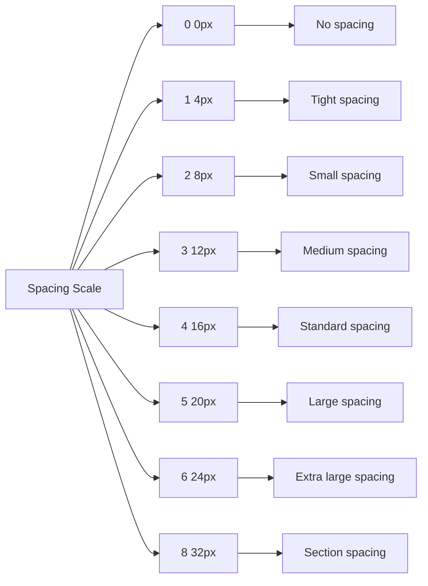

| Tên | Rem | Pixels | Sử dụng | Ví dụ |
|-----|-----|--------|---------|-------|
| 0 | 0 | 0px | No spacing | Collapsed elements |
| 1 | 0.25rem | 4px | Tight spacing | Icon spacing, Badge padding |
| 2 | 0.5rem | 8px | Small spacing | Button padding, Small gaps |
| 3 | 0.75rem | 12px | Medium spacing | Form gap, Small margins |
| 4 | 1rem | 16px | Standard spacing | Card padding, Standard margins |
| 5 | 1.25rem | 20px | Large spacing | Section padding |
| 6 | 1.5rem | 24px | Extra large spacing | Large section padding |
| 8 | 2rem | 32px | Section spacing | Page sections |

### Layout Spacing

| Tên | Variable | Value | Sử dụng |
|-----|----------|-------|---------|
| Sidebar Width | `--sidebar-width` | 252px | CMS sidebar |
| Topbar Height | `--topbar-height` | 68px | CMS topbar |

### Component Spacing

```css
/* Card padding */
.app-card {
  padding: 1rem; /* 16px */
}

.card-header {
  padding: 1rem 1.15rem;
}

.card-body {
  padding: 1rem 1.15rem;
}

/* Button gap */
.gap-2 {
  gap: 0.5rem; /* 8px */
}

.gap-3 {
  gap: 0.75rem; /* 12px */
}

/* Margin bottom utilities */
.mb-3 {
  margin-bottom: 0.75rem; /* 12px */
}

.mb-4 {
  margin-bottom: 1rem; /* 16px */
}

/* Gap utilities */
.gap-1 {
  gap: 0.25rem; /* 4px */
}

.gap-2 {
  gap: 0.5rem; /* 8px */
}

.gap-3 {
  gap: 0.75rem; /* 12px */
}

.gap-4 {
  gap: 1rem; /* 16px */
}
```

### Spacing Examples

```html
<!-- Button group with gap -->
<div class="d-flex gap-2">
  <button class="btn btn-primary">Lưu</button>
  <button class="btn btn-secondary">Hủy</button>
</div>

<!-- Card with padding -->
<div class="app-card p-4">
  <h3 class="card-title mb-3">Tiêu đề</h3>
  <p>Nội dung card</p>
</div>

<!-- Form with spacing -->
<div class="form-group mb-3">
  <label class="form-label">Tên</label>
  <input type="text" class="form-control" />
</div>
<div class="form-group mb-3">
  <label class="form-label">Email</label>
  <input type="email" class="form-control" />
</div>
```

## Border Radius

| Tên | Variable | Value | Sử dụng |
|-----|----------|-------|---------|
| Card Radius | `--card-radius` | 5px | Cards, panels |
| Control Radius | `--control-radius` | 5px | Inputs, buttons |

## Icons System

### Icon Overview

Icons sử dụng Google Material Icons với consistent sizing và coloring để đảm bảo visual consistency.

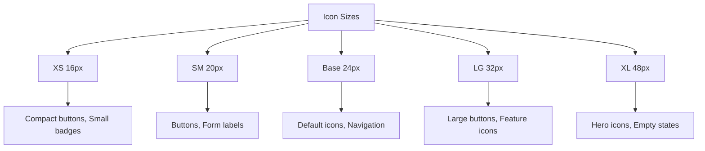

### Icon Size Tokens

| Tên | Variable | Pixels | Line Height | Sử dụng | Ví dụ |
|-----|----------|--------|-------------|---------|-------|
| XS | `--icon-size-xs` | 16px | 1 | Compact buttons, small badges | Compact button icon, Small badge icon |
| SM | `--icon-size-sm` | 20px | 1 | Buttons, form labels | Button icon, Label icon |
| Base | `--icon-size-base` | 24px | 1 | Default icons, navigation | Default icon, Menu icon |
| LG | `--icon-size-lg` | 32px | 1 | Large buttons, feature icons | Large button icon, Feature icon |
| XL | `--icon-size-xl` | 48px | 1 | Hero icons, empty states | Hero icon, Empty state icon |

### Icon Color Mapping

| Context | Variable | Sử dụng |
|---------|----------|---------|
| Primary | `--text-primary` | Default icons in light backgrounds |
| Secondary | `--text-secondary` | Less prominent icons |
| Muted | `--text-muted` | Disabled icons, helper icons |
| On Primary | `--text-on-primary` | Icons on brand color backgrounds |
| On Dark | `--text-on-primary` | Icons on dark backgrounds |
| Brand Green | `--brand-green` | Accent icons, active states |
| Brand Blue | `--brand-blue` | Info icons, secondary actions |
| Brand Red | `--brand-red` | Error icons, delete actions |
| Brand Success | `--brand-success` | Success icons |
| Brand Yellow | `--brand-yellow` | Warning icons |

### Icon Usage Guidelines

#### Material Icons Import

```html
<!-- Trong index.html -->
<link rel="stylesheet" href="https://fonts.googleapis.com/css2?family=Material+Symbols+Outlined:opsz,wght,FILL,GRAD@20..48,100..700,0..1,-50..200" />
```

#### Icon Sizes

```css
/* XS icon */
.icon-xs {
  font-size: var(--icon-size-xs);
  line-height: 1;
}

/* SM icon */
.icon-sm {
  font-size: var(--icon-size-sm);
  line-height: 1;
}

/* Base icon */
.icon {
  font-size: var(--icon-size-base);
  line-height: 1;
}

/* LG icon */
.icon-lg {
  font-size: var(--icon-size-lg);
  line-height: 1;
}

/* XL icon */
.icon-xl {
  font-size: var(--icon-size-xl);
  line-height: 1;
}
```

#### Icon Colors

```css
/* Primary icon */
.icon-primary {
  color: var(--text-primary);
}

/* Secondary icon */
.icon-secondary {
  color: var(--text-secondary);
}

/* Muted icon */
.icon-muted {
  color: var(--text-muted);
}

/* Brand icon */
.icon-brand {
  color: var(--brand-green);
}

/* Success icon */
.icon-success {
  color: var(--brand-success);
}

/* Error icon */
.icon-error {
  color: var(--brand-red);
}

/* Warning icon */
.icon-warning {
  color: var(--brand-yellow);
}
```

#### Icon with Text

```css
/* Icon + text button */
.btn-icon-text {
  display: inline-flex;
  align-items: center;
  gap: var(--spacing-xs);
}

.btn-icon-text .material-symbols-outlined {
  font-size: var(--icon-size-sm);
}

/* Icon in label */
.label-with-icon {
  display: inline-flex;
  align-items: center;
  gap: var(--spacing-xs);
}

.label-with-icon .material-symbols-outlined {
  font-size: var(--icon-size-sm);
  color: var(--text-secondary);
}
```

#### Standalone Icon Button

```css
/* Icon-only button */
.btn-icon {
  display: inline-flex;
  align-items: center;
  justify-content: center;
  width: 36px;
  height: 36px;
  padding: 0;
  border-radius: var(--radius-sm);
  background: transparent;
  border: none;
  cursor: pointer;
  transition: background-color var(--transition-fast) var(--ease-out);
}

.btn-icon .material-symbols-outlined {
  font-size: var(--icon-size-base);
  color: var(--text-secondary);
}

.btn-icon:hover {
  background-color: var(--surface-hover);
}

.btn-icon:hover .material-symbols-outlined {
  color: var(--text-primary);
}
```

#### Icon in Badge

```css
/* Badge with icon */
.badge-icon {
  display: inline-flex;
  align-items: center;
  gap: var(--spacing-xs);
  padding: var(--spacing-xs) var(--spacing-sm);
  border-radius: var(--radius-full);
  font-size: var(--font-size-xs);
  font-weight: var(--font-weight-semibold);
}

.badge-icon .material-symbols-outlined {
  font-size: var(--icon-size-xs);
}
```

### Common Icons

| Icon Name | Material Icon Name | Use Case |
|-----------|-------------------|----------|
| Close | `close` | Close modals, dismiss notifications |
| Search | `search` | Search inputs, search buttons |
| Menu | `menu` | Menu toggle, hamburger menu |
| More Vert | `more_vert` | Action menus, overflow |
| More Horiz | `more_horiz` | Horizontal action menus |
| Add | `add` | Add new items, create |
| Delete | `delete` | Delete items, remove |
| Edit | `edit` | Edit items, modify |
| Save | `save` | Save changes |
| Check | `check` | Success, completed, selected |
| Arrow Down | `arrow_downward` | Dropdowns, expand |
| Arrow Up | `arrow_upward` | Collapse, move up |
| Arrow Back | `arrow_back` | Back navigation |
| Arrow Forward | `arrow_forward` | Forward navigation |
| Filter | `filter_list` | Filter options |
| Sort | `sort` | Sort options |
| Refresh | `refresh` | Refresh content, reload |
| Download | `download` | Download files |
| Upload | `upload` | Upload files |
| Attach File | `attach_file` | Attachments |
| Star | `star` | Favorites, ratings |
| Star Border | `star_border` | Unfavorited, unrated |
| Favorite | `favorite` | Favorites |
| Favorite Border | `favorite_border` | Unfavorited |
| Visibility | `visibility` | Show password, view |
| Visibility Off | `visibility_off` | Hide password |
| Notifications | `notifications` | Notifications bell |
| Settings | `settings` | Settings, configuration |
| Help | `help` | Help, documentation |
| Info | `info` | Information, tooltips |
| Warning | `warning` | Warnings, alerts |
| Error | `error` | Errors, validation |
| Success | `check_circle` | Success states |
| Account | `account_circle` | User avatar, profile |
| Email | `email` | Email inputs |
| Phone | `phone` | Phone inputs |
| Location | `location_on` | Location, address |
| Calendar | `calendar_today` | Date inputs, calendar |
| Clock | `schedule` | Time, scheduling |
| Folder | `folder` | Folders, directories |
| File | `description` | Files, documents |
| Image | `image` | Images, photos |
| Video | `videocam` | Videos |
| Link | `link` | Links, URLs |
| Copy | `content_copy` | Copy to clipboard |
| Print | `print` | Print |
| Share | `share` | Share content |

### Icon Best Practices

```css
/* ✓ Sử dụng CSS variables cho icon sizes */
.icon {
  font-size: var(--icon-size-base);
}

/* ✓ Sử dụng appropriate icon sizes cho context */
.button-icon {
  font-size: var(--icon-size-sm); /* Smaller for buttons */
}

.hero-icon {
  font-size: var(--icon-size-xl); /* Larger for hero */
}

/* ✓ Sử dụng consistent colors */
.icon-primary {
  color: var(--text-primary);
}

.icon-brand {
  color: var(--brand-green);
}

/* ✗ Không hardcode icon sizes */
.icon {
  font-size: 24px; /* ✗ Sai */
}

/* ✗ Không dùng quá nhiều icon sizes trong cùng một context */
.icon-1 { font-size: 16px; }
.icon-2 { font-size: 18px; }
.icon-3 { font-size: 20px; } /* ✗ Inconsistent */

/* ✗ Không dùng icon colors không phù hợp với context */
.error-icon {
  color: var(--brand-success); /* ✗ Sai - nên dùng brand-red */
}
```

### Accessibility for Icons

```html
<!-- Icon button với aria-label -->
<button class="btn-icon" aria-label="Close">
  <span class="material-symbols-outlined">close</span>
</button>

<!-- Icon với text - icon decorative -->
<span class="icon-text">
  <span class="material-symbols-outlined" aria-hidden="true">search</span>
  Search
</span>

<!-- Standalone icon với aria-label -->
<span class="material-symbols-outlined" role="img" aria-label="Success">check_circle</span>
```

## Icons

### Icon Library

**Primary**: Bootstrap Icons 1.13.1

**CDN Link** (trong `index.html`):
```html
<link rel="stylesheet" href="https://cdn.jsdelivr.net/npm/bootstrap-icons@1.13.1/font/bootstrap-icons.css">
```

**Sử dụng**:
```html
<i class="bi bi-search"></i>
<i class="bi bi-person"></i>
<i class="bi bi-arrow-right"></i>
```

### Icon Categories

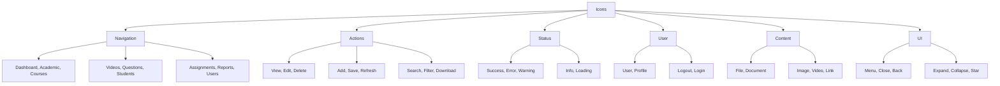

#### Navigation Icons

| Icon | Class | Sử dụng | Ví dụ |
|------|-------|---------|-------|
| Dashboard | `bi-grid` | Dashboard | <i class="bi bi-grid"></i> |
| Academic | `bi-building` | Cơ cấu đào tạo | <i class="bi bi-building"></i> |
| Courses | `bi-journals` | Môn học | <i class="bi bi-journals"></i> |
| Videos | `bi-play-btn` | Video | <i class="bi bi-play-btn"></i> |
| Questions | `bi-patch-question` | Câu hỏi | <i class="bi bi-patch-question"></i> |
| Students | `bi-people` | Học viên | <i class="bi bi-people"></i> |
| Assignments | `bi-clipboard-check` | Bài tập | <i class="bi bi-clipboard-check"></i> |
| Reports | `bi-bar-chart` | Báo cáo | <i class="bi bi-bar-chart"></i> |
| Users | `bi-person-gear` | Người dùng | <i class="bi bi-person-gear"></i> |
| Roles | `bi-shield-lock` | Phân quyền | <i class="bi bi-shield-lock"></i> |
| Settings | `bi-gear` | Cài đặt | <i class="bi bi-gear"></i> |

#### Action Icons

| Icon | Class | Sử dụng | Ví dụ |
|------|-------|---------|-------|
| View | `bi-eye` | Xem chi tiết | <i class="bi bi-eye"></i> |
| Edit | `bi-pencil` | Chỉnh sửa | <i class="bi bi-pencil"></i> |
| Delete | `bi-trash` | Xóa | <i class="bi bi-trash"></i> |
| Add | `bi-plus` | Thêm mới | <i class="bi bi-plus"></i> |
| Save | `bi-floppy` | Lưu | <i class="bi bi-floppy"></i> |
| Refresh | `bi-arrow-clockwise` | Làm mới | <i class="bi bi-arrow-clockwise"></i> |
| Search | `bi-search` | Tìm kiếm | <i class="bi bi-search"></i> |
| Filter | `bi-funnel` | Bộ lọc | <i class="bi bi-funnel"></i> |
| Download | `bi-download` | Tải xuống | <i class="bi bi-download"></i> |
| Upload | `bi-upload` | Tải lên | <i class="bi bi-upload"></i> |
| Export | `bi-box-arrow-right` | Xuất | <i class="bi bi-box-arrow-right"></i> |
| Import | `bi-box-arrow-in-right` | Nhập | <i class="bi bi-box-arrow-in-right"></i> |
| Copy | `bi-copy` | Sao chép | <i class="bi bi-copy"></i> |
| Share | `bi-share` | Chia sẻ | <i class="bi bi-share"></i> |
| Print | `bi-printer` | In | <i class="bi bi-printer"></i> |

#### Status Icons

| Icon | Class | Sử dụng | Ví dụ |
|------|-------|---------|-------|
| Success | `bi-check-circle` | Thành công | <i class="bi bi-check-circle"></i> |
| Error | `bi-exclamation-circle` | Lỗi | <i class="bi bi-exclamation-circle"></i> |
| Warning | `bi-exclamation-triangle` | Cảnh báo | <i class="bi bi-exclamation-triangle"></i> |
| Info | `bi-info-circle` | Thông tin | <i class="bi bi-info-circle"></i> |
| Loading | `bi-arrow-repeat` (spin) | Đang tải | <i class="bi bi-arrow-repeat spin-icon"></i> |
| Check | `bi-check` | Đã hoàn thành | <i class="bi bi-check"></i> |
| X | `bi-x` | Đóng/Hủy | <i class="bi bi-x"></i> |

#### User Icons

| Icon | Class | Sử dụng | Ví dụ |
|------|-------|---------|-------|
| User | `bi-person` | Người dùng | <i class="bi bi-person"></i> |
| Profile | `bi-person-circle` | Hồ sơ | <i class="bi bi-person-circle"></i> |
| Logout | `bi-box-arrow-right` | Đăng xuất | <i class="bi bi-box-arrow-right"></i> |
| Login | `bi-box-arrow-in-right` | Đăng nhập | <i class="bi bi-box-arrow-in-right"></i> |
| Users | `bi-people` | Danh sách người dùng | <i class="bi bi-people"></i> |
| User Plus | `bi-person-plus` | Thêm người dùng | <i class="bi bi-person-plus"></i> |

#### Content Icons

| Icon | Class | Sử dụng | Ví dụ |
|------|-------|---------|-------|
| File | `bi-file-earmark` | File | <i class="bi bi-file-earmark"></i> |
| Document | `bi-file-earmark-text` | Tài liệu | <i class="bi bi-file-earmark-text"></i> |
| Image | `bi-image` | Hình ảnh | <i class="bi bi-image"></i> |
| Video | `bi-play-circle` | Video | <i class="bi bi-play-circle"></i> |
| Link | `bi-link-45deg` | Liên kết | <i class="bi bi-link-45deg"></i> |
| Attachment | `bi-paperclip` | Đính kèm | <i class="bi bi-paperclip"></i> |
| Folder | `bi-folder` | Thư mục | <i class="bi bi-folder"></i> |
| Archive | `bi-archive` | Lưu trữ | <i class="bi bi-archive"></i> |

#### UI Icons

| Icon | Class | Sử dụng | Ví dụ |
|------|-------|---------|-------|
| Menu | `bi-list` | Menu toggle | <i class="bi bi-list"></i> |
| Close | `bi-x` | Đóng | <i class="bi bi-x"></i> |
| Back | `bi-arrow-left` | Quay lại | <i class="bi bi-arrow-left"></i> |
| Forward | `bi-arrow-right` | Tiếp tục | <i class="bi bi-arrow-right"></i> |
| Up | `bi-arrow-up` | Lên | <i class="bi bi-arrow-up"></i> |
| Down | `bi-arrow-down` | Xuống | <i class="bi bi-arrow-down"></i> |
| Expand | `bi-arrows-fullscreen` | Mở rộng | <i class="bi bi-arrows-fullscreen"></i> |
| Collapse | `bi-arrows-angle-contract` | Thu gọn | <i class="bi bi-arrows-angle-contract"></i> |
| Star | `bi-star` | Yêu thích | <i class="bi bi-star"></i> |
| Star Fill | `bi-star-fill` | Đã yêu thích | <i class="bi bi-star-fill"></i> |
| Heart | `bi-heart` | Thích | <i class="bi bi-heart"></i> |
| Heart Fill | `bi-heart-fill` | Đã thích | <i class="bi bi-heart-fill"></i> |
| Bell | `bi-bell` | Thông báo | <i class="bi bi-bell"></i> |
| Bell Fill | `bi-bell-fill` | Có thông báo | <i class="bi bi-bell-fill"></i> |
| Clock | `bi-clock` | Thời gian | <i class="bi bi-clock"></i> |
| Calendar | `bi-calendar` | Lịch | <i class="bi bi-calendar"></i> |
| Location | `bi-geo-alt` | Địa điểm | <i class="bi bi-geo-alt"></i> |
| Phone | `bi-telephone` | Điện thoại | <i class="bi bi-telephone"></i> |
| Email | `bi-envelope` | Email | <i class="bi bi-envelope"></i> |

### Icon Sizes

```css
.icon-xs {
  font-size: 0.75rem; /* 12px */
}

.icon-sm {
  font-size: 0.875rem; /* 14px */
}

.icon-base {
  font-size: 1rem; /* 16px */
}

.icon-lg {
  font-size: 1.25rem; /* 20px */
}

.icon-xl {
  font-size: 1.5rem; /* 24px */
}

.icon-2xl {
  font-size: 2rem; /* 32px */
}

.icon-3xl {
  font-size: 3rem; /* 48px */
}
```

**HTML**:
```html
<i class="bi bi-search icon-xs"></i>
<i class="bi bi-search icon-sm"></i>
<i class="bi bi-search icon-base"></i>
<i class="bi bi-search icon-lg"></i>
<i class="bi bi-search icon-xl"></i>
<i class="bi bi-search icon-2xl"></i>
<i class="bi bi-search icon-3xl"></i>
```

### Icon with Spin Animation

```css
.spin-icon {
  animation: spin 1s linear infinite;
}

@keyframes spin {
  from {
    transform: rotate(0deg);
  }
  to {
    transform: rotate(360deg);
  }
}
```

**HTML**:
```html
<i class="bi bi-arrow-repeat spin-icon"></i>
```

### Icon in Buttons

```html
<!-- Icon only -->
<button class="btn btn-action-view btn-icon" aria-label="Xem">
  <i class="bi bi-eye"></i>
</button>

<!-- Icon + text -->
<button class="btn btn-primary">
  <i class="bi bi-save"></i> Lưu
</button>

<!-- Text + icon -->
<button class="btn btn-primary">
  Lưu <i class="bi bi-save ms-1"></i>
</button>
```

### Solar Menu Icons

**Custom SVG icons** cho sidebar CMS:
- Component: `SolarMenuIcon.vue`
- Icons: dashboard, academic, courses, videos, questions, students, assignments, reports, users, roles, settings

**Usage**:
```html
<SolarMenuIcon name="dashboard" />
<SolarMenuIcon name="courses" />
```

### Icon Best Practices

#### Do's
```html
<!-- ✓ Sử dụng aria-label cho icon-only buttons -->
<button class="btn btn-icon" aria-label="Đóng">
  <i class="bi bi-x"></i>
</button>

<!-- ✓ Sử dụng icon có ý nghĩa phù hợp -->
<button class="btn btn-action-delete">
  <i class="bi bi-trash"></i> Xóa
</button>

<!-- ✓ Sử dụng icon size phù hợp với context -->
<h1><i class="bi bi-gear icon-2xl"></i> Cài đặt</h1>
```

#### Don'ts
```html
<!-- ✗ Không dùng icon mà không có aria-label -->
<button class="btn btn-icon">
  <i class="bi bi-x"></i>
</button>

<!-- ✗ Không dùng icon không phù hợp với action -->
<button class="btn btn-action-delete">
  <i class="bi bi-heart"></i> Xóa
</button>

<!-- ✗ Không dùng icon quá lớn cho text nhỏ -->
<small><i class="bi bi-gear icon-3xl"></i> Settings</small>
```

## Spacing Scale System

### Spacing Overview

Spacing scale sử dụng base unit 4px với multiplicative pattern để đảm bảo consistency toàn bộ UI.

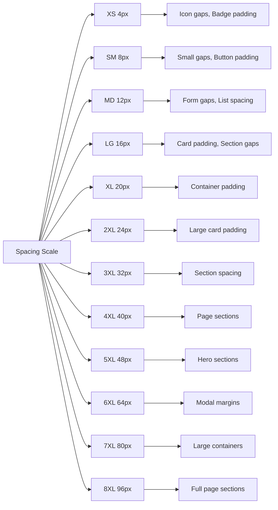

### Spacing Tokens

| Tên | Variable | Pixels | Sử dụng | Ví dụ |
|-----|----------|--------|---------|-------|
| XS | `--spacing-xs` | 4px | Icon gaps, badge padding | Icon + text gap, Badge padding |
| SM | `--spacing-sm` | 8px | Small gaps, button padding | Button padding, List item gap |
| MD | `--spacing-md` | 12px | Form gaps, list spacing | Form fields gap, Card list spacing |
| LG | `--spacing-lg` | 16px | Card padding, section gaps | Card body padding, Section gap |
| XL | `--spacing-xl` | 20px | Container padding | Modal body padding |
| 2XL | `--spacing-2xl` | 24px | Large card padding | Large card body padding |
| 3XL | `--spacing-3xl` | 32px | Section spacing | Section vertical spacing |
| 4XL | `--spacing-4xl` | 40px | Page sections | Page section gap |
| 5XL | `--spacing-5xl` | 48px | Hero sections | Hero content spacing |
| 6XL | `--spacing-6xl` | 64px | Modal margins | Modal vertical margin |
| 7XL | `--spacing-7xl` | 80px | Large containers | Container max margin |
| 8XL | `--spacing-8xl` | 96px | Full page sections | Full page sections |

### Spacing Usage Guidelines

#### Padding

```css
/* Small elements */
.badge {
  padding: var(--spacing-xs) var(--spacing-sm);
}

/* Buttons */
.btn {
  padding: var(--spacing-sm) var(--spacing-lg);
}

/* Cards */
.card {
  padding: var(--spacing-lg);
}

/* Large cards */
.card-large {
  padding: var(--spacing-2xl);
}

/* Modals */
.modal-body {
  padding: var(--spacing-xl);
}
```

#### Margin

```css
/* Small gaps */
.icon + .text {
  margin-left: var(--spacing-xs);
}

/* Section gaps */
.section {
  margin-bottom: var(--spacing-3xl);
}

/* Page sections */
.page-section {
  margin-bottom: var(--spacing-4xl);
}

/* Hero sections */
.hero-section {
  margin-bottom: var(--spacing-5xl);
}
```

#### Gap (Flexbox/Grid)

```css
/* Form fields */
.form-group {
  display: flex;
  flex-direction: column;
  gap: var(--spacing-md);
}

/* Card list */
.card-list {
  display: flex;
  flex-direction: column;
  gap: var(--spacing-lg);
}

/* Grid items */
.grid {
  display: grid;
  gap: var(--spacing-xl);
}
```

## Shadows System

### Shadow Overview

Shadows được sử dụng để tạo depth và hierarchy cho UI elements với 6 levels từ subtle đến dramatic.

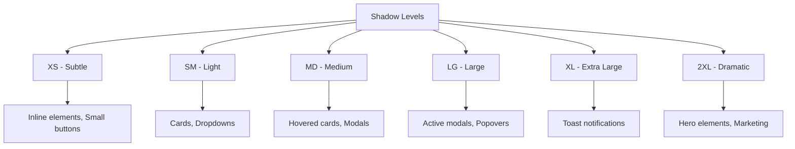

### Shadow Tokens

| Tên | Variable | CSS Value | Elevation | Sử dụng | Ví dụ |
|-----|----------|-----------|-----------|---------|-------|
| XS | `--shadow-xs` | 0 1px 2px rgba(0, 0, 0, 0.05) | 1px | Inline elements, small buttons | Badge, Small button |
| SM | `--shadow-sm` | 0 1px 3px rgba(0, 0, 0, 0.1), 0 1px 2px rgba(0, 0, 0, 0.06) | 2px | Cards, dropdowns | Card, Dropdown menu |
| MD | `--shadow-md` | 0 4px 6px rgba(0, 0, 0, 0.1), 0 2px 4px rgba(0, 0, 0, 0.06) | 4px | Hovered cards, modals | Card hover, Modal |
| LG | `--shadow-lg` | 0 10px 15px rgba(0, 0, 0, 0.1), 0 4px 6px rgba(0, 0, 0, 0.05) | 8px | Active modals, popovers | Active modal, Popover |
| XL | `--shadow-xl` | 0 20px 25px rgba(0, 0, 0, 0.1), 0 10px 10px rgba(0, 0, 0, 0.04) | 16px | Toast notifications | Toast, Notification |
| 2XL | `--shadow-2xl` | 0 25px 50px rgba(0, 0, 0, 0.15) | 24px | Hero elements, marketing | Hero card, Marketing element |

### Shadow Usage Guidelines

#### Default State

```css
/* Cards without shadow by default */
.card {
  box-shadow: none;
  border: 1px solid var(--neutral-line);
}

/* Cards with subtle shadow */
.card-elevated {
  box-shadow: var(--shadow-sm);
}
```

#### Hover State

```css
/* Card hover effect */
.card:hover {
  box-shadow: var(--shadow-md);
  transform: translateY(-2px);
  transition: box-shadow var(--transition-normal), transform var(--transition-normal);
}
```

#### Active/Focus State

```css
/* Modal shadow */
.modal {
  box-shadow: var(--shadow-lg);
}

/* Popover shadow */
.popover {
  box-shadow: var(--shadow-lg);
}
```

#### Toast/Notification

```css
/* Toast notification */
.toast {
  box-shadow: var(--shadow-xl);
}
```

#### Special Cases

```css
/* Hero marketing element */
.hero-card {
  box-shadow: var(--shadow-2xl);
}

/* Button hover (subtle) */
.btn:hover {
  box-shadow: var(--shadow-xs);
}
```

### Shadow Don'ts

```css
/* ✗ Không hardcode shadow values */
.card {
  box-shadow: 0 4px 6px rgba(0, 0, 0, 0.1); /* ✗ Sai */
}

/* ✗ Không dùng quá nhiều shadow levels cho cùng một type */
.card-1 { box-shadow: var(--shadow-sm); }
.card-2 { box-shadow: var(--shadow-md); }
.card-3 { box-shadow: var(--shadow-lg); } /* ✗ Inconsistent */

/* ✗ Không dùng shadow trên inline text */
.text {
  box-shadow: var(--shadow-sm); /* ✗ Sai */
}
```

## Border Radius System

### Border Radius Overview

Border radius scale sử dụng base unit 4px với rounded values để tạo consistency cho corners.

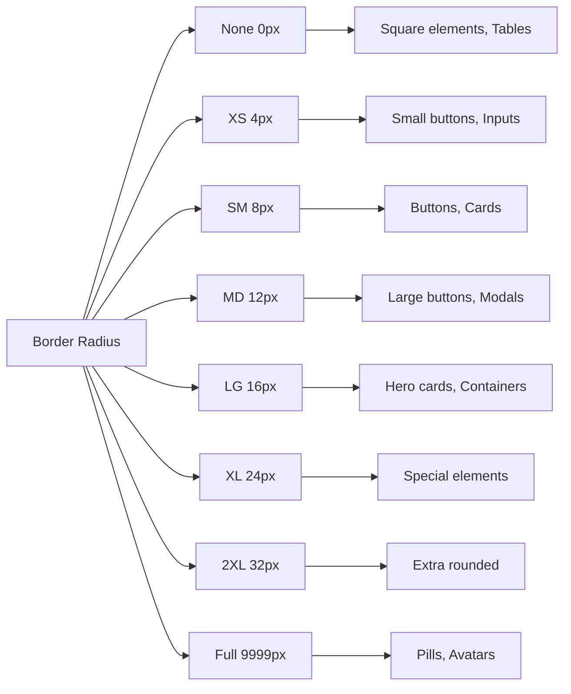

### Border Radius Tokens

| Tên | Variable | Pixels | Sử dụng | Ví dụ |
|-----|----------|--------|---------|-------|
| None | `--radius-none` | 0px | Square elements, tables | Table cells, Square buttons |
| XS | `--radius-xs` | 4px | Small buttons, inputs | Small button, Input field |
| SM | `--radius-sm` | 8px | Buttons, cards | Standard button, Card |
| MD | `--radius-md` | 12px | Large buttons, modals | Large button, Modal |
| LG | `--radius-lg` | 16px | Hero cards, containers | Hero card, Container |
| XL | `--radius-xl` | 24px | Special elements | Special card |
| 2XL | `--radius-2xl` | 32px | Extra rounded | Extra rounded element |
| Full | `--radius-full` | 9999px | Pills, avatars, badges | Pill button, Avatar, Badge |

### Border Radius Usage Guidelines

#### Buttons

```css
/* Standard button */
.btn {
  border-radius: var(--radius-sm);
}

/* Large button */
.btn-lg {
  border-radius: var(--radius-md);
}

/* Pill button */
.btn-pill {
  border-radius: var(--radius-full);
}
```

#### Cards

```css
/* Standard card */
.card {
  border-radius: var(--radius-sm);
}

/* Large card */
.card-large {
  border-radius: var(--radius-md);
}

/* Hero card */
.hero-card {
  border-radius: var(--radius-lg);
}
```

#### Inputs

```css
/* Input field */
.input {
  border-radius: var(--radius-xs);
}

/* Search input */
.search-input {
  border-radius: var(--radius-full);
}
```

#### Modals

```css
/* Modal */
.modal {
  border-radius: var(--radius-md);
}
```

#### Badges & Tags

```css
/* Badge */
.badge {
  border-radius: var(--radius-xs);
}

/* Pill badge */
.badge-pill {
  border-radius: var(--radius-full);
}
```

#### Avatars

```css
/* Avatar */
.avatar {
  border-radius: var(--radius-full);
}
```

#### Tables

```css
/* Table cells - no radius */
.table td,
.table th {
  border-radius: var(--radius-none);
}
```

### Border Radius Don'ts

```css
/* ✗ Không hardcode border radius */
.card {
  border-radius: 8px; /* ✗ Sai */
}

/* ✗ Không dùng inconsistent radius cho cùng một type */
.card-1 { border-radius: var(--radius-sm); }
.card-2 { border-radius: var(--radius-md); } /* ✗ Inconsistent */

/* ✗ Không dùng quá rounded cho table cells */
.table td {
  border-radius: var(--radius-full); /* ✗ Sai */
}
```

## Z-Index Scale

### Z-Index Overview

Z-Index scale được sử dụng để quản lý layering và stacking order của UI elements.

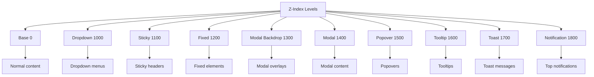

### Z-Index Tokens

| Tên | Variable | Value | Sử dụng | Ví dụ |
|-----|----------|-------|---------|-------|
| Base | `--z-index-base` | 0 | Normal content | Page content, Cards |
| Dropdown | `--z-index-dropdown` | 1000 | Dropdown menus | Select dropdown, Menu |
| Sticky | `--z-index-sticky` | 1100 | Sticky elements | Sticky header, Sticky sidebar |
| Fixed | `--z-index-fixed` | 1200 | Fixed elements | Fixed header, Fixed sidebar |
| Modal Backdrop | `--z-index-modal-backdrop` | 1300 | Modal overlay | Modal backdrop |
| Modal | `--z-index-modal` | 1400 | Modal content | Modal dialog |
| Popover | `--z-index-popover` | 1500 | Popovers | Popover, Dropdown with button |
| Tooltip | `--z-index-tooltip` | 1600 | Tooltips | Tooltip on hover |
| Toast | `--z-index-toast` | 1700 | Toast notifications | Toast messages |
| Notification | `--z-index-notification` | 1800 | Top notifications | In-app notifications |

### Z-Index Usage Guidelines

#### Dropdowns

```css
/* Dropdown menu */
.dropdown-menu {
  z-index: var(--z-index-dropdown);
}
```

#### Sticky Elements

```css
/* Sticky header */
.sticky-header {
  position: sticky;
  top: 0;
  z-index: var(--z-index-sticky);
}
```

#### Fixed Elements

```css
/* Fixed header */
.fixed-header {
  position: fixed;
  top: 0;
  z-index: var(--z-index-fixed);
}
```

#### Modals

```css
/* Modal backdrop */
.modal-backdrop {
  z-index: var(--z-index-modal-backdrop);
}

/* Modal content */
.modal {
  z-index: var(--z-index-modal);
}
```

#### Popovers

```css
/* Popover */
.popover {
  z-index: var(--z-index-popover);
}
```

#### Tooltips

```css
/* Tooltip */
.tooltip {
  z-index: var(--z-index-tooltip);
}
```

#### Toasts

```css
/* Toast container */
.toast-container {
  z-index: var(--z-index-toast);
}
```

#### Notifications

```css
/* Notification banner */
.notification-banner {
  z-index: var(--z-index-notification);
}
```

### Z-Index Best Practices

```css
/* ✓ Sử dụng CSS variables */
.modal {
  z-index: var(--z-index-modal);
}

/* ✓ Nesting elements với relative z-index */
.modal-wrapper {
  position: relative;
  z-index: var(--z-index-modal);
}

/* ✗ Không hardcode z-index values */
.modal {
  z-index: 1400; /* ✗ Sai */
}

/* ✗ Không dùng quá cao z-index khi không cần */
.some-content {
  z-index: 99999; /* ✗ Sai */
}

/* ✗ Không dùng negative z-index unless necessary */
.behind-content {
  z-index: -1; /* ✗ Avoid unless absolutely necessary */
}
```

### Stacking Context Examples

```css
/* Modal với backdrop */
.modal-backdrop {
  position: fixed;
  z-index: var(--z-index-modal-backdrop);
}

.modal {
  position: fixed;
  z-index: var(--z-index-modal);
}

/* Dropdown trên sticky header */
.sticky-header {
  position: sticky;
  z-index: var(--z-index-sticky);
}

.dropdown-menu {
  z-index: var(--z-index-dropdown);
  /* Sẽ render trên sticky header vì 1000 > 1100? Không, cần higher */
  /* Sửa: dropdown nên có z-index cao hơn sticky header */
}

/* Tooltip trên popover */
.popover {
  z-index: var(--z-index-popover);
}

.tooltip {
  z-index: var(--z-index-tooltip);
}
```

## Components

### Buttons

#### Button Hierarchy

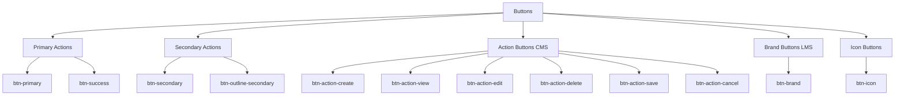

#### Primary Button
```css
.btn-primary {
  color: #fff;
  background-color: var(--brand-green);
  border-color: var(--brand-green);
  font-size: var(--font-size-ui);
  font-weight: var(--font-weight-semibold);
  line-height: 1.2;
  padding: 0.5rem 1rem;
  border-radius: var(--control-radius);
}

.btn-primary:hover {
  color: #fff;
  background-color: var(--brand-green-dark);
  border-color: var(--brand-green-dark);
}

.btn-primary:focus {
  color: #fff;
  background-color: var(--brand-green-dark);
  border-color: var(--brand-green-dark);
  box-shadow: 0 0 0 3px rgba(var(--brand-green-rgb), 0.25);
}

.btn-primary:disabled {
  opacity: 0.65;
  cursor: not-allowed;
}
```

**HTML**:
```html
<button class="btn btn-primary">
  <i class="bi bi-save"></i> Lưu
</button>
<button class="btn btn-primary btn-sm">
  <i class="bi bi-save"></i> Lưu
</button>
```

#### Secondary Button
```css
.btn-secondary {
  color: #fff;
  background-color: var(--brand-blue);
  border-color: var(--brand-blue);
}

.btn-secondary:hover {
  color: #fff;
  background-color: var(--brand-blue-dark);
  border-color: var(--brand-blue-dark);
}
```

**HTML**:
```html
<button class="btn btn-secondary">
  <i class="bi bi-x"></i> Hủy
</button>
```

#### Success Button
```css
.btn-success {
  color: #fff;
  background-color: var(--brand-success);
  border-color: var(--brand-success);
}

.btn-success:hover {
  color: #fff;
  background-color: var(--brand-success-dark);
  border-color: var(--brand-success-dark);
}
```

**HTML**:
```html
<button class="btn btn-success">
  <i class="bi bi-check"></i> Hoàn thành
</button>
```

#### Danger Button
```css
.btn-danger {
  color: #fff;
  background-color: var(--brand-red);
  border-color: var(--brand-red);
}

.btn-danger:hover {
  color: #fff;
  background-color: var(--brand-red-dark);
  border-color: var(--brand-red-dark);
}
```

**HTML**:
```html
<button class="btn btn-danger">
  <i class="bi bi-trash"></i> Xóa
</button>
```

#### Action Buttons (CMS)

| Class | Màu nền | Màu text | Màu hover | Sử dụng |
|-------|---------|----------|-----------|---------|
| `btn-action-create` | `--brand-green` | #fff | `--brand-green-dark` | Tạo mới |
| `btn-action-view` | `--brand-blue` | #fff | `--brand-blue-dark` | Xem chi tiết |
| `btn-action-refresh` | `--brand-blue` | #fff | `--brand-blue-dark` | Làm mới |
| `btn-action-edit` | `--brand-secondary` | #fff | `--brand-secondary-dark` | Chỉnh sửa |
| `btn-action-upload` | `--brand-secondary` | #fff | `--brand-secondary-dark` | Tải lên |
| `btn-action-save` | `--brand-success` | #fff | `--brand-success-dark` | Lưu |
| `btn-action-export` | `--brand-success` | #fff | `--brand-success-dark` | Xuất |
| `btn-action-share` | `--brand-green` | #fff | `--brand-green-dark` | Chia sẻ |
| `btn-action-delete` | `--brand-red` | #fff | `--brand-red-dark` | Xóa |
| `btn-action-filter` | `--brand-blue` | #fff | `--brand-blue-dark` | Bộ lọc |
| `btn-action-copy` | `--brand-yellow` | `--theme-navy` | #d59b00 | Sao chép |
| `btn-action-cancel` | #edf1f0 | `--ink` | #dfe7e4 | Hủy |

**CSS**:
```css
.btn.btn-action-create {
  color: #fff;
  background: var(--brand-green);
  border-color: var(--brand-green);
}

.btn.btn-action-create:hover,
.btn.btn-action-create:focus {
  color: #fff;
  background: var(--brand-green-dark);
  border-color: var(--brand-green-dark);
}

.btn.btn-action-view,
.btn.btn-action-refresh {
  color: #fff;
  background: var(--brand-blue);
  border-color: var(--brand-blue);
}

.btn.btn-action-view:hover,
.btn.btn-action-view:focus,
.btn.btn-action-refresh:hover,
.btn.btn-action-refresh:focus {
  color: #fff;
  background: var(--brand-blue-dark);
  border-color: var(--brand-blue-dark);
}

.btn.btn-action-edit,
.btn.btn-action-upload {
  color: #fff;
  background: var(--brand-secondary);
  border-color: var(--brand-secondary);
}

.btn.btn-action-edit:hover,
.btn.btn-action-edit:focus,
.btn.btn-action-upload:hover,
.btn.btn-action-upload:focus {
  color: #fff;
  background: var(--brand-secondary-dark);
  border-color: var(--brand-secondary-dark);
}

.btn.btn-action-save,
.btn.btn-action-export {
  color: #fff;
  background: var(--brand-success);
  border-color: var(--brand-success);
}

.btn.btn-action-save:hover,
.btn.btn-action-save:focus,
.btn.btn-action-export:hover,
.btn.btn-action-export:focus {
  color: #fff;
  background: var(--brand-success-dark);
  border-color: var(--brand-success-dark);
}

.btn.btn-action-delete {
  color: #fff !important;
  background: var(--brand-red);
  border-color: var(--brand-red);
}

.btn.btn-action-delete:hover,
.btn.btn-action-delete:focus {
  color: #fff !important;
  background: var(--brand-red-dark);
  border-color: var(--brand-red-dark);
}

.btn.btn-action-cancel {
  color: var(--ink);
  background: #edf1f0;
  border-color: #edf1f0;
}

.btn.btn-action-cancel:hover,
.btn.btn-action-cancel:focus {
  color: var(--ink);
  background: #dfe7e4;
  border-color: #dfe7e4;
}

.btn-icon {
  width: 34px;
  padding-right: 0;
  padding-left: 0;
}
```

**HTML**:
```html
<button class="btn btn-action-create">
  <i class="bi bi-plus"></i> Thêm mới
</button>
<button class="btn btn-action-view">
  <i class="bi bi-eye"></i> Xem
</button>
<button class="btn btn-action-edit">
  <i class="bi bi-pencil"></i> Sửa
</button>
<button class="btn btn-action-delete">
  <i class="bi bi-trash"></i> Xóa
</button>
<button class="btn btn-action-save">
  <i class="bi bi-floppy"></i> Lưu
</button>
<button class="btn btn-action-cancel">
  <i class="bi bi-x"></i> Hủy
</button>
<button class="btn btn-action-refresh">
  <i class="bi bi-arrow-clockwise"></i> Làm mới
</button>
```

#### Icon Button
```css
.btn-icon {
  width: 34px;
  padding-right: 0;
  padding-left: 0;
}
```

**HTML**:
```html
<button class="btn btn-action-view btn-icon" aria-label="Xem">
  <i class="bi bi-eye"></i>
</button>
```

#### Brand Button (LMS)
```html
<button class="btn btn-brand">
  Tiếp tục học <i class="bi bi-arrow-right ms-1"></i>
</button>
```

#### Button Sizes

```css
.btn-sm {
  padding: 0.25rem 0.5rem;
  font-size: var(--font-size-sm);
}

.btn-lg {
  padding: 0.75rem 1.5rem;
  font-size: var(--font-size-lg);
}
```

**HTML**:
```html
<button class="btn btn-primary btn-sm">Small</button>
<button class="btn btn-primary">Default</button>
<button class="btn btn-primary btn-lg">Large</button>
```

#### Button States

```html
<!-- Normal -->
<button class="btn btn-primary">Normal</button>

<!-- Hover (CSS handles) -->
<button class="btn btn-primary">Hover</button>

<!-- Focus (CSS handles) -->
<button class="btn btn-primary">Focus</button>

<!-- Disabled -->
<button class="btn btn-primary" disabled>Disabled</button>

<!-- Loading -->
<button class="btn btn-primary" disabled>
  <span class="spinner-border spinner-border-sm"></span>
  Đang xử lý...
</button>
```

### Cards

#### Card Structure

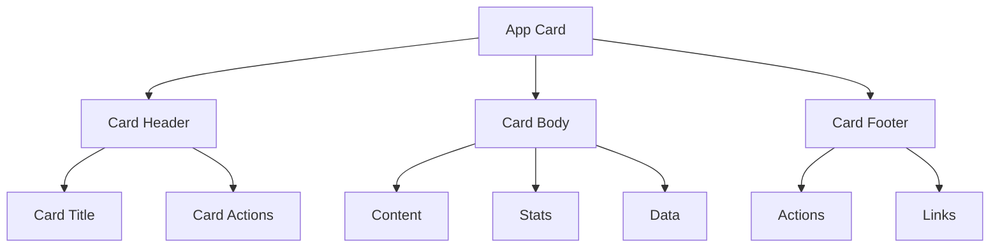

#### Standard Card
```css
.app-card {
  background: var(--surface);
  border: 0;
  border-radius: var(--card-radius);
  box-shadow: 0 10px 30px rgba(13, 41, 68, 0.055);
}

.app-card:hover {
  border-color: transparent;
  box-shadow: 0 14px 34px rgba(13, 41, 68, 0.075);
}

.card-header {
  padding: 1rem 1.15rem;
  background: transparent;
  border-bottom: 0;
}

.card-title {
  margin: 0;
  color: var(--ink);
  font-size: 0.95rem;
  font-weight: 700;
}

.card-body {
  padding: 1rem 1.15rem;
}

.card-footer {
  padding: 1rem 1.15rem;
  background: transparent;
  border-top: 1px solid var(--neutral-line);
}
```

**HTML**:
```html
<div class="app-card">
  <div class="card-header">
    <h3 class="card-title">Tiêu đề card</h3>
  </div>
  <div class="card-body">
    <p>Nội dung card</p>
  </div>
  <div class="card-footer">
    <button class="btn btn-primary">Action</button>
  </div>
</div>
```

#### Stat Card
```css
.stat.app-card {
  display: flex;
  align-items: center;
  justify-content: space-between;
  padding: 1.25rem;
}

.stat > div {
  display: flex;
  flex-direction: column;
  gap: 0.25rem;
}

.stat span {
  font-size: var(--font-size-sm);
  color: var(--text-secondary);
}

.stat strong {
  font-size: var(--font-size-2xl);
  font-weight: var(--font-weight-bold);
  color: var(--text-primary);
}

.stat small {
  font-size: var(--font-size-xs);
  color: var(--text-muted);
}

.stat i {
  font-size: 2rem;
  opacity: 0.8;
}

.stat i.green {
  color: var(--brand-success);
}

.stat i.blue {
  color: var(--brand-blue);
}

.stat i.yellow {
  color: var(--brand-yellow);
}

.stat i.red {
  color: var(--brand-red);
}
```

**HTML**:
```html
<div class="stat app-card">
  <div>
    <span>Tổng khóa học</span>
    <strong>150</strong>
    <small>Trong cơ sở dữ liệu</small>
  </div>
  <i class="bi bi-journals green"></i>
</div>

<div class="stat app-card">
  <div>
    <span>Tổng học viên</span>
    <strong>1,250</strong>
    <small>Tài khoản học viên</small>
  </div>
  <i class="bi bi-people blue"></i>
</div>
```

#### Course Card (LMS)
```css
.course.app-card {
  display: flex;
  flex-direction: column;
  overflow: hidden;
}

.course-cover {
  padding: 1rem;
  background: var(--soft-green);
  display: flex;
  align-items: center;
  gap: 0.5rem;
}

.course-cover i {
  font-size: 1.5rem;
  color: var(--brand-green);
}

.course-cover span {
  font-size: var(--font-size-sm);
  font-weight: var(--font-weight-semibold);
  color: var(--brand-green);
}

.course-progress {
  height: 6px;
  background: var(--neutral-line);
  border-radius: 3px;
}

.course-progress .progress-bar {
  background: var(--brand-green);
  border-radius: 3px;
}
```

**HTML**:
```html
<article class="course app-card">
  <div class="course-cover">
    <i class="bi bi-code-slash"></i>
    <span>CNTT001</span>
  </div>
  <div class="p-3 flex-grow-1">
    <span class="badge badge-soft-success mb-2">Lập trình</span>
    <h3>Lập trình Web cơ bản</h3>
    <div class="small text-secondary mb-3">
      <i class="bi bi-person me-1"></i>Nguyễn Văn A
    </div>
    <div class="d-flex justify-content-between small mb-1">
      <span>Tiến độ</span>
      <b>75%</b>
    </div>
    <div class="progress course-progress mb-3">
      <div class="progress-bar" style="width: 75%"></div>
    </div>
    <button class="btn btn-action-view btn-sm">
      <i class="bi bi-arrow-right-circle"></i> Mở môn học
    </button>
  </div>
</article>
```

### Badges

#### Badge Types

```css
.badge {
  border-radius: 4px;
  padding: 0.38rem 0.5rem;
  font-size: 0.74rem;
  font-weight: 600;
  letter-spacing: 0.015em;
}

.badge-soft-success {
  color: #056c48;
  background: #dff2eb;
}

.badge-soft-primary {
  color: #00447f;
  background: #e4eff9;
}

.badge-soft-warning {
  color: #755f00;
  background: #fff7c7;
}

.badge-soft-danger {
  color: #a41515;
  background: #fbe7e7;
}
```

**HTML**:
```html
<!-- Solid badges -->
<span class="badge badge-success">Đang hoạt động</span>
<span class="badge badge-warning">Chờ duyệt</span>
<span class="badge badge-danger">Đã khóa</span>
<span class="badge badge-info">Thông tin</span>

<!-- Soft badges -->
<span class="badge badge-soft-success">Hoàn thành</span>
<span class="badge badge-soft-primary">Đang xử lý</span>
<span class="badge badge-soft-warning">Cảnh báo</span>
<span class="badge badge-soft-danger">Lỗi</span>
```

### Forms

#### Input Field
```css
.form-label {
  margin-bottom: 0.4rem;
  color: #3d4944;
  font-size: 0.84rem;
  font-weight: 600;
}

.form-control,
.form-select {
  min-height: 40px;
  border: 1px solid var(--neutral-line-strong);
  border-radius: var(--control-radius);
  color: #29342f;
  background-color: #fff;
  font-size: 0.88rem;
}

.form-control::placeholder {
  color: #9aa5a0;
}

.form-control:hover,
.form-select:hover {
  border-color: #c8d2cd;
}

.form-control:focus,
.form-select:focus {
  border-color: var(--eduvers-bdr-color);
  box-shadow: 0 0 0 3px rgba(var(--eduvers-base-rgb), 0.10);
}

.form-check-input {
  border-color: #c7d1cc;
}

.form-check-input:checked {
  background-color: var(--eduvers-base);
  border-color: var(--eduvers-base);
}

.input-group-text {
  border-color: var(--neutral-line-strong);
  background: #f5f7f6;
  color: #6d7b75;
}
```

**HTML**:
```html
<div class="form-group">
  <label class="form-label" for="courseName">Tên môn học</label>
  <input type="text" class="form-control" id="courseName" placeholder="Nhập tên môn học" />
</div>

<div class="form-group">
  <label class="form-label" for="department">Khoa</label>
  <select class="form-select" id="department">
    <option value="">Chọn khoa</option>
    <option value="cntt">Công nghệ thông tin</option>
    <option value="kt">Kinh tế</option>
  </select>
</div>

<div class="form-group">
  <label class="form-label" for="description">Mô tả</label>
  <textarea class="form-control" id="description" rows="4" placeholder="Nhập mô tả"></textarea>
</div>

<div class="form-check">
  <input class="form-check-input" type="checkbox" id="active" />
  <label class="form-check-label" for="active">Đang hoạt động</label>
</div>
```

#### Form States

```html
<!-- Normal -->
<input type="text" class="form-control" placeholder="Normal" />

<!-- Hover (CSS handles) -->
<input type="text" class="form-control" placeholder="Hover" />

<!-- Focus (CSS handles) -->
<input type="text" class="form-control" placeholder="Focus" />

<!-- Disabled -->
<input type="text" class="form-control" placeholder="Disabled" disabled />

<!-- Readonly -->
<input type="text" class="form-control" placeholder="Readonly" readonly />

<!-- Invalid -->
<div class="form-group">
  <label class="form-label">Email</label>
  <input type="email" class="form-control is-invalid" placeholder="email@example.com" />
  <div class="invalid-feedback">Vui lòng nhập email hợp lệ.</div>
</div>

<!-- Valid -->
<div class="form-group">
  <label class="form-label">Email</label>
  <input type="email" class="form-control is-valid" value="user@example.com" />
  <div class="valid-feedback">Email hợp lệ.</div>
</div>
```

### Tables

#### Standard Table
```css
.table {
  --bs-table-bg: transparent;
  color: var(--ink-soft);
  font-size: 0.88rem;
}

.table > :not(caption) > * > * {
  padding: 0.82rem 0.8rem;
  border-bottom-color: var(--neutral-line);
  vertical-align: middle;
}

.table thead th {
  color: #fff;
  background: var(--eduvers-base);
  font-size: 0.76rem;
  font-weight: 700;
  text-transform: uppercase;
  letter-spacing: 0.045em;
  white-space: nowrap;
}

.table thead th:first-child {
  border-top-left-radius: var(--control-radius);
}

.table thead th:last-child {
  border-top-right-radius: var(--control-radius);
}

.table tbody tr:last-child > * {
  border-bottom: 0;
}

.table tbody tr {
  transition: background-color 0.18s ease;
}

.table tbody tr:hover > * {
  background: rgba(var(--brand-green-rgb), 0.035);
}

.table-responsive {
  scrollbar-width: thin;
  scrollbar-color: #c9d1ce transparent;
}
```

**HTML**:
```html
<div class="table-responsive">
  <table class="table align-middle">
    <thead>
      <tr>
        <th>Tên môn học</th>
        <th>Mã</th>
        <th>Giảng viên</th>
        <th>Số bài học</th>
        <th>Trạng thái</th>
        <th>Actions</th>
      </tr>
    </thead>
    <tbody>
      <tr>
        <td>
          <strong>Lập trình Web cơ bản</strong>
          <small class="d-block text-secondary">CNTT001</small>
        </td>
        <td>CNTT001</td>
        <td>Nguyễn Văn A</td>
        <td>15</td>
        <td>
          <span class="badge badge-success">Đang hoạt động</span>
        </td>
        <td class="action-cell">
          <button class="btn btn-action-view btn-sm" title="Xem">
            <i class="bi bi-eye"></i>
          </button>
          <button class="btn btn-action-edit btn-sm" title="Sửa">
            <i class="bi bi-pencil"></i>
          </button>
          <button class="btn btn-action-delete btn-sm" title="Xóa">
            <i class="bi bi-trash"></i>
          </button>
        </td>
      </tr>
    </tbody>
  </table>
</div>
```

#### Table with Action Cell
```css
.action-cell {
  white-space: nowrap;
}

.action-cell .btn + .btn,
.table td.text-end .btn + .btn {
  margin-left: 0.28rem;
}
```

### Progress Bars

```css
.progress {
  overflow: hidden;
  background: #e8edeb;
  border-radius: 3px;
}

.progress-bar {
  background: var(--brand-green);
  border-radius: 3px;
}
```

**HTML**:
```html
<div class="progress">
  <div class="progress-bar" role="progressbar" style="width: 75%"></div>
</div>

<div class="progress">
  <div class="progress-bar bg-success" role="progressbar" style="width: 50%"></div>
</div>

<div class="progress">
  <div class="progress-bar bg-warning" role="progressbar" style="width: 25%"></div>
</div>
```

### Avatars

```css
.avatar {
  width: 38px;
  height: 38px;
  border-radius: 50%;
  display: grid;
  place-items: center;
  color: var(--brand-green);
  background: var(--soft-green);
  font-weight: 700;
}

.avatar-sm {
  width: 32px;
  height: 32px;
  font-size: 0.875rem;
}

.avatar-lg {
  width: 48px;
  height: 48px;
  font-size: 1.125rem;
}
```

**HTML**:
```html
<div class="avatar">NV</div>
<div class="avatar avatar-sm">NV</div>
<div class="avatar avatar-lg">NV</div>


```

### Alerts

#### Success Alert
```html
<div class="alert alert-success">
  <i class="bi bi-check-circle"></i>
  Thao tác thành công!
</div>
```

#### Error Alert
```html
<div class="alert alert-danger">
  <i class="bi bi-exclamation-circle"></i>
  Đã xảy ra lỗi. Vui lòng thử lại.
</div>
```

#### Warning Alert
```html
<div class="alert alert-warning">
  <i class="bi bi-exclamation-triangle"></i>
  Vui lòng kiểm tra lại thông tin.
</div>
```

#### Info Alert
```html
<div class="alert alert-info">
  <i class="bi bi-info-circle"></i>
  Thông tin quan trọng.
</div>
```

### Loading States

#### Spinner
```html
<div class="app-card p-5 text-center">
  <span class="spinner-border text-success"></span>
  <p class="text-secondary mt-3">Đang tải...</p>
</div>
```

#### Spinner with text
```html
<button class="btn btn-primary" disabled>
  <span class="spinner-border spinner-border-sm"></span>
  Đang xử lý...
</button>
```

### Empty States

#### Standard Empty State
```css
.app-feedback-state {
  min-height: 240px;
  display: grid;
  place-items: center;
  align-content: center;
  gap: var(--space-4);
  padding: var(--space-8);
  color: var(--color-text-secondary);
  text-align: center;
}

.app-feedback-state__icon {
  width: 48px;
  height: 48px;
  display: grid;
  place-items: center;
  border-radius: var(--radius-lg);
  color: var(--color-secondary);
  background: var(--color-secondary-subtle);
  font-size: 1.25rem;
}

.app-feedback-state strong {
  display: block;
  color: var(--color-text-primary);
  font-size: 0.95rem;
}

.app-feedback-state p {
  max-width: 460px;
  margin: var(--space-1) auto 0;
  color: var(--color-muted);
  font-size: 0.8125rem;
}

.app-feedback-state__actions {
  margin-top: var(--space-4);
}
```

**HTML**:
```html
<div class="app-feedback-state">
  <div class="app-feedback-state__icon">
    <i class="bi bi-inbox"></i>
  </div>
  <strong>Không có dữ liệu</strong>
  <p>Chưa có mục nào được thêm vào hệ thống.</p>
  <div class="app-feedback-state__actions">
    <button class="btn btn-primary">Thêm mới</button>
  </div>
</div>
```

### Pagination

```html
<AppPagination
  :current-page="currentPage"
  :total-pages="totalPages"
  @page-change="handlePageChange"
/>
```

### Filter Bar

```html
<AppFilterBar>
  <input type="search" placeholder="Tìm kiếm..." v-model="searchText" />
  <select v-model="selectedStatus">
    <option value="">Tất cả trạng thái</option>
    <option value="active">Đang hoạt động</option>
    <option value="inactive">Ngừng hoạt động</option>
  </select>
  <button class="btn btn-action-add">
    <i class="bi bi-plus"></i> Thêm mới
  </button>
</AppFilterBar>
```

## Responsive Design

### Breakpoints

| Breakpoint | Width | Devices |
|------------|-------|---------|
| XS | 0px | Mobile portrait |
| SM | 576px | Mobile landscape |
| MD | 768px | Tablet |
| LG | 992px | Desktop |
| XL | 1200px | Large desktop |
| XXL | 1400px | Extra large desktop |

### Grid System

Bootstrap 5 Grid (12 columns):
```html
<div class="container">
  <div class="row">
    <div class="col-12 col-md-6 col-lg-4">
      <!-- Content -->
    </div>
  </div>
</div>
```

### Responsive Sidebar

- Desktop (≥992px): Sidebar hiển thị cố định
- Mobile (<992px): Sidebar ẩn, dùng offcanvas

### Responsive Tables

```html
<div class="table-responsive">
  <table class="table">
    <!-- Table content -->
  </table>
</div>
```

## Accessibility

### Color Contrast

- Màu chữ trên nền: WCAG AA (minimum 4.5:1)
- Màu chữ lớn trên nền: WCAG AA (minimum 3:1)
- Màu UI components: WCAG AA (minimum 3:1)

### Focus States

```css
button:focus,
input:focus,
select:focus,
textarea:focus {
  outline: 2px solid var(--brand-blue);
  outline-offset: 2px;
}
```

### ARIA Labels

```html
<button aria-label="Đóng modal">
  <i class="bi bi-x"></i>
</button>

<input aria-label="Tìm kiếm" type="search" />
```

### Keyboard Navigation

- Tab order logical
- Focus indicators visible
- Escape key closes modals
- Enter/Space activates buttons

## CSS Variables Reference

### Complete Token List

```css
:root {
  /* Brand Colors */
  --brand-green: #d3224d;
  --brand-green-dark: #aa1b3e;
  --brand-green-rgb: 211, 34, 77;
  --brand-blue: #005099;
  --brand-blue-dark: #003d75;
  --brand-blue-rgb: 0, 80, 153;
  --brand-secondary: #ff5543;
  --brand-secondary-dark: #df3c2c;
  --brand-red: #c62828;
  --brand-red-dark: #a71d1d;
  --brand-yellow: #ffc224;
  --brand-success: #07875a;
  --brand-success-dark: #056b48;
  
  /* Theme Colors */
  --theme-navy: #102f4d;
  --theme-sidebar: #183b59;
  
  /* Text Colors */
  --ink: #172636;
  --ink-soft: #243d55;
  --muted: #4d5756;
  --text-primary: #172636;
  --text-secondary: #4d5e6d;
  --text-muted: #6d7c87;
  --text-disabled: #9aa5ad;
  --text-on-primary: #fff;
  
  /* Surface Colors */
  --surface: #fff;
  --page: #f3f5f7;
  --soft-surface: #f8f4f2;
  --soft-green: rgba(0, 80, 153, 0.08);
  --soft-blue: rgba(0, 80, 153, 0.1);
  --soft-yellow: rgba(255, 194, 36, 0.16);
  --neutral-line: #ede8e6;
  --neutral-line-strong: #ede8e6;
  
  /* Semantic Colors */
  --color-text-primary: var(--text-primary);
  --color-text-secondary: var(--text-secondary);
  --color-muted: var(--text-muted);
  --color-primary: var(--brand-green);
  --color-primary-subtle: rgba(var(--brand-green-rgb), 0.1);
  --color-secondary: var(--brand-blue);
  --color-secondary-subtle: rgba(var(--brand-blue-rgb), 0.1);
  --color-danger: var(--brand-red);
  --color-surface: var(--surface);
  --color-surface-hover: #f7f8f9;
  --color-border: var(--neutral-line);
  
  /* Layout */
  --sidebar-width: 252px;
  --topbar-height: 68px;
  
  /* Border Radius */
  --card-radius: 5px;
  --control-radius: 5px;
  
  /* Typography */
  --font-family-base: 'Be Vietnam Pro', 'Segoe UI', Arial, sans-serif;
  --font-body: var(--font-family-base);
  --font-heading: var(--font-family-base);
  --font-size-xs: 0.75rem;
  --font-size-sm: 0.8125rem;
  --font-size-ui: 0.875rem;
  --font-size-base: 1rem;
  --font-size-lg: 1.125rem;
  --font-size-xl: 1.25rem;
  --font-size-2xl: 1.5rem;
  --font-size-3xl: 1.75rem;
  --font-size-4xl: 2rem;
  --font-weight-normal: 400;
  --font-weight-medium: 500;
  --font-weight-semibold: 600;
  --font-weight-bold: 700;
  --line-height-heading: 1.35;
  --line-height-ui: 1.5;
  --line-height-body: 1.6;
  --line-height-reading: 1.75;
}
```

## File References

### CSS Tokens
-:root {
  --brand-green: #d3224d;
  --brand-green-dark: #aa1b3e;
  --brand-green-rgb: 211, 34, 77;
  --brand-blue: #005099;
  --brand-blue-dark: #003d75;
  --brand-blue-rgb: 0, 80, 153;
  --brand-secondary: #ff5543;
  --brand-secondary-dark: #df3c2c;
  --brand-red: #c62828;
  --brand-red-dark: #a71d1d;
  --brand-yellow: #ffc224;
  --brand-success: #07875a;
  --brand-success-dark: #056b48;
  --theme-navy: #102f4d;
  --theme-sidebar: #183b59;
  --ink: #172636;
  --ink-soft: #243d55;
  --muted: #4d5756;
  --surface: #fff;
  --page: #f3f5f7;
  --soft-surface: #f8f4f2;
  --soft-green: rgba(0, 80, 153, 0.08);
  --soft-blue: rgba(0, 80, 153, 0.1);
  --soft-yellow: rgba(255, 194, 36, 0.16);
  --neutral-line: #ede8e6;
  --neutral-line-strong: #ede8e6;
  --text-primary: #172636;
  --text-secondary: #4d5e6d;
  --text-muted: #6d7c87;
  --text-disabled: #9aa5ad;
  --text-on-primary: #fff;
  --color-text-primary: var(--text-primary);
  --color-text-secondary: var(--text-secondary);
  --color-muted: var(--text-muted);
  --color-primary: var(--brand-green);
  --color-primary-subtle: rgba(var(--brand-green-rgb), 0.1);
  --color-secondary: var(--brand-blue);
  --color-secondary-subtle: rgba(var(--brand-blue-rgb), 0.1);
  --color-danger: var(--brand-red);
  --color-surface: var(--surface);
  --color-surface-hover: #f7f8f9;
  --color-border: var(--neutral-line);
  --sidebar-width: 252px;
  --topbar-height: 68px;
  --card-radius: 5px;
  --control-radius: 5px;
  --font-family-base: 'Be Vietnam Pro', 'Segoe UI', Arial, sans-serif;
  --font-body: var(--font-family-base);
  --font-heading: var(--font-family-base);
  --font-size-xs: 0.75rem;
  --font-size-sm: 0.8125rem;
  --font-size-ui: 0.875rem;
  --font-size-base: 1rem;
  --font-size-lg: 1.125rem;
  --font-size-xl: 1.25rem;
  --font-size-2xl: 1.5rem;
  --font-size-3xl: 1.75rem;
  --font-size-4xl: 2rem;
  --font-weight-normal: 400;
  --font-weight-medium: 500;
  --font-weight-semibold: 600;
  --font-weight-bold: 700;
  --line-height-heading: 1.35;
  --line-height-ui: 1.5;
  --line-height-body: 1.6;
  --line-height-reading: 1.75;
}
/* Typography system dùng chung cho toà n bộ CMS/LMS. Các selector được giới hạn
   trong #app để đủ ưu tiên trước style scoped nhưng không ảnh hưởng thư viện ngoà i. */
#app {
  color: var(--text-primary);
  font-family: var(--font-family-base);
  font-size: var(--font-size-base);
  font-weight: var(--font-weight-normal);
  line-height: var(--line-height-body);
}

#app :where(input, select, textarea, button, label, option, table) {
  font-family: var(--font-family-base);
}

#app :where(.page-title, .app-page-header .page-title) {
  font-size: var(--font-size-2xl);
  font-weight: var(--font-weight-bold);
  line-height: var(--line-height-heading);
  letter-spacing: 0;
}

#app :where(.page-subtitle, .app-page-header .page-subtitle) {
  color: var(--text-secondary);
  font-size: var(--font-size-ui);
  font-weight: var(--font-weight-normal);
  line-height: var(--line-height-ui);
}

#app :where(
  .section-title,
  .discussion-heading h2,
  .interactive-authoring-heading h3,
  .assignment-requirements h3,
  .lesson-resource-tab h2
) {
  font-size: var(--font-size-lg);
  font-weight: var(--font-weight-semibold);
  line-height: 1.4;
  letter-spacing: 0;
}

#app :where(.card-title, .app-card > header h2, .app-card > header h3) {
  font-size: var(--font-size-base);
  font-weight: var(--font-weight-semibold);
  line-height: 1.4;
}

#app :where(
  .eyebrow,
  .builder-eyebrow,
  .grading-eyebrow,
  .search-kicker,
  .editor-kicker,
  .app-page-header__eyebrow,
  .modal-heading small,
  .preview-header small
) {
  font-size: var(--font-size-xs);
  font-weight: var(--font-weight-semibold);
  line-height: var(--line-height-ui);
  letter-spacing: 0;
}

#app :where(.form-label, .field-group .form-label, .grading-filters label > span) {
  color: var(--text-primary);
  font-size: var(--font-size-ui);
  font-weight: var(--font-weight-semibold);
  line-height: 1.4;
}

#app :where(.form-control, .form-select, input, select, textarea) {
  font-size: var(--font-size-ui);
  font-weight: var(--font-weight-normal);
  line-height: var(--line-height-ui);
}

#app :where(.form-control, input, textarea)::placeholder {
  color: var(--text-disabled);
  font-size: inherit;
  font-weight: var(--font-weight-normal);
}

#app :where(
  .btn,
  .btn-comment-primary,
  .btn-comment-plain,
  .btn-comment-danger,
  .type-tab,
  .discussion-load-more
) {
  font-size: var(--font-size-ui);
  font-weight: var(--font-weight-semibold);
  line-height: 1.2;
  letter-spacing: 0;
}

#app :where(.btn-sm, .btn-sm.btn, .comment-actions button) {
  font-size: var(--font-size-sm);
  font-weight: var(--font-weight-semibold);
}

#app :where(.badge, .comment-role, .status-badge, [class*='badge-']) {
  font-size: var(--font-size-xs);
  font-weight: var(--font-weight-semibold);
  line-height: 1.3;
  letter-spacing: 0;
}

#app .table {
  font-size: var(--font-size-ui);
  line-height: 1.45;
}

#app .table thead th {
  font-size: var(--font-size-sm);
  font-weight: var(--font-weight-semibold);
  line-height: 1.4;
  letter-spacing: 0;
}

#app .table tbody td {
  font-size: var(--font-size-ui);
  font-weight: var(--font-weight-normal);
  line-height: 1.45;
}

#app :where(.sidebar .side-link, .lms-nav .nav-link) {
  font-size: var(--font-size-ui);
  font-weight: var(--font-weight-medium);
  line-height: 1.4;
}

#app :where(.sidebar .menu-label, .topbar-heading small) {
  font-size: var(--font-size-xs);
  font-weight: var(--font-weight-semibold);
  line-height: 1.4;
  letter-spacing: 0.02em;
}

#app :where(.top-search input, .profile-copy strong) {
  font-size: var(--font-size-sm);
}

#app :where(.profile-copy small, .tiny, .text-meta, .lesson-copy small, .chapter-copy small) {
  color: var(--text-muted);
  font-size: var(--font-size-xs);
  font-weight: var(--font-weight-normal);
  line-height: 1.4;
}

/* Sidebar môn học: phân cấp vừa đủ, ưu tiên khả năng quét nhanh danh sách dà i. */
#app .curriculum-heading strong {
  font-size: var(--font-size-base);
  font-weight: var(--font-weight-bold);
  line-height: 1.4;
}

#app .curriculum-heading small {
  font-size: var(--font-size-xs);
  font-weight: var(--font-weight-normal);
  line-height: 1.4;
}

#app .chapter-toggle strong {
  font-size: var(--font-size-ui);
  font-weight: var(--font-weight-semibold);
  line-height: 1.4;
}

#app .chapter-toggle small {
  font-size: var(--font-size-xs);
  font-weight: var(--font-weight-normal);
  line-height: 1.4;
}

#app .chapter a strong {
  font-size: var(--font-size-sm);
  font-weight: var(--font-weight-semibold);
  line-height: 1.45;
}

#app .chapter a small {
  font-size: var(--font-size-xs);
  font-weight: var(--font-weight-normal);
  line-height: 1.4;
}

#app .current-lesson-heading h1 {
  font-size: var(--font-size-lg);
  font-weight: var(--font-weight-bold);
  line-height: 1.4;
}

#app .current-lesson-heading small {
  font-size: var(--font-size-xs);
  font-weight: var(--font-weight-semibold);
  line-height: 1.4;
}

#app :where(.modal-heading h2, .app-confirm-modal h3, .confirm-modal h2) {
  font-size: var(--font-size-lg);
  font-weight: var(--font-weight-bold);
  line-height: 1.4;
  letter-spacing: 0;
}

#app .login-page .form-heading h2 {
  font-size: var(--font-size-2xl);
  font-weight: var(--font-weight-bold);
  line-height: var(--line-height-heading);
}

#app :where(.form-modal, .modal-content, .app-confirm-modal, .confirm-modal) {
  font-size: var(--font-size-ui);
  line-height: 1.55;
}

#app :where(.lesson-tabs button, [role='tab'], .nav-tabs .nav-link) {
  font-size: var(--font-size-ui);
  font-weight: var(--font-weight-medium);
  line-height: 1.4;
}

#app :where(.lesson-tabs button.active, [role='tab'][aria-selected='true'], .nav-tabs .nav-link.active) {
  font-weight: var(--font-weight-semibold);
}

#app :where(.alert, .toast, .notification-item) {
  font-size: var(--font-size-sm);
  font-weight: var(--font-weight-normal);
  line-height: var(--line-height-ui);
}

#app :where(.empty-state p, .app-feedback-state p, .search-state p) {
  color: var(--text-secondary);
  font-size: var(--font-size-ui);
  line-height: var(--line-height-ui);
}

/* Nội dung học dà i cần nhịp dòng rộng và cột đọc vừa phải. */
#app :where(.lesson-html, .docx-preview-content, .interactive-reading-content, .assignment-requirements) {
  font-size: 1.03125rem;
  font-weight: var(--font-weight-normal);
  line-height: var(--line-height-reading);
}

#app :where(.lesson-html, .docx-preview-content, .interactive-reading-content) > :where(p, ul, ol, blockquote) {
  max-width: 900px;
}

#app :where(.lesson-html, .docx-preview-content, .interactive-reading-content) h1 {
  font-size: var(--font-size-3xl);
  font-weight: var(--font-weight-bold);
  line-height: 1.3;
}

#app :where(.lesson-html, .docx-preview-content, .interactive-reading-content) h2 {
  font-size: var(--font-size-2xl);
  font-weight: var(--font-weight-bold);
  line-height: var(--line-height-heading);
}

#app :where(.lesson-html, .docx-preview-content, .interactive-reading-content) h3 {
  font-size: var(--font-size-xl);
  font-weight: var(--font-weight-semibold);
  line-height: 1.4;
}

#app :where(.lesson-html, .docx-preview-content, .interactive-reading-content) h4 {
  font-size: var(--font-size-lg);
  font-weight: var(--font-weight-semibold);
  line-height: 1.4;
}

/* Quiz, bà i tập và thảo luận. */
#app :where(
  .question-card h3,
  .quiz-question h3,
  .quiz-question-card > p,
  .interactive-question-card h3,
  .inline-question-card .question-heading h3,
  .question-modal h2
) {
  font-size: var(--font-size-base);
  font-weight: var(--font-weight-semibold);
  line-height: 1.55;
}

#app :where(
  .answer,
  .interaction-answer,
  .quiz-answer,
  .quiz-option,
  .interactive-option,
  .content-answer-options span
) {
  font-size: var(--font-size-ui);
  font-weight: var(--font-weight-normal);
  line-height: 1.55;
}

#app .quiz-question-card legend {
  font-size: var(--font-size-xs);
  font-weight: var(--font-weight-semibold);
  line-height: 1.4;
}

#app :where(.question-result p, .answer-result p, .interactive-result p) {
  font-size: var(--font-size-ui);
  font-weight: var(--font-weight-normal);
  line-height: var(--line-height-body);
}

#app :where(.assignment-heading h2, .assignment-content h1) {
  font-size: var(--font-size-xl);
  font-weight: var(--font-weight-bold);
  line-height: var(--line-height-heading);
}

#app :where(.assignment-metadata, .assignment-resource, .submission-context) {
  font-size: var(--font-size-sm);
  line-height: var(--line-height-ui);
}

#app .comment-body header strong {
  font-size: var(--font-size-ui);
  font-weight: var(--font-weight-semibold);
}

#app .comment-content {
  font-size: var(--font-size-ui);
  font-weight: var(--font-weight-normal);
  line-height: 1.55;
}

#app :where(.comment-body time, .comment-actions > span) {
  font-size: var(--font-size-xs);
  font-weight: var(--font-weight-normal);
}

@media (max-width: 767px) {
  #app :where(.page-title, .app-page-header .page-title) {
    font-size: var(--font-size-xl);
  }

  #app :where(.section-title, .discussion-heading h2, .interactive-authoring-heading h3) {
    font-size: 1.0625rem;
  }

  #app .login-page .form-heading h2 {
    font-size: var(--font-size-xl);
  }

  #app :where(.lesson-html, .docx-preview-content, .interactive-reading-content, .assignment-requirements) {
    font-size: var(--font-size-base);
  }
}
/*
 * Shared supporting headings.
 * The ID selector intentionally outranks scoped page styles so Vietnamese
 * text keeps one readable type treatment throughout CMS/LMS dialogs.
 */
#app :where(
  .eyebrow,
  .builder-eyebrow,
  .grading-eyebrow,
  .search-kicker,
  .editor-kicker,
  .modal-heading small,
  .preview-header small
) {
  font-family: var(--font-body);
  font-size: var(--font-size-xs);
  font-style: normal;
  font-weight: var(--font-weight-semibold);
  font-synthesis: none;
  font-variant-caps: normal;
  line-height: var(--line-height-ui);
  letter-spacing: 0;
  text-transform: none;
}

### Design Token Usage
Khi sử dụng design tokens trong CSS:

```css
/* Sử dụng CSS variables */
.my-component {
  color: var(--text-primary);
  background-color: var(--surface);
  border-color: var(--neutral-line);
  font-size: var(--font-size-ui);
  font-weight: var(--font-weight-semibold);
  border-radius: var(--card-radius);
}
```

```css
/* Sử dụng trong Vue SFC */
<style scoped>
.example {
  color: var(--brand-green);
  background: var(--soft-green);
  padding: var(--font-size-base);
}
</style>
```

## Transitions & Animations

### Transition Overview

Transitions và animations được sử dụng để tạo smooth interactions và improve user experience với consistent timing.

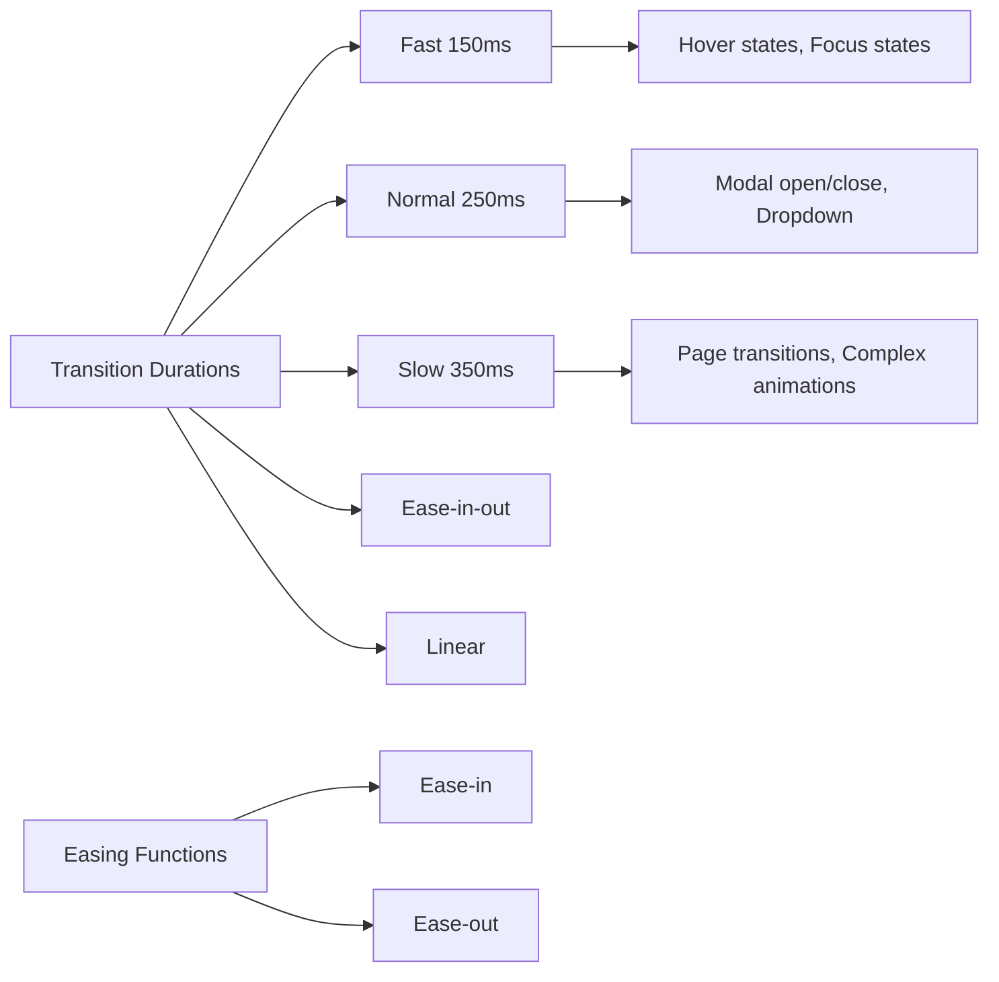

### Transition Duration Tokens

| Tên | Variable | Ms | Sử dụng | Ví dụ |
|-----|----------|-----|---------|-------|
| Fast | `--transition-fast` | 150ms | Hover states, focus states | Button hover, Input focus |
| Normal | `--transition-normal` | 250ms | Modal open/close, dropdown | Modal animation, Dropdown |
| Slow | `--transition-slow` | 350ms | Page transitions, complex animations | Page load, Complex interactions |

### Easing Function Tokens

| Tên | Variable | CSS Value | Sử dụng | Ví dụ |
|-----|----------|-----------|---------|-------|
| Ease In | `--ease-in` | cubic-bezier(0.4, 0, 1, 1) | Entering elements | Modal enter, Slide down |
| Ease Out | `--ease-out` | cubic-bezier(0, 0, 0.2, 1) | Leaving elements | Modal leave, Slide up |
| Ease In Out | `--ease-in-out` | cubic-bezier(0.4, 0, 0.2, 1) | Both directions | Toggle switch, Flip card |
| Linear | `--linear` | linear | Continuous animations | Progress bar, Spinner |

### Transition Usage Guidelines

#### Hover States

```css
/* Button hover */
.btn {
  transition: background-color var(--transition-fast) var(--ease-out),
              border-color var(--transition-fast) var(--ease-out),
              box-shadow var(--transition-fast) var(--ease-out);
}

.btn:hover {
  background-color: var(--brand-green-dark);
}
```

#### Focus States

```css
/* Input focus */
.input {
  transition: border-color var(--transition-fast) var(--ease-out),
              box-shadow var(--transition-fast) var(--ease-out);
}

.input:focus {
  border-color: var(--brand-blue);
  box-shadow: 0 0 0 3px var(--focus-ring);
}
```

#### Modal Animation

```css
/* Modal enter */
.modal {
  opacity: 0;
  transform: scale(0.95);
  transition: opacity var(--transition-normal) var(--ease-out),
              transform var(--transition-normal) var(--ease-out);
}

.modal.active {
  opacity: 1;
  transform: scale(1);
}
```

#### Dropdown Animation

```css
/* Dropdown menu */
.dropdown-menu {
  opacity: 0;
  transform: translateY(-10px);
  transition: opacity var(--transition-normal) var(--ease-out),
              transform var(--transition-normal) var(--ease-out);
}

.dropdown-menu.active {
  opacity: 1;
  transform: translateY(0);
}
```

#### Slide Animation

```css
/* Slide up */
.slide-up {
  transform: translateY(100%);
  transition: transform var(--transition-normal) var(--ease-out);
}

.slide-up.active {
  transform: translateY(0);
}

/* Slide down */
.slide-down {
  transform: translateY(-100%);
  transition: transform var(--transition-normal) var(--ease-out);
}

.slide-down.active {
  transform: translateY(0);
}
```

#### Fade Animation

```css
/* Fade in */
.fade-in {
  opacity: 0;
  transition: opacity var(--transition-normal) var(--ease-out);
}

.fade-in.active {
  opacity: 1;
}

/* Fade out */
.fade-out {
  opacity: 1;
  transition: opacity var(--transition-normal) var(--ease-out);
}

.fade-out.active {
  opacity: 0;
}
```

### Animation Patterns

#### Loading Spinner

```css
/* Spinner */
@keyframes spin {
  from {
    transform: rotate(0deg);
  }
  to {
    transform: rotate(360deg);
  }
}

.spinner {
  animation: spin 1s linear infinite;
}
```

#### Pulse Animation

```css
/* Pulse for attention */
@keyframes pulse {
  0%, 100% {
    opacity: 1;
  }
  50% {
    opacity: 0.5;
  }
}

.pulse {
  animation: pulse 2s var(--ease-in-out) infinite;
}
```

#### Bounce Animation

```css
/* Bounce for feedback */
@keyframes bounce {
  0%, 100% {
    transform: translateY(0);
  }
  50% {
    transform: translateY(-10px);
  }
}

.bounce {
  animation: bounce 0.5s var(--ease-out);
}
```

#### Shimmer Animation

```css
/* Shimmer for loading states */
@keyframes shimmer {
  0% {
    background-position: -200% 0;
  }
  100% {
    background-position: 200% 0;
  }
}

.shimmer {
  background: linear-gradient(90deg, 
    var(--surface) 0%, 
    var(--surface-hover) 50%, 
    var(--surface) 100%);
  background-size: 200% 100%;
  animation: shimmer 1.5s infinite;
}
```

### Transition Don'ts

```css
/* ✗ Không hardcode transition values */
.btn {
  transition: background-color 250ms ease-out; /* ✗ Sai */
}

/* ✗ Không dùng quá nhiều transitions cùng lúc */
.element {
  transition: background-color 150ms ease-out,
              border-color 150ms ease-out,
              color 150ms ease-out,
              padding 150ms ease-out,
              margin 150ms ease-out,
              transform 150ms ease-out; /* ✗ Quá nhiều */
}

/* ✗ Không dùng slow transitions cho hover states */
.btn:hover {
  transition: background-color 350ms ease-out; /* ✗ Quá chậm cho hover */
}

/* ✗ Không dùng linear cho ui interactions */
.btn {
  transition: background-color 150ms linear; /* ✗ Linear không natural */
}
```

### Performance Best Practices

```css
/* ✓ Sử dụng transform và opacity thay vì layout properties */
.good {
  transition: transform var(--transition-fast) var(--ease-out),
              opacity var(--transition-fast) var(--ease-out);
}

.bad {
  transition: width var(--transition-fast) var(--ease-out),
              height var(--transition-fast) var(--ease-out); /* ✗ Triggers layout */
}

/* ✓ Sử dụng will-change cho animations phức tạp */
.animated-element {
  will-change: transform;
  transition: transform var(--transition-normal) var(--ease-out);
}

/* ✓ Disable transitions khi user prefers reduced motion */
@media (prefers-reduced-motion: reduce) {
  *,
  *::before,
  *::after {
    animation-duration: 0.01ms !important;
    animation-iteration-count: 1 !important;
    transition-duration: 0.01ms !important;
  }
}
```

## Best Practices

### Color Usage

1. **Brand Green**: Primary actions, CTAs, links chính
2. **Brand Blue**: Secondary actions, links phụ
3. **Brand Red**: Delete actions, error states
4. **Brand Yellow**: Warning states, highlights
5. **Brand Success**: Success states, confirmations
6. **Text Primary**: Headings, body text
7. **Text Secondary**: Descriptions, subtitles
8. **Text Muted**: Metadata, timestamps
9. **Text Disabled**: Disabled inputs, placeholders

### Typography Usage

1. **Page Title**: Chỉ dùng 1 H1 per page
2. **Section Title**: Dùng H2 cho sections chính
3. **Card Title**: Dùng H3 cho card headers
4. **Body Text**: Sử dụng font-size-base cho nội dung chính
5. **Reading Content**: Sử dụng line-height-reading cho nội dung dài
6. **Tiny Text**: Chỉ dùng cho metadata, không dùng cho nội dung quan trọng

### Component Usage

1. **Buttons**: D dùng btn-action-* cho actions CRUD trong CMS
2. **Cards**: Dùng app-card class cho tất cả card components
3. **Tables**: Luôn wrap trong table-responsive
4. **Forms**: Dùng form-label cho tất cả labels
5. **Badges**: Dùng badge-* classes cho status indicators

### Accessibility

1. Luôn cung cấp aria-label cho icon-only buttons
2. Đảm bảo contrast ratio meet WCAG AA
3. Sử dụng semantic HTML (button, input, label)
4. Test keyboard navigation
5. Provide focus indicators

## Responsive Design Guidelines

### Breakpoint Overview

Responsive design sử dụng mobile-first approach với 6 breakpoints chính để đảm bảo consistency trên tất cả devices.

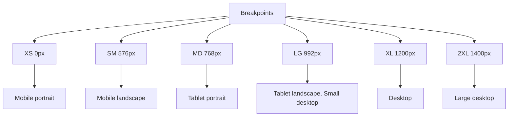

### Breakpoint Tokens

| Tên | Variable | Min Width | Max Width | Device | Sử dụng |
|-----|----------|-----------|-----------|--------|---------|
| XS | `--breakpoint-xs` | 0px | 575px | Mobile portrait | Small phones |
| SM | `--breakpoint-sm` | 576px | 767px | Mobile landscape | Large phones |
| MD | `--breakpoint-md` | 768px | 991px | Tablet portrait | Tablets portrait |
| LG | `--breakpoint-lg` | 992px | 1199px | Tablet landscape, Small desktop | Tablets landscape, Small laptops |
| XL | `--breakpoint-xl` | 1200px | 1399px | Desktop | Desktops, Laptops |
| 2XL | `--breakpoint-2xl` | 1400px | ∞ | Large desktop | Large monitors |

### Media Query Mixins

```css
/* XS (Mobile First - Default) */
/* Không cần media query - base styles */

/* SM */
@media (min-width: 576px) {
  /* Mobile landscape styles */
}

/* MD */
@media (min-width: 768px) {
  /* Tablet portrait styles */
}

/* LG */
@media (min-width: 992px) {
  /* Tablet landscape, Small desktop styles */
}

/* XL */
@media (min-width: 1200px) {
  /* Desktop styles */
}

/* 2XL */
@media (min-width: 1400px) {
  /* Large desktop styles */
}
```

### Responsive Typography

```css
/* Base typography - mobile first */
h1 {
  font-size: var(--font-size-2xl);
  line-height: var(--line-height-heading);
}

/* Tablet and up */
@media (min-width: 768px) {
  h1 {
    font-size: var(--font-size-3xl);
  }
}

/* Desktop and up */
@media (min-width: 1200px) {
  h1 {
    font-size: var(--font-size-4xl);
  }
}
```

### Responsive Spacing

```css
/* Section spacing - mobile first */
.section {
  padding: var(--spacing-3xl) 0;
}

/* Tablet and up */
@media (min-width: 768px) {
  .section {
    padding: var(--spacing-4xl) 0;
  }
}

/* Desktop and up */
@media (min-width: 1200px) {
  .section {
    padding: var(--spacing-5xl) 0;
  }
}
```

### Responsive Grid

```css
/* Grid - mobile first (1 column) */
.grid {
  display: grid;
  grid-template-columns: 1fr;
  gap: var(--spacing-lg);
}

/* Tablet (2 columns) */
@media (min-width: 768px) {
  .grid {
    grid-template-columns: repeat(2, 1fr);
  }
}

/* Desktop (3 columns) */
@media (min-width: 992px) {
  .grid {
    grid-template-columns: repeat(3, 1fr);
  }
}

/* Large desktop (4 columns) */
@media (min-width: 1400px) {
  .grid {
    grid-template-columns: repeat(4, 1fr);
  }
}
```

### Responsive Navigation

```css
/* Mobile navigation - hamburger menu */
.nav {
  display: flex;
  flex-direction: column;
}

.nav-menu {
  display: none;
}

.nav-toggle {
  display: block;
}

/* Tablet and up - horizontal menu */
@media (min-width: 768px) {
  .nav {
    flex-direction: row;
  }

  .nav-menu {
    display: flex;
    gap: var(--spacing-lg);
  }

  .nav-toggle {
    display: none;
  }
}
```

### Responsive Cards

```css
/* Card - mobile first */
.card {
  padding: var(--spacing-lg);
}

.card-grid {
  display: grid;
  grid-template-columns: 1fr;
  gap: var(--spacing-lg);
}

/* Tablet (2 columns) */
@media (min-width: 768px) {
  .card-grid {
    grid-template-columns: repeat(2, 1fr);
  }
}

/* Desktop (3 columns) */
@media (min-width: 992px) {
  .card-grid {
    grid-template-columns: repeat(3, 1fr);
  }

  .card {
    padding: var(--spacing-2xl);
  }
}
```

### Responsive Tables

```css
/* Table - mobile first */
.table-responsive {
  overflow-x: auto;
  -webkit-overflow-scrolling: touch;
}

.table {
  width: 100%;
  min-width: 600px; /* Ensure horizontal scroll on mobile */
}

/* Tablet and up - no scroll needed */
@media (min-width: 768px) {
  .table {
    min-width: auto;
  }
}
```

### Responsive Modals

```css
/* Modal - mobile first */
.modal {
  width: 100%;
  max-width: 100%;
  margin: var(--spacing-lg);
  max-height: calc(100vh - var(--spacing-5xl));
}

/* Tablet and up */
@media (min-width: 768px) {
  .modal {
    max-width: 500px;
    margin: var(--spacing-3xl) auto;
  }
}

/* Desktop and up */
@media (min-width: 1200px) {
  .modal {
    max-width: 600px;
  }
}

/* Large modal */
.modal-lg {
  max-width: 100%;
}

@media (min-width: 768px) {
  .modal-lg {
    max-width: 700px;
  }
}

@media (min-width: 1200px) {
  .modal-lg {
    max-width: 800px;
  }
}
```

### Responsive Forms

```css
/* Form - mobile first */
.form {
  display: flex;
  flex-direction: column;
  gap: var(--spacing-md);
}

.form-row {
  display: flex;
  flex-direction: column;
  gap: var(--spacing-md);
}

/* Tablet and up - 2 columns */
@media (min-width: 768px) {
  .form-row {
    flex-direction: row;
  }

  .form-row > * {
    flex: 1;
  }
}

/* Desktop and up - 3 columns for some forms */
@media (min-width: 992px) {
  .form-row-3 {
    display: grid;
    grid-template-columns: repeat(3, 1fr);
    gap: var(--spacing-md);
  }
}
```

### Responsive Best Practices

```css
/* ✓ Mobile-first approach */
.component {
  /* Base styles for mobile */
  padding: var(--spacing-lg);
}

@media (min-width: 768px) {
  .component {
    /* Tablet enhancements */
    padding: var(--spacing-2xl);
  }
}

/* ✓ Use relative units */
.container {
  width: 100%;
  max-width: 1200px;
  margin: 0 auto;
  padding: 0 var(--spacing-lg);
}

/* ✓ Test touch targets on mobile */
.btn {
  min-height: 44px; /* Minimum touch target */
  min-width: 44px;
}

/* ✗ Don't use fixed widths */
.card {
  width: 300px; /* ✗ Sai */
}

.card {
  width: 100%;
  max-width: 300px; /* ✓ Đúng */
}

/* ✗ Don't use desktop-only breakpoints only */
@media (max-width: 992px) {
  /* ✗ Mobile-last approach - avoid */
}

/* ✓ Use min-width breakpoints */
@media (min-width: 992px) {
  /* ✓ Mobile-first approach */
}
```

## Layout System

### Container System

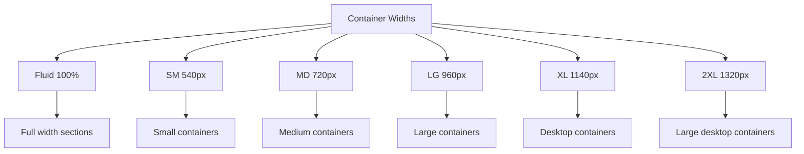

### Container Tokens

| Tên | Variable | Max Width | Sử dụng |
|-----|----------|-----------|---------|
| Fluid | `--container-fluid` | 100% | Full width sections |
| SM | `--container-sm` | 540px | Small containers |
| MD | `--container-md` | 720px | Medium containers |
| LG | `--container-lg` | 960px | Large containers |
| XL | `--container-xl` | 1140px | Desktop containers |
| 2XL | `--container-2xl` | 1320px | Large desktop containers |

### Container Usage

```css
/* Base container */
.container {
  width: 100%;
  max-width: var(--container-xl);
  margin: 0 auto;
  padding: 0 var(--spacing-lg);
}

/* Fluid container */
.container-fluid {
  width: 100%;
  padding: 0 var(--spacing-lg);
}

/* Small container */
.container-sm {
  max-width: var(--container-sm);
}

/* Medium container */
.container-md {
  max-width: var(--container-md);
}

/* Large container */
.container-lg {
  max-width: var(--container-lg);
}

/* Extra large container */
.container-2xl {
  max-width: var(--container-2xl);
}
```

### Grid System

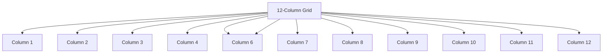

### Grid Tokens

| Tên | Variable | Value | Sử dụng |
|-----|----------|-------|---------|
| Columns | `--grid-columns` | 12 | Số cột trong grid |
| Gutter | `--grid-gutter` | var(--spacing-lg) | Khoảng cách giữa columns |
| Gutter SM | `--grid-gutter-sm` | var(--spacing-md) | Gutter nhỏ |
| Gutter LG | `--grid-gutter-lg` | var(--spacing-xl) | Gutter lớn |

### Grid Usage

```css
/* Grid container */
.grid {
  display: grid;
  grid-template-columns: repeat(var(--grid-columns), 1fr);
  gap: var(--grid-gutter);
}

/* Grid columns */
.col-1 { grid-column: span 1; }
.col-2 { grid-column: span 2; }
.col-3 { grid-column: span 3; }
.col-4 { grid-column: span 4; }
.col-5 { grid-column: span 5; }
.col-6 { grid-column: span 6; }
.col-7 { grid-column: span 7; }
.col-8 { grid-column: span 8; }
.col-9 { grid-column: span 9; }
.col-10 { grid-column: span 10; }
.col-11 { grid-column: span 11; }
.col-12 { grid-column: span 12; }

/* Responsive grid columns */
@media (min-width: 576px) {
  .col-sm-1 { grid-column: span 1; }
  .col-sm-2 { grid-column: span 2; }
  .col-sm-3 { grid-column: span 3; }
  .col-sm-4 { grid-column: span 4; }
  .col-sm-5 { grid-column: span 5; }
  .col-sm-6 { grid-column: span 6; }
  .col-sm-7 { grid-column: span 7; }
  .col-sm-8 { grid-column: span 8; }
  .col-sm-9 { grid-column: span 9; }
  .col-sm-10 { grid-column: span 10; }
  .col-sm-11 { grid-column: span 11; }
  .col-sm-12 { grid-column: span 12; }
}

@media (min-width: 768px) {
  .col-md-1 { grid-column: span 1; }
  .col-md-2 { grid-column: span 2; }
  .col-md-3 { grid-column: span 3; }
  .col-md-4 { grid-column: span 4; }
  .col-md-5 { grid-column: span 5; }
  .col-md-6 { grid-column: span 6; }
  .col-md-7 { grid-column: span 7; }
  .col-md-8 { grid-column: span 8; }
  .col-md-9 { grid-column: span 9; }
  .col-md-10 { grid-column: span 10; }
  .col-md-11 { grid-column: span 11; }
  .col-md-12 { grid-column: span 12; }
}

@media (min-width: 992px) {
  .col-lg-1 { grid-column: span 1; }
  .col-lg-2 { grid-column: span 2; }
  .col-lg-3 { grid-column: span 3; }
  .col-lg-4 { grid-column: span 4; }
  .col-lg-5 { grid-column: span 5; }
  .col-lg-6 { grid-column: span 6; }
  .col-lg-7 { grid-column: span 7; }
  .col-lg-8 { grid-column: span 8; }
  .col-lg-9 { grid-column: span 9; }
  .col-lg-10 { grid-column: span 10; }
  .col-lg-11 { grid-column: span 11; }
  .col-lg-12 { grid-column: span 12; }
}

@media (min-width: 1200px) {
  .col-xl-1 { grid-column: span 1; }
  .col-xl-2 { grid-column: span 2; }
  .col-xl-3 { grid-column: span 3; }
  .col-xl-4 { grid-column: span 4; }
  .col-xl-5 { grid-column: span 5; }
  .col-xl-6 { grid-column: span 6; }
  .col-xl-7 { grid-column: span 7; }
  .col-xl-8 { grid-column: span 8; }
  .col-xl-9 { grid-column: span 9; }
  .col-xl-10 { grid-column: span 10; }
  .col-xl-11 { grid-column: span 11; }
  .col-xl-12 { grid-column: span 12; }
}
```

### Grid Examples

```css
/* 2-column grid */
.grid-2 {
  display: grid;
  grid-template-columns: repeat(2, 1fr);
  gap: var(--grid-gutter);
}

/* 3-column grid */
.grid-3 {
  display: grid;
  grid-template-columns: repeat(3, 1fr);
  gap: var(--grid-gutter);
}

/* 4-column grid */
.grid-4 {
  display: grid;
  grid-template-columns: repeat(4, 1fr);
  gap: var(--grid-gutter);
}

/* Auto-fit grid */
.grid-auto {
  display: grid;
  grid-template-columns: repeat(auto-fit, minmax(280px, 1fr));
  gap: var(--grid-gutter);
}

/* Masonry-like grid */
.grid-masonry {
  display: grid;
  grid-template-columns: repeat(auto-fill, minmax(300px, 1fr));
  gap: var(--grid-gutter);
}
```

### Flexbox Layout

```css
/* Flex container */
.flex {
  display: flex;
}

/* Flex row */
.flex-row {
  flex-direction: row;
}

/* Flex column */
.flex-column {
  flex-direction: column;
}

/* Flex wrap */
.flex-wrap {
  flex-wrap: wrap;
}

/* Justify content */
.justify-start { justify-content: flex-start; }
.justify-center { justify-content: center; }
.justify-end { justify-content: flex-end; }
.justify-between { justify-content: space-between; }
.justify-around { justify-content: space-around; }

/* Align items */
.items-start { align-items: flex-start; }
.items-center { align-items: center; }
.items-end { align-items: flex-end; }
.items-stretch { align-items: stretch; }

/* Gap utilities */
.gap-xs { gap: var(--spacing-xs); }
.gap-sm { gap: var(--spacing-sm); }
.gap-md { gap: var(--spacing-md); }
.gap-lg { gap: var(--spacing-lg); }
.gap-xl { gap: var(--spacing-xl); }
```

### Layout Examples

```css
/* Card grid layout */
.card-grid {
  display: grid;
  grid-template-columns: repeat(auto-fit, minmax(300px, 1fr));
  gap: var(--spacing-lg);
}

/* Sidebar layout */
.sidebar-layout {
  display: grid;
  grid-template-columns: 250px 1fr;
  gap: var(--spacing-lg);
}

@media (max-width: 992px) {
  .sidebar-layout {
    grid-template-columns: 1fr;
  }
}

/* Header layout */
.header {
  display: flex;
  align-items: center;
  justify-content: space-between;
  gap: var(--spacing-lg);
  padding: var(--spacing-lg) var(--spacing-xl);
}

/* Center content */
.center-content {
  display: flex;
  align-items: center;
  justify-content: center;
  min-height: 100vh;
}
```

### Layout Best Practices

```css
/* ✓ Use CSS variables for layout */
.container {
  max-width: var(--container-xl);
  gap: var(--grid-gutter);
}

/* ✓ Use responsive layouts */
.grid {
  display: grid;
  grid-template-columns: 1fr;
  gap: var(--spacing-lg);
}

@media (min-width: 768px) {
  .grid {
    grid-template-columns: repeat(2, 1fr);
  }
}

/* ✓ Use meaningful class names */
.card-grid {
  display: grid;
  grid-template-columns: repeat(auto-fit, minmax(300px, 1fr));
  gap: var(--spacing-lg);
}

/* ✗ Don't use fixed heights */
.container {
  height: 600px; /* ✗ Sai */
}

.container {
  min-height: 600px; /* ✓ Đúng */
}

/* ✗ Don't use magic numbers */
.grid {
  gap: 24px; /* ✗ Sai */
}

.grid {
  gap: var(--spacing-lg); /* ✓ Đúng */
}
```

## Future Enhancements

### Dark Mode

```css
:root[data-theme='dark'] {
  --surface: #1a1a1a;
  --page: #121212;
  --text-primary: #ffffff;
  --text-secondary: #b0b0b0;
  /* ... more dark mode tokens */
}
```

### Custom Themes

```css
:root[data-theme='custom'] {
  --brand-green: #custom-color;
  /* ... custom theme tokens */
}
```

### Additional Components

- Toast notifications
- Tooltips
- Dropdown menus
- Progress bars
- Skeleton loaders
- Avatar groups
- Tags input
- Date picker
- File upload with preview
